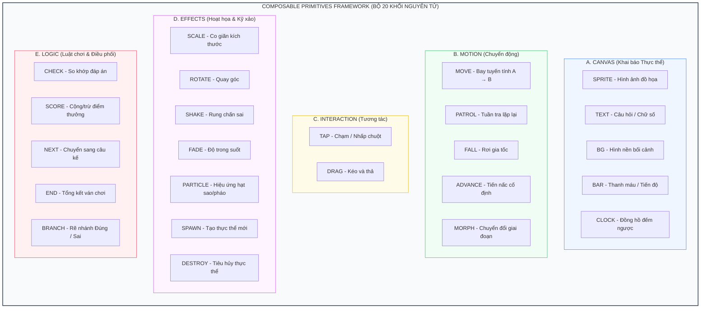
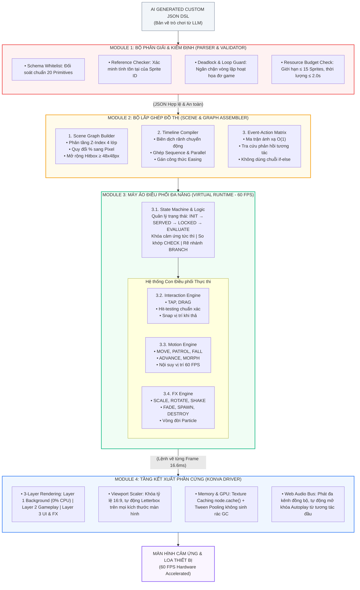
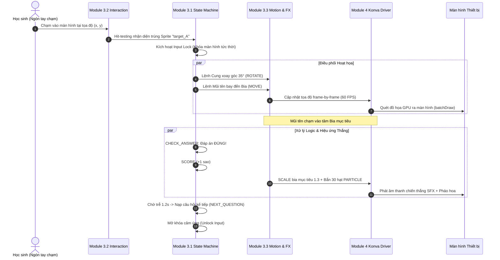

# Giải pháp Tổng thể: Composable Primitives Framework (CPF)
### Giải pháp kỹ thuật khi giáo viên gửi mô tả nằm ngoài danh mục cơ chế game hiện có

> **Kiến trúc CPF (Giải pháp kỹ thuật)**: [[Mô tả ngoài danh mục game]] | [[00. Tổng quan vấn đề giáo viên mô tả ngoài danh mục game|Vấn đề đối ứng]]

---

## 1. Căn cứ Khoa học: Bản chất Vấn đề và Các Rủi ro Kỹ thuật

Theo các nghiên cứu về **Neurosymbolic Game Generation** và **Mixed-Initiative Co-Creation**, tồn tại một mâu thuẫn cốt lõi giữa Mô hình Ngôn ngữ Lớn (LLM) và Công cụ Trò chơi (Game Engine):

1. **LLM là công cụ dự đoán xác suất (Plausibility Engine)**: Mô hình luôn cố tạo ra chuỗi văn bản hoặc mã nguồn trông "có vẻ hợp lý" dựa trên phân phối từ ngữ thống kê.
2. **Game Engine là cỗ máy logic tiền định (Correctness Engine)**: Engine đòi hỏi tính đúng đắn tuyệt đối về state-machine, hệ tọa độ, component và logic tương tác thời gian thực.

Khi giáo viên đưa vào một mô tả nằm ngoài danh mục cơ chế hỗ trợ (**Out-of-Distribution - OOD Mechanics**, ví dụ: Game đua xe 3D né chướng ngại vật, Game nhập vai RPG thế giới mở, Game bắn súng góc nhìn thứ nhất...), nếu không có cơ chế kiểm soát, hệ thống sẽ rơi vào 2 thảm họa kỹ thuật nghiêm trọng:
- **Hallucinated Logic (Ảo giác mã nguồn)**: LLM tự bịa ra các hàm, component, hoặc thuộc tính không tồn tại trong Engine $\to$ Gây **Runtime Crash 100%** khi chạy trên trình duyệt.
- **Vacuous Satisfaction (Thỏa mãn giả tạo)**: LLM sinh ra JSON hợp lệ để không báo lỗi cú pháp, nhưng âm thầm bỏ qua cơ chế giáo viên mong muốn, biến thành một game trống rỗng hoặc sinh ra placeholder không tương tác được.

Do đó, hệ sinh thái AI sinh game bắt buộc phải thiết lập một tầng phân loại & xử lý OOD bài bản: **Composable Primitives Framework (CPF)** kết hợp cùng **Mechanics Mapping & Fallback Pipeline**.

---

## 2. Bóc tách Trải nghiệm Game: Phân loại 5 Nhóm Hành vi Cơ bản

### 2.1. Khảo sát 10 Trải nghiệm Game Giáo dục Phổ biến
| Tựa Game | Mô tả trải nghiệm của học sinh |
| :--- | :--- |
| **Bắn cung** | Chọn bia chứa đáp án $\to$ Mũi tên xoay và bay đến bia mục tiêu |
| **Câu cá** | Cá bơi qua lại $\to$ Chạm vào cá mang đáp án đúng $\to$ Cần câu kéo cá lên |
| **Đua xe** | Trả lời đúng $\to$ Xe tiến về đích một đoạn; trả lời sai $\to$ Xe rung lắc đứng yên |
| **Hứng trái cây** | Trái cây mang từ/số rơi từ trên xuống $\to$ Di chuyển rổ hứng đúng quả |
| **Leo núi** | Trả lời đúng $\to$ Nhân vật leo lên 1 bậc thang $\to$ Lên đỉnh núi là chiến thắng |
| **Nấu ăn** | Kéo thả đúng nguyên liệu vào nồi $\to$ Món ăn biến đổi và chín dần |
| **Bắt bướm** | Bướm bay lượn ngẫu nhiên $\to$ Chạm vợt bắt đúng bướm mang đáp án |
| **Xây tháp** | Trả lời đúng $\to$ Một viên gạch xếp chồng lên $\to$ Xây xong tháp là chiến thắng |
| **Phóng tên lửa**| Trả lời đúng $\to$ Tên lửa khai hỏa bay lên cao thêm một chặng |
| **Tưới cây** | Trả lời đúng $\to$ Cây lớn thêm một giai đoạn (Hạt $\to$ Mầm $\to$ Cây con $\to$ Nở hoa) |

### 2.2. Quy nạp về 5 Nhóm Hành vi Cơ sở
Quan sát từ góc độ kỹ thuật đồ họa 2D, toàn bộ các game trên đều được hợp thành từ **5 nhóm hành vi nguyên tử (Primitives)**:

1. **Nhóm A: Đặt vật lên màn hình (Canvas)**: Đặt hình ảnh (Sprite), văn bản câu hỏi/đáp án (Text), hình nền (Background), thanh tiến trình (Bar), đồng hồ (Clock).
2. **Nhóm B: Chuyển động (Motion)**:
   - Bay từ $A \to B$ theo đường thẳng (`MOVE`): Mũi tên, Phóng tên lửa.
   - Di chuyển qua lại tuần tra (`PATROL`): Cá bơi, Bướm bay.
   - Rơi từ trên xuống (`FALL`): Trái cây rơi.
   - Tiến về phía trước từng bước (`ADVANCE`): Xe đua, Leo núi, Xây tháp.
   - Biến đổi hình thái (`MORPH`): Cây lớn dần, Nồi thức ăn chuyển màu.
3. **Nhóm C: Tương tác (Interaction)**:
   - Chạm/Bấm (`TAP`): Bắn cung, Câu cá, Bắt bướm, Chọn biển báo xe đua.
   - Kéo thả (`DRAG`): Nấu ăn kéo nguyên liệu, Hứng quả kéo rổ.
4. **Nhóm D: Hiệu ứng Thị giác (Visual Effects)**:
   - Phóng to / Thu nhỏ (`SCALE`): Bia nảy lên, Nhân vật mừng rỡ.
   - Xoay góc (`ROTATE`): Cây cung ngắm bắn, Bánh xe quay.
   - Rung lắc (`SHAKE`): Bắn trượt, Chọn đáp án sai.
   - Mờ dần / Biến mất (`FADE`, `DESTROY`): Đáp án sai mờ đi, Cá bị kéo khỏi mặt nước.
   - Hiệu ứng hạt (`PARTICLE`): Pháo hoa, Sao vàng lấp lánh khi chọn đúng.
   - Sản sinh liên tục (`SPAWN`): Hoa quả hoặc bướm xuất hiện định kỳ.
5. **Nhóm E: Luật chơi & Điều phối (Game Logic)**:
   - Kiểm tra đúng/sai (`CHECK`), tính điểm (`SCORE`), chuyển câu (`NEXT`), rẽ nhánh (`BRANCH`), kết thúc trò chơi (`END`).

---

## 3. Bộ Khối Lắp ghép Tổng quát (Universal 20-Primitive Set)



### 3.1. Bảng Chứng minh Độ Bao phủ: 20 Khối kiến tạo 10+ Tựa Game

| Tựa Game | Khối Canvas (A) | Khối Motion (B) | Khối Interaction (C) | Khối Effects (D) | Khối Logic (E) |
| :--- | :--- | :--- | :--- | :--- | :--- |
| **Bắn cung** | `SPRITE`, `TEXT`, `BG` | `MOVE` | `TAP` | `ROTATE`, `SCALE`, `PARTICLE` | `CHECK`, `SCORE`, `NEXT`, `BRANCH` |
| **Câu cá** | `SPRITE`, `TEXT`, `BG` | `PATROL`, `MOVE` | `TAP` | `SCALE`, `DESTROY`, `PARTICLE` | `CHECK`, `SCORE`, `NEXT`, `BRANCH` |
| **Đua xe** | `SPRITE`, `TEXT`, `BAR` | `ADVANCE` | `TAP` | `SHAKE`, `PARTICLE` | `CHECK`, `SCORE`, `NEXT`, `END` |
| **Hứng trái cây** | `SPRITE`, `TEXT`, `CLOCK` | `FALL`, `SPAWN` | `TAP` / `DRAG` | `DESTROY`, `PARTICLE` | `CHECK`, `SCORE`, `END` |
| **Leo núi** | `SPRITE`, `TEXT`, `BAR` | `ADVANCE` | `TAP` | `SCALE`, `PARTICLE` | `CHECK`, `SCORE`, `NEXT`, `END` |
| **Nấu ăn** | `SPRITE`, `TEXT`, `BG` | `MORPH` | `DRAG` | `SCALE`, `PARTICLE` | `CHECK`, `SCORE`, `NEXT` |
| **Bắt bướm** | `SPRITE`, `CLOCK`, `BG` | `PATROL`, `SPAWN` | `TAP` | `DESTROY`, `PARTICLE` | `CHECK`, `SCORE`, `END` |
| **Xây tháp** | `SPRITE`, `BAR`, `BG` | `ADVANCE`, `MOVE` | `TAP` | `SCALE`, `PARTICLE` | `CHECK`, `SCORE`, `NEXT`, `END` |
| **Phóng tên lửa**| `SPRITE`, `TEXT`, `BG` | `MOVE`, `ADVANCE` | `TAP` | `SCALE`, `PARTICLE`, `SHAKE` | `CHECK`, `SCORE`, `NEXT` |
| **Tưới cây** | `SPRITE`, `TEXT`, `BG` | `MORPH` | `TAP` | `SCALE`, `FADE`, `PARTICLE` | `CHECK`, `SCORE`, `NEXT`, `END` |

---

## 4. Đặc tả JSON DSL: Minh họa 3 Tựa Game Tiêu biểu

### 4.1. Game Câu cá — Học Từ vựng Tiếng Anh
```json
{
  "mechanic": "CUSTOM",
  "background": "ocean.png",
  "elements": [
    { "type": "SPRITE", "id": "rod", "image": "fishing_rod.png", "x": 50, "y": 20 },
    { "type": "TEXT", "id": "question", "content": "Tap the fish: APPLE", "x": 50, "y": 8 },
    { "type": "SPRITE", "id": "fish_A", "image": "fish_red.png", "x": 10, "y": 60, "label": "🍎", "correct": true },
    { "type": "SPRITE", "id": "fish_B", "image": "fish_blue.png", "x": 30, "y": 75, "label": "🍌", "correct": false },
    { "type": "SPRITE", "id": "fish_C", "image": "fish_green.png", "x": 60, "y": 65, "label": "🍇", "correct": false }
  ],
  "flow": [
    {
      "trigger": {
        "type": "PATROL",
        "sprites": ["fish_A", "fish_B", "fish_C"],
        "axis": "x",
        "range": [5, 95],
        "speed": 2,
        "note": "Cá bơi qua lại liên tục"
      }
    },
    {
      "trigger": { "type": "TAP", "on": "fish_*" },
      "actions": [
        {
          "type": "MOVE",
          "sprite": "$tapped",
          "to": "rod",
          "duration": 800,
          "note": "Cá bị kéo lên vị trí cần câu"
        },
        {
          "type": "CHECK_ANSWER",
          "on_correct": [
            { "type": "SCALE", "sprite": "$tapped", "to": 1.5 },
            { "type": "PARTICLE", "effect": "stars", "at": "$tapped" },
            { "type": "SCORE", "add": 1 }
          ],
          "on_wrong": [
            { "type": "SHAKE", "sprite": "$tapped" },
            { "type": "MOVE", "sprite": "$tapped", "to_y": 70, "note": "Thả cá bơi lại" }
          ]
        },
        { "type": "NEXT_QUESTION", "delay": 1000 }
      ]
    }
  ]
}
```

### 4.2. Game Đua xe — Học Bảng Cửu chương
```json
{
  "mechanic": "CUSTOM",
  "background": "race_track.png",
  "elements": [
    { "type": "SPRITE", "id": "car", "image": "car.png", "x": 5, "y": 80 },
    { "type": "SPRITE", "id": "finish", "image": "finish_flag.png", "x": 95, "y": 80 },
    { "type": "BAR", "id": "progress", "current": 0, "max": 10 },
    { "type": "TEXT", "id": "question", "content": "4 × 6 = ?", "x": 50, "y": 30 },
    { "type": "SPRITE", "id": "opt_A", "image": "sign.png", "x": 25, "y": 50, "label": "24", "correct": true },
    { "type": "SPRITE", "id": "opt_B", "image": "sign.png", "x": 50, "y": 50, "label": "28", "correct": false },
    { "type": "SPRITE", "id": "opt_C", "image": "sign.png", "x": 75, "y": 50, "label": "22", "correct": false }
  ],
  "flow": [
    {
      "trigger": { "type": "TAP", "on": "opt_*" },
      "actions": [
        {
          "type": "CHECK_ANSWER",
          "on_correct": [
            { "type": "ADVANCE", "sprite": "car", "by_x": 9, "duration": 600, "note": "Xe tiến 1 đoạn về đích" },
            { "type": "PARTICLE", "effect": "boost", "at": "car" },
            { "type": "SCORE", "add": 1 }
          ],
          "on_wrong": [
            { "type": "SHAKE", "sprite": "car", "note": "Xe rung lắc và đứng yên" },
            { "type": "FADE", "sprite": "$tapped", "to": 0.3 }
          ]
        },
        { "type": "NEXT_QUESTION", "delay": 800 }
      ]
    }
  ]
}
```

### 4.3. Game Tưới cây — Phép cộng Lớp 1
```json
{
  "mechanic": "CUSTOM",
  "background": "garden.png",
  "elements": [
    {
      "type": "SPRITE",
      "id": "plant",
      "image": "seed.png",
      "x": 50,
      "y": 70,
      "morph_stages": ["seed.png", "sprout.png", "small_tree.png", "tree.png", "flower.png"]
    },
    { "type": "SPRITE", "id": "watering_can", "image": "can.png", "x": 20, "y": 40 },
    { "type": "TEXT", "id": "question", "content": "2 + 3 = ?", "x": 50, "y": 15 },
    { "type": "SPRITE", "id": "opt_A", "image": "raindrop.png", "x": 30, "y": 35, "label": "5", "correct": true },
    { "type": "SPRITE", "id": "opt_B", "image": "raindrop.png", "x": 50, "y": 35, "label": "6", "correct": false },
    { "type": "SPRITE", "id": "opt_C", "image": "raindrop.png", "x": 70, "y": 35, "label": "4", "correct": false }
  ],
  "flow": [
    {
      "trigger": { "type": "TAP", "on": "opt_*" },
      "actions": [
        { "type": "MOVE", "sprite": "$tapped", "to": "plant", "duration": 600, "note": "Giọt nước rơi vào cây" },
        {
          "type": "CHECK_ANSWER",
          "on_correct": [
            { "type": "MORPH", "sprite": "plant", "next_stage": true, "duration": 800, "note": "Cây lớn lên 1 nấc" },
            { "type": "PARTICLE", "effect": "sparkle", "at": "plant" },
            { "type": "SCORE", "add": 1 }
          ],
          "on_wrong": [
            { "type": "SHAKE", "sprite": "plant" },
            { "type": "FADE", "sprite": "$tapped", "to": 0 }
          ]
        },
        { "type": "NEXT_QUESTION", "delay": 1000 }
      ]
    }
  ]
}
```

---

## 5. Sơ đồ Kiến trúc Toàn diện Composable Primitives Framework (CPF)



---

## 6. Chi tiết 4 Tầng Kiến trúc Bên trong CPF

### 6.1. Module 1: Bộ Phân giải & Kiểm định Khối (Primitive Parser & Validator)
Đóng vai trò như một **Compiler Guard** theo nguyên tắc **Zero-Trust** (không bao giờ tin $100\%$ mã nguồn do AI tự sinh):
1. **Chặn khối "bịa đặt" (Whitelist Check)**: Đối soát toàn bộ các khối với danh mục 20 Primitives chuẩn. Nếu AI tự tạo các lệnh lạ (`EXPLODE_3D`, `GRAVITY`...) $\to$ Chặn đứng ngay lập tức.
2. **Dò tìm đối tượng "ma" (Reference Check)**: Đảm bảo mọi ID được gọi trong action (`MOVE`, `SCALE`) đều đã được khai báo tường minh trong mảng `elements`.
3. **Chống đơ game bằng toán đồ thị (Deadlock & Loop Guard)**: Quét chuỗi hoạt họa xem có bị lặp vô tận không, và bảo đảm luôn tồn tại đường đi đến khối chuyển câu hỏi (`NEXT_QUESTION` hoặc `END`).
4. **Kiểm định sư phạm & Giới hạn phần cứng (Budget Check)**: Đảm bảo câu hỏi có ít nhất một đáp án đúng (`correct: true`); giới hạn $\le 15$ Sprites và thời lượng animation $\le 2.0$ giây để iPad cũ chạy êm ái.

> *Xem chi tiết*: [[Module 1 Bộ Phân giải & Kiểm định Khối (Parser & Validator)]]

---

### 6.2. Module 2: Bộ Lắp ghép Đồ thị Trò chơi (Scene & Graph Assembler)
Đóng vai trò như một **"Xưởng cơ khí lắp ráp và tiền biên dịch"** trong bộ nhớ RAM:
1. **Dựng Cây Không gian (Scene Graph)**: Quy đổi tọa độ phần trăm ($\%$) sang Pixel thực tế; phân chia 4 tầng $Z$-index (Nền $\to$ Đối tượng tương tác $\to$ Văn bản $\to$ Giao diện điều khiển); nới rộng hitbox tối thiểu đạt $48\text{px} \times 48\text{px}$.
2. **Biên dịch Dòng thời gian Hoạt họa (Timeline Compiler)**: Xếp lịch các chuyển động theo chuỗi nối tiếp (*Sequence*) hoặc song song (*Parallel*); gắn các hàm nội suy Easing (`easeOutBack`, `easeInOutQuad`).
3. **Lập Ma trận Tra cứu Nhanh $\mathcal{O}(1)$ (Event-Action Matrix)**: Bảng tra cứu trực tiếp theo ID đối tượng, giúp kích hoạt phản hồi tức thì trong $0.1\text{ms}$ mà không phải duyệt vòng lặp.
4. **Nạp trước Tài nguyên (Asset Preloader)**: Tải sẵn $100\%$ hình ảnh và âm thanh vào bộ nhớ đệm trước khi mở màn hình ván chơi.

> *Xem chi tiết*: [[Module 2 Bộ Lắp ghép Đồ thị Trò chơi (Scene & Graph Assembler)]]

---

### 6.3. Module 3: Máy ảo Điều phối Đa năng (Virtual Runtime Engine)
Là **"Trái tim điều hành"** của toàn bộ framework, duy trì vòng lặp 60 FPS:
1. **Máy trạng thái & Khóa Cảm ứng (State Machine & Logic)**:
   - Chu trình trạng thái: `[INIT] -> [SERVED] -> [LOCKED] -> [EVALUATE] -> [TRANSITION]`.
   - Cơ chế **Input Lock**: Tức thời khóa cảm ứng ngay khi học sinh chạm đáp án để hoạt họa diễn ra trọn vẹn, chống tình trạng trẻ nhấp liên tục gây loạn logic.
   - Xử lý các khối logic sư phạm: `CHECK`, `SCORE`, `BRANCH`, `NEXT`, `END`.
2. **Bộ bắt Cảm ứng & Va chạm (Interaction & Hit-Testing)**:
   - Bắt chính xác tọa độ chạm ngón tay `TAP` hoặc kéo thả `DRAG`.
   - Tự động hút vật thể vào đích (`SNAP`) khi thả đúng vị trí.
3. **Bộ Động lực học (Motion Engine)**:
   - Tính toán quỹ đạo toán học cho 5 kiểu chuyển động: `MOVE`, `PATROL`, `FALL`, `ADVANCE`, `MORPH`.
4. **Bộ Kỹ xảo Thị giác (FX & Particle Engine)**:
   - Thực thi các biến đổi hình học: `SCALE`, `ROTATE`, `SHAKE`, `FADE`.
   - Sinh hạt pháo hoa lấp lánh `PARTICLE` và dọn dẹp bộ nhớ `DESTROY`.

> *Xem chi tiết*: [[Module 3 Máy ảo Điều phối Đa năng (Virtual Runtime Engine)]]

---

### 6.4. Module 4: Tầng Kết xuất Phần cứng Canvas (Konva Driver)
Đóng vai trò **"Họa sĩ và Nhà hát trình diễn"**, giao tiếp trực tiếp với GPU và Loa thiết bị:
1. **Kiến trúc 3 Tầng Canvas (Multi-Layer Rendering)**:
   - *Layer 1 (Nền tĩnh)*: Vẽ 1 lần duy nhất, tắt cảm ứng ($0\%$ CPU).
   - *Layer 2 (Gameplay)*: Vẽ các đối tượng chuyển động bằng `batchDraw()`.
   - *Layer 3 (UI & FX)*: Điểm số, đồng hồ, pháo hoa nằm trên cùng.
2. **Bộ Co giãn Chuẩn Tỷ lệ vàng (Viewport Scaler)**:
   - Tự động scale và Letterbox chuẩn $1920 \times 1080$ trên mọi thiết bị:
     $$\text{Scale} = \min\left(\frac{W_{\text{thực tế}}}{1920}, \; \frac{H_{\text{thực tế}}}{1080}\right)$$
3. **Bộ nhớ & GPU (Texture Caching & Tween Pooling)**:
   - Biến vector/chữ thành bitmap trên GPU qua `node.cache()`.
   - Tái sử dụng đối tượng chuyển động qua Tween Pool, tránh hiện tượng dừng hình do Garbage Collection.
4. **Hệ thống Âm thanh Đa kênh (Web Audio Bus)**:
   - Phát đồng thời nhạc nền (BGM) và hiệu ứng tiếng vút tên/tiếng nổ (SFX).

> *Xem chi tiết*: [[Module 4 Tầng Kết xuất Phần cứng Canvas (Konva Driver)]]

---

## 7. Ví dụ Luồng Vận hành Dữ liệu: Thao tác Chạm Bia trong Game Bắn Cung



---

## 8. Giá trị Cốt lõi của Bản Thiết kế CPF

1. **Tính độc lập tuyệt đối**: CPF là một Game Engine hoàn chỉnh, khép kín với đầy đủ các tầng: Ngôn ngữ biểu diễn (JSON DSL), Trạm kiểm định an toàn (Validator), Bộ tiền biên dịch (Assembler), Máy ảo logic (Virtual Runtime), và Driver phần cứng (Konva Driver).
2. **Khả năng tổng quát hóa phi giới hạn**: Bất kể giáo viên yêu cầu Bắn cung, Đua xe, Câu cá, Hái quả hay Tưới cây, Runtime chỉ nhìn nhận thế giới dưới dạng: **Entities**, **Motions**, **Events**, và **Rules**. Mọi game 2D tương tác đều là tổ hợp của 20 Primitives chuẩn.
3. **Chuẩn mực Kỹ nghệ Phần mềm Cao cấp**: Phân tách triệt để giữa tầng Tính toán Logic (Module 3) và tầng Hiển thị Đồ họa (Module 4), kiểm định Zero-Trust đầu vào (Module 1), và đảm bảo hiệu năng tối ưu phần cứng trên mọi thiết bị trường học.

---

## 9. Điều hướng Bốn Module Kỹ thuật Chuyên sâu

- [[Module 1 Bộ Phân giải & Kiểm định Khối (Parser & Validator)|Module 1: Bộ Phân giải & Kiểm định Khối (Primitive Parser & Validator)]]
- [[Module 2 Bộ Lắp ghép Đồ thị Trò chơi (Scene & Graph Assembler)|Module 2: Bộ Lắp ghép Đồ thị Trò chơi (Scene & Graph Assembler)]]
- [[Module 3 Máy ảo Điều phối Đa năng (Virtual Runtime Engine)|Module 3: Máy ảo Điều phối Đa năng (Virtual Runtime Engine)]]
- [[Module 4 Tầng Kết xuất Phần cứng Canvas (Konva Driver)|Module 4: Tầng Kết xuất Phần cứng Canvas (Konva Driver)]]
- [[Các cơ chế game|Danh mục 24 Cơ chế Game Giáo dục Mở rộng]]
- [[Đồ họa game|Quy chuẩn Đồ họa & Thiết kế Visual Juiciness]]
- [[Đề xuất các game khác|Danh mục Đề xuất Game & Bối cảnh Sáng tạo]]
