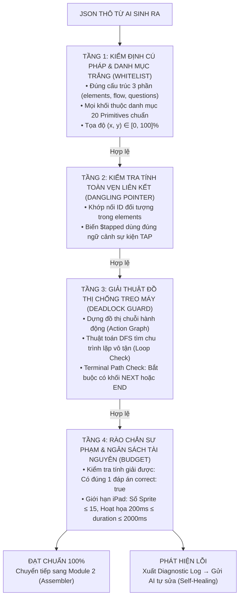
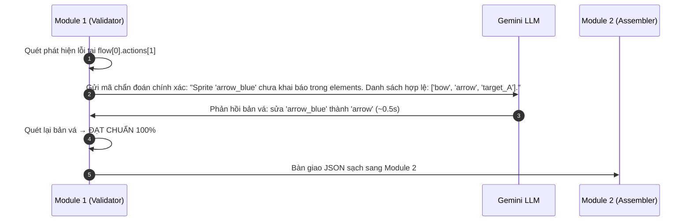

# Module 1 Bộ Phân giải & Kiểm định Khối (Parser & Validator)

> **CPF Engine (Module 1/4)**: [[Mô tả ngoài danh mục game]] | [[Module 2 Bộ Lắp ghép Đồ thị Trò chơi (Scene & Graph Assembler)|Chuyển tiếp: Module 2 Assembler]]

> **Tài liệu nguồn gốc**: `Module 1 Bộ Phân giải & Kiểm định Khối (Parser & Validator).pdf`  
> **Chủ đề**: Kiến trúc Module 1 — Trạm Kiểm định Zero-Trust AI & Khử Ảo giác Mã nguồn  
> **Chuyển đổi & Tinh chỉnh định dạng**: 2026-11-04

---

## 1. Vai Trò Sống Còn của Module 1 trong CPF

Module 1: **Bộ Phân giải & Kiểm định Khối (Primitive Parser & Validator)** chính là *"Cổng an ninh nghiêm ngặt nhất"* trong toàn bộ kiến trúc Composable Primitives Framework (CPF).

Sở dĩ Module này đóng vai trò quan trọng sống còn là vì:
* **Dữ liệu đầu vào không phải do lập trình viên viết, mà do AI (LLM) tự do sinh ra**.
* AI là mô hình ngôn ngữ xác suất, nó rất dễ *"bịa"* ra những thuộc tính không tồn tại, trỏ nhầm ID hình ảnh, hoặc tạo ra những chuỗi hoạt họa lặp vô tận làm treo máy của trẻ em.
* Module 1 hoạt động theo nguyên lý **"Zero-Trust AI"** (Tuyệt đối không tin tưởng $100\%$ mã nguồn do AI sinh ra). Nó đóng vai trò như một **Trình biên dịch (Compiler Frontend)** quét toàn bộ JSON qua 4 tầng kiểm định liên hoàn trước khi cho phép nạp vào Game Engine.

---

## 2. Sơ Đồ Hoạt Động của Module 1



---

## 3. Chi Tiết 4 Tầng Kiểm Định của Module 1

### Tầng 1: Kiểm định Cú pháp & Danh mục trắng (Whitelist Schema Validation)
* **Chặn đứng thuộc tính "bịa đặt"**: Module 1 nạp sẵn một bản Whitelist Schema nghiêm ngặt. Nếu AI "nổi hứng" bịa ra khối `EXPLODE_3D`, `GRAVITY_PHYSICS`, hay `VOICE_RECOGNITION`, Validator chặn đứng ngay lập tức với mã lỗi `E_UNSUPPORTED_PRIMITIVE`.
* **Ràng buộc miền giá trị (Value Bounds Checking)**:
  * Tọa độ $x, y$ bắt buộc phải là số thực từ $0.0 \to 100.0\%$. Nếu AI sinh $x = 150\%$ (nằm ngoài màn hình) hoặc $y = -20\%$, hệ thống cảnh báo lỗi tọa độ.
  * Thời lượng hoạt họa `duration` bắt buộc phải $> 0$ (tránh chia cho số 0 trong công thức toán học tính vận tốc frame).

### Tầng 2: Kiểm tra Tính toàn vẹn Liên kết (Reference & Dependency Integrity)
Trong kỹ thuật phần mềm, đây gọi là kiểm tra *"Dangling Pointer"* (Con trỏ rác):
* **Khớp nối ID đối tượng**: Giả sử ở khối `flow`, AI viết:
  ```json
  { "type": "MOVE", "sprite": "arrow_gold", "to": "target_A" }
  ```
  Validator sẽ lập tức quét ngược lại khối `elements`:
  * Hệ thống có khai báo sprite nào tên là `"arrow_gold"` không? Nếu chỉ có `"arrow"` chứ không có `"arrow_gold"` $\to$ Báo lỗi `E_UNDEFINED_ENTITY: arrow_gold`.
  * Hệ thống có bia nào tên là `"target_A"` không? Nếu không có $\to$ Báo lỗi `E_UNDEFINED_TARGET: target_A`.
* **Kiểm tra biến ngữ cảnh (Context Variables Scope)**:
  * Biến `$tapped` (đối tượng vừa được học sinh chạm vào) chỉ được phép tồn tại bên trong trigger loại `TAP`. Nếu AI gán `$tapped` vào một sự kiện đếm giờ `TIMER` $\to$ Chặn lại vì lúc đó không có đối tượng nào bị chạm cả.

### Tầng 3: Giải thuật Đồ thị Chống Treo máy & Khóa chết (Deadlock & Cycle Detection)
Đây là tầng toán học quan trọng nhất giúp game không bao giờ bị "đơ":
* **Phát hiện chu trình lặp vô hạn (Infinite Loop Detection)**:
  * Validator chuyển toàn bộ chuỗi hành động trong `flow` thành một **Đồ thị có hướng (Directed Action Graph)**.
  * Chạy thuật toán phát hiện chu trình **DFS Cycle Check**: Nếu phát hiện Hành động $A$ kích hoạt Hành động $B$, mà Hành động $B$ lại gọi lại Hành động $A$ ($A \to B \to A$) $\to$ Đây là vòng lặp vô tận làm đứng CPU của trình duyệt $\to$ Hủy ngay lập tức.
* **Kiểm tra Lối thoát trạng thái (Terminal Path Check)**:
  * Một game chuẩn bắt buộc phải có đường dẫn đến hồi kết. Validator kiểm tra: Sau chuỗi hoạt họa đúng/sai, có khối `NEXT_QUESTION` (chuyển câu) hoặc `END_GAME` (kết thúc) hay không?
  * Nếu AI quên sinh khối này, học sinh bấm xong mũi tên bay cắm bia nhưng game đứng yên mãi mãi không chuyển bài $\to$ Validator sẽ phát hiện thiếu khối điều hướng.

### Tầng 4: Rào chắn Sư phạm & Ngân sách Phần cứng (Pedagogy & Resource Budget)
* **Bảo đảm tính giải được (Pedagogical Solvability)**:
  * Dò toàn bộ mảng `options` của bài học: Phải có đúng 1 đáp án mang `correct: true` (hoặc danh sách đáp án đúng được định nghĩa rõ ràng).
  * Không bao giờ cho phép xảy ra trường hợp: Tất cả các bia đều sai (học sinh không bao giờ thắng được) hoặc Tất cả các bia đều đúng.
* **Ngân sách phần cứng cho thiết bị trường học (Hardware Budget Guard)**:
  Học sinh mầm non/tiểu học thường dùng máy tính bảng cũ hoặc máy tính phòng lab cấu hình yếu. Validator đặt trần giới hạn:
  * **Số lượng Sprite hiển thị cùng lúc**: Tối đa $15$ đối tượng (ngăn AI sinh ra 100 quả bóng gây tràn RAM WebGL/Canvas).
  * **Thời lượng một hoạt họa**: $200\text{ms} \le \text{duration} \le 2000\text{ms}$ (dưới $0.2\text{s}$ thì nhanh quá mắt trẻ không kịp thấy; trên $2\text{s}$ thì quá chậm khiến trẻ mất tập trung).

---

## 4. Cơ Chế Tự Sửa Lỗi (Self-Healing Diagnostic Loop)

Nếu phát hiện lỗi, Module 1 không làm sập quy trình mà hoạt động theo cơ chế phản hồi vi mô:



---

## 5. Tóm Lại Giá Trị của Module 1

Nếu ví Module 3 (Runtime) là chiếc xe hơi thể thao chạy với tốc độ 60 FPS, thì Module 1 chính là **Trạm Đăng Kiểm**:
1. **Loại bỏ 100% rác và ảo giác của AI** trước khi đến tay Game Engine.
2. **Bảo đảm game không bao giờ crash, không bao giờ đơ**, và luôn có thể giải được theo chuẩn sư phạm.
3. Khi bảo vệ khóa luận, việc trình bày được Module 1 với các giải thuật kiểm tra tính toàn vẹn liên kết và thuật toán đồ thị DFS phát hiện Deadlock sẽ **chứng minh tư duy kỹ nghệ phần mềm chuyên nghiệp** của nhóm trước Hội đồng!
