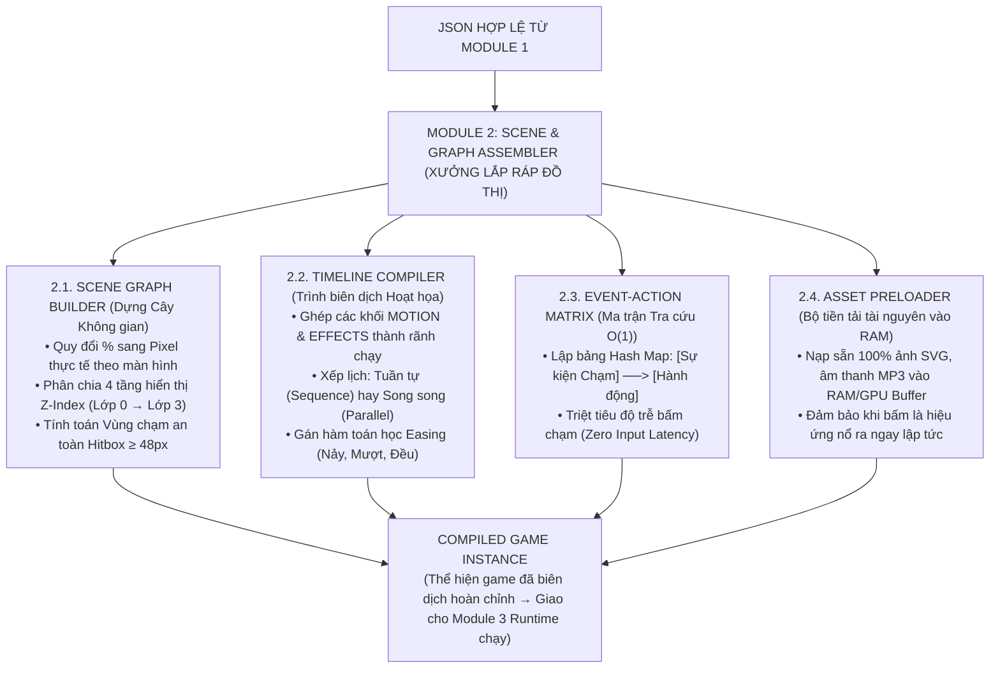

# Module 2 Bộ Lắp ghép Đồ thị Trò chơi (Scene & Graph Assembler)

> **CPF Engine (Module 2/4)**: [[Module 1 Bộ Phân giải & Kiểm định Khối (Parser & Validator)|Nhận từ: Module 1]] | [[Module 3 Máy ảo Điều phối Đa năng (Virtual Runtime Engine)|Chuyển tiếp: Module 3 Runtime]]

> **Tài liệu nguồn gốc**: `Module 2 Bộ Lắp ghép Đồ thị Trò chơi (Scene & Graph Assembler).pdf`  
> **Chủ đề**: Kiến trúc Module 2 — Xưởng Lắp Ráp & Tiền Biên Dịch Đồ Thị Game Trước Giờ Chạy  
> **Chuyển đổi & Tinh chỉnh định dạng**: 2026-11-04

---

## 1. Vai Trò Cốt Lõi của Module 2 trong CPF

Nếu Module 1 (Validator) là "Trạm đăng kiểm" loại bỏ rác của AI, thì **Module 2: Bộ Lắp ghép Đồ thị Trò chơi (Scene & Graph Assembler)** chính là **"Xưởng cơ khí lắp ráp"**.

* **Nhiệm vụ cốt lõi**: Biến bản vẽ JSON dạng chữ tĩnh thành một **Cỗ máy trò chơi sống động sẵn sàng nổ máy trong bộ nhớ RAM**.
* **Tại sao không để Game Engine đọc trực tiếp JSON thô?**: Nếu mỗi khung hình (frame) Game Engine lại phải đọc mảng, tính toán tọa độ, tìm kiếm ID đối tượng qua chuỗi `if-else` thì game sẽ bị giật lag nghiêm trọng. 
* **Giải pháp**: Module 2 tiến hành **tiền biên dịch (pre-compile)** toàn bộ kịch bản thành các cấu trúc dữ liệu tối ưu trong bộ nhớ trước khi bấm nút "Bắt đầu chơi".

---

## 2. Sơ Đồ Cấu Trúc Bên Trong của Module 2



---

## 3. Chi Tiết 4 Thành Phần Lắp Ghép Cốt Lõi

### 2.1. Scene Graph Builder (Bộ dựng Cây Đối tượng Không gian)
Thay vì một danh sách phẳng các phần tử trong JSON, Assembler dựng nên một **Cây phả hệ phân tầng (Hierarchical Scene Graph)**:

1. **Quy đổi tọa độ phần trăm sang Pixel thực tế (Viewport Normalization)**:
   * AI sinh tọa độ: $x = 50\%$, $y = 85\%$.
   * Assembler đo kích thước màn hình học sinh (ví dụ iPad $1024 \times 768\text{px}$):
     $$X_{\text{thực tế}} = 50\% \times 1024 = 512\text{px}, \quad Y_{\text{thực tế}} = 85\% \times 768 = 652.8\text{px}$$
   * Giúp mọi hình ảnh, bia ngắm, cây cung luôn nằm đúng tỷ lệ vàng trên mọi kích cỡ màn hình.

2. **Phân chia 4 Tầng hiển thị (Z-Index Layering)**:
   * *Lớp 0 (Background Layer)*: Nền bãi cỏ, vũ trụ $\to$ không bao giờ bắt sự kiện chạm, tối ưu không vẽ lại.
   * *Lớp 1 (Static Layer)*: Cây cung tĩnh, các cột mốc.
   * *Lớp 2 (Dynamic Actor Layer)*: Mũi tên bay, các tấm bia nhắm, hạt bụi/pháo hoa $\to$ đối tượng chuyển động liên tục.
   * *Lớp 3 (HUD / UI Layer)*: Thanh điểm số, đồng hồ đếm ngược, câu hỏi chữ to $\to$ luôn luôn nằm trên cùng, không bao giờ bị mũi tên che khuất.

3. **Tính toán Vùng chạm an toàn (Bounding Box Calculation)**:
   * Tự động mở rộng vùng nhận cảm ứng (Hit-Area) của các đối tượng nhỏ lên tối thiểu $\ge 48\text{px} \times 48\text{px}$ (theo khuyến nghị sư phạm công thái học cho ngón tay trẻ mầm non/tiểu học).

---

### 2.2. Timeline Compiler (Trình biên dịch Dòng thời gian Hoạt họa)
* **Xếp lịch chuyển động**:
  * **Chained Sequence (Tuần tự)**: Cung xoay xong $200\text{ms} \to$ Mũi tên mới bắt đầu phóng đi.
  * **Parallel Group (Song song)**: Mũi tên bay cùng lúc với việc xả khói phía sau và phát âm thanh "vút".
* **Gán hàm nội suy toán học (Easing Functions)**:
  * `ease-out`: Giảm tốc từ từ khi mũi tên găm trúng bia.
  * `bounce`: Nảy tưng tưng khi quả táo rơi chạm đất.
  * `shake`: Hàm dao động $\sin$ tắt dần khi trẻ chọn sai đáp án.

---

### 2.3. Event-Action Matrix (Ma trận Tra cứu Nhanh $O(1)$)
* Thay vì dùng chuỗi lệnh `if-else` kiểm tra chậm chạp khi chạm, Assembler biên dịch trước thành một bảng băm (**Hash Map $O(1)$**):
  ```
  Key: "TAP:target_A" ──> [Action_LockInput, Action_RotateBow(35°), Action_LaunchArrow, Action_CheckAnswer]
  ```
* Khi ngón tay trẻ vừa chạm vào bia, Game Engine chỉ mất $0.1\text{ms}$ để trích xuất ngay danh sách hành động cần thực thi, đạt **Zero Input Latency** (Độ trễ bấm chạm bằng 0).

---

### 2.4. Asset Preloader (Bộ tiền tải tài nguyên vào RAM)
* Nạp sẵn $100\%$ hình ảnh Vector SVG và âm thanh MP3 vào bộ nhớ đệm (RAM và GPU Texture Buffer).
* Đảm bảo khi trẻ bấm nút, âm thanh "BÙM" và pháo hoa nổ ra ngay lập tức, triệt tiêu hoàn toàn hiện tượng "mũi tên tàng hình" do chờ tải mạng.

---

## 4. Đầu Ra Của Module 2: CompiledGameInstance

Sau khi qua Module 2, bản JSON tĩnh đã chuyển hóa thành một đối tượng thực thi hoàn chỉnh trong RAM (`CompiledGameInstance`) chứa:
* Cây phân cấp đối tượng không gian với tọa độ pixel tuyệt đối.
* Bảng ánh xạ sự kiện $O(1)$.
* Danh sách tween hoạt họa đã nạp sẵn tài nguyên.
Đối tượng này được bàn giao trực tiếp cho **Module 3 (Virtual Runtime Engine)** để bắt đầu vòng lặp 60 khung hình/giây.
