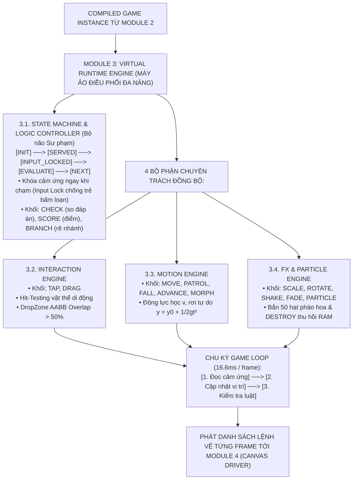
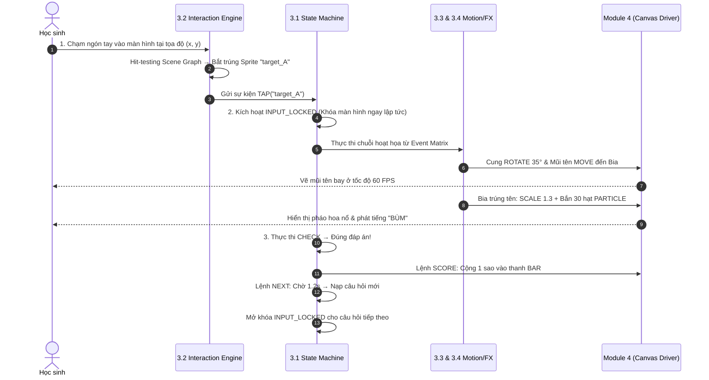

# Module 3 Máy ảo Điều phối Đa năng (Virtual Runtime Engine)

> **CPF Engine (Module 3/4)**: [[Module 2 Bộ Lắp ghép Đồ thị Trò chơi (Scene & Graph Assembler)|Nhận từ: Module 2]] | [[Module 4 Tầng Kết xuất Phần cứng Canvas (Konva Driver)|Chuyển tiếp: Module 4 Driver]]

> **Tài liệu nguồn gốc**: `Module 3 Máy ảo Điều phối Đa năng (Virtual Runtime Engine).pdf`  
> **Chủ đề**: Kiến trúc Module 3 — Trái Tim Điều Phối Đa Năng Vòng Lặp 60 FPS  
> **Chuyển đổi & Tinh chỉnh định dạng**: 2026-11-04

---

## 1. Vai Trò Cốt Lõi của Module 3 trong CPF

Nếu Module 2 (Assembler) đã lắp ráp xong "chiếc xe", thì **Module 3: Máy ảo Điều phối Đa năng (CPF Virtual Runtime Engine)** chính là **"Động cơ và Bộ não điều khiển chiếc xe đó nổ máy chạy trên đường"**.

* **Nhịp độ chuẩn 60 FPS**: Trung tâm điều hành mọi hoạt động sống của trò chơi, chạy bền bỉ ở nhịp độ **60 khung hình/giây** ($16.6\text{ms}$ mỗi frame).
* **Tính trung lập với thể loại game**: Module 3 hoàn toàn không cần biết đây là game Bắn cung, Đua xe hay Câu cá. Nó là một cỗ máy trung lập, vận hành nhịp nhàng 4 bộ phận chuyên trách để biến các khối nguyên tử thành trải nghiệm thực tế.

---

## 2. Sơ Đồ Hoạt Động của Module 3 (Vòng Lặp 60 FPS)

---

## 3. Bốn Bộ Phận Cốt Lõi của Module 3

### 3.1. State Machine & Logic Controller (Bộ não Luật chơi & Sư phạm)
Quản lý trạng thái trò chơi thông qua Máy trạng thái hữu hạn (**Finite State Machine - FSM**) cực kỳ kỷ luật:
1. `[QUESTION_SERVED]` **(Giao đề bài)**: Hiển thị câu hỏi, phát giọng đọc âm thanh mẫu giáo/tiểu học, mở cảm ứng cho học sinh tương tác.
2. `[INPUT_LOCKED]` **(Khóa cảm ứng - Cực kỳ quan trọng)**:
   * Ngay khi ngón tay trẻ vừa chạm vào một đáp án, State Machine lập tức **khóa toàn bộ màn hình**.
   * *Tác dụng*: Trẻ nhỏ thường có thói quen bấm liên tục lia lịa vào màn hình. Việc khóa cảm ứng này bảo đảm chuỗi hoạt họa (mũi tên bay, pháo hoa nổ) được diễn ra trọn vẹn, không bị loạn logic, không đơ máy và không nhảy cóc câu hỏi.
3. `[EVALUATE]` **& Khối `BRANCH` (Chấm điểm & Rẽ nhánh)**:
   * Lấy kết quả từ khối `CHECK`.
   * *Nếu Đúng*: Kích hoạt rãnh thưởng (nhạc vui, cộng sao `SCORE`, pháo hoa `PARTICLE`).
   * *Nếu Sai*: Kích hoạt rãnh hỗ trợ (rung nhẹ `SHAKE`, âm thanh nhắc nhở, mờ đáp án sai `FADE`).
4. `[TRANSITION]` **(Chuyển tiếp)**: Thực thi khối `NEXT_QUESTION` (chuyển câu hỏi) hoặc `END_GAME` (kết thúc bài tập và hiện cúp khen thưởng).

---

### 3.2. Interaction Engine (Cỗ máy Bắt cảm ứng & Va chạm)
Chịu trách nhiệm phiên dịch mọi thao tác vật lý của học sinh:
* **Khối `TAP` & Thuật toán Hit-Testing Không gian**:
  * Khi trẻ chạm vào điểm $(X, Y)$, Interaction Engine đối soát tức thì với Cây không gian (Scene Graph) để biết trúng vật thể nào.
  * *Điểm đặc biệt*: Kể cả khi con cá đang bơi (`PATROL`) hay quả táo đang rơi (`FALL`), thuật toán vẫn bắt trúng đối tượng đang chuyển động một cách chính xác tuyệt đối.
* **Khối `DRAG` & Vùng hút nam châm (DropZone Snap)**:
  * Khi kéo thả vật thể vào giỏ bài tập, Interaction Engine tính toán diện tích giao thoa (**AABB Overlap**).
  * Nếu diện tích trùng lặp $> 50\%$, vật thể tự động kích hoạt hiệu ứng hút nam châm (`SNAP`) trúng đích và khớp vị trí.

---

### 3.3. Motion Engine (Cỗ máy Động lực học & Chuyển động)
* `MOVE`: Tính vector vận tốc $\vec{v}$ từ tọa độ cây cung đến tấm bia mục tiêu.
* `PATROL`: Dao động qua lại trong đoạn $[X_{\min}, X_{\max}]$, khi chạm biên tự động lật ngược hình ảnh (`scaleX = -1`).
* `FALL`: Rơi tự do có gia tốc trọng trường:
  $$y = y_0 + \frac{1}{2}gt^2$$
* `ADVANCE`: Tiến nấc rời rạc $+10\%$ về phía đích khi học sinh làm đúng phép tính (đua xe, leo núi).
* `MORPH`: Cập nhật chỉ số hình ảnh theo mốc tiến trình (Hạt mầm $\to$ Cây non $\to$ Cây nở hoa).

---

### 3.4. FX & Particle Engine (Hiệu ứng Thị giác & Hệ thống Hạt)
* **Biến dạng hình học**: `SCALE` (phóng to khi trúng), `ROTATE` (xoay tròn), `SHAKE` (rung lắc nảy lò xo khi sai), `FADE` (mờ dần).
* **Hệ thống hạt (Particle System)**: Khi làm đúng, tự động sinh 50 ngôi sao vàng bung nở với quỹ đạo tỏa tròn ngẫu nhiên.
* **Thu hồi rác bộ nhớ (`DESTROY`)**: Khi các hạt sao tan biến sau $600\text{ms}$, lệnh `DESTROY` lập tức giải phóng vùng nhớ trong RAM để tránh tràn bộ nhớ máy tính bảng.

---

## 4. Chuỗi Tương Tác Thực Tế: Từ Cú Chạm Đến Phản Hồi

