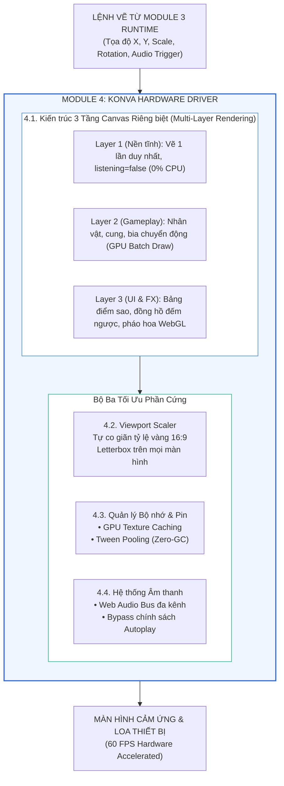
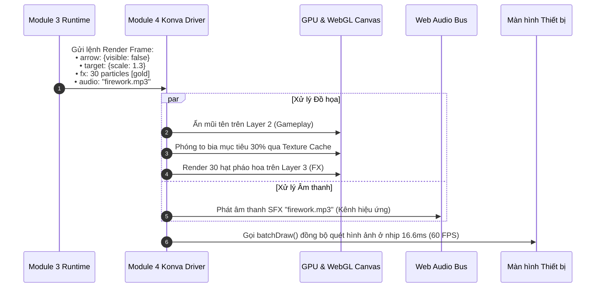

# Module 4 Tầng Kết xuất Phần cứng Canvas (Konva Driver)

> **CPF Engine (Module 4/4)**: [[Module 3 Máy ảo Điều phối Đa năng (Virtual Runtime Engine)|Nhận từ: Module 3]] | [[Mô tả ngoài danh mục game]] | [[Giải pháp cho vấn đề nếu như giáo viên gửi mô tả nằm ngoài cơ chế game hiện có|Kiến trúc tổng thể CPF]]

---

## 1. Giới thiệu & Vai trò

Nếu **Module 3 (Virtual Runtime Engine)** là *"Đạo diễn vô hình"* tính toán mọi vị trí, logic và điểm số trong bộ nhớ RAM, thì **Module 4: Tầng Kết xuất Phần cứng Canvas (Konva Driver)** chính là *"Họa sĩ và Nhà hát trình diễn"*.

Nhiệm vụ cốt lõi của Module 4:
- Nhận các con số toán học từ Module 3 và vẽ thực tế từng điểm ảnh (Pixel) lên màn hình bằng công nghệ **HTML5 Canvas** (thông qua thư viện **Konva.js**).
- Đồng thời kích hoạt phát âm thanh ra loa thiết bị.
- Được định nghĩa là **"Driver"** (Trình điều khiển phần cứng) vì nó trực tiếp giao tiếp với Card đồ họa (GPU) của iPad, điện thoại hay máy tính để đảm bảo hình ảnh hiển thị sắc nét nhất, tiết kiệm pin và mượt mà tuyệt đối ở tốc độ **60 FPS** (16.6ms/khung hình).

---

## 2. Sơ đồ Kiến trúc Module 4

---

## 3. Bốn Trụ cột Kỹ thuật của Module 4

### 3.1. Kiến trúc 3 Tầng Canvas Riêng biệt (Multi-Layer Rendering)

Thay vì vẽ dồn toàn bộ trò chơi lên một thẻ `<canvas>` duy nhất (khiến thiết bị phải xóa đi vẽ lại toàn bộ màn hình 60 lần/giây rất hao pin và nóng máy), Konva Driver chia màn hình thành 3 tấm kính Canvas trong suốt xếp chồng lên nhau:

1. **Layer 1: Canvas Nền tĩnh (Background Layer)**:
   - Vẽ hình ảnh nền (bãi cỏ, vũ trụ, đại dương, v.v.) đúng **1 lần duy nhất** khi khởi tạo game.
   - Tắt hoàn toàn tính năng bắt cảm ứng (`listening: false`).
   - **Hiệu quả**: Tiết kiệm hơn **70%** sức mạnh xử lý CPU/GPU vì không bao giờ phải vẽ lại nền cỏ khi mũi tên bay.

2. **Layer 2: Canvas Trò chơi Động (Gameplay Layer)**:
   - Nơi chứa các đối tượng tương tác và chuyển động: Cây cung, Mũi tên, Tấm bia mục tiêu, Cá bơi, v.v.
   - Chỉ vẽ lại những vùng có thay đổi chuyển động thông qua phương thức `batchDraw()` được tối ưu phần cứng.

3. **Layer 3: Canvas Hiệu ứng & Giao diện (UI & Particle FX Layer)**:
   - Chứa Đồng hồ đếm ngược, Thanh điểm số/sao, và Hiệu ứng hạt (Particle) pháo hoa nổ.
   - Nằm trên cùng để pháo hoa hay sao rơi phủ lên khung cảnh trò chơi một cách rực rỡ mà không ảnh hưởng tới logic tính toán các nhân vật bên dưới.

---

### 3.2. Bộ Thích ứng Màn hình Thông minh (Viewport Scaler)

Học sinh có thể tham gia trò chơi trên nhiều kích cỡ thiết bị khác nhau:
- **iPad / Tablet**: Tỷ lệ $4:3$
- **Điện thoại thông minh**: Tỷ lệ $19.5:9$
- **Laptop / Màn hình tương tác phòng học**: Tỷ lệ $16:9$

Konva Driver thiết lập một **Thế giới Game ảo (Virtual Stage)** chuẩn mực ở độ phân giải Full HD:
$$\text{Virtual Stage} = 1920 \times 1080 \text{ px}$$

Khi chạy trên thiết bị bất kỳ, Driver tự động tính toán hệ số phóng to/thu nhỏ (Scale factor) và căn giữa (Letterboxing):

$$\text{Scale} = \min\left(\frac{W_{\text{thực tế}}}{1920}, \; \frac{H_{\text{thực tế}}}{1080}\right)$$

> **Kết quả**: Giao diện trò chơi luôn giữ nguyên bố cục thẩm mỹ, không bị méo hình, không bị mất góc hay tràn viền nút bấm trên bất kỳ màn hình nào.

---

### 3.3. Quản lý Bộ nhớ & Tiết kiệm Pin (Tween Pooling & Texture Caching)

Thiết bị mầm non và tiểu học thường là máy tính bảng dùng pin. Konva Driver áp dụng 2 kỹ thuật tối ưu phần cứng cao cấp:

- **GPU Texture Caching (`node.cache()`)**:
  - Chuyển các hình vẽ vector SVG hoặc typography phức tạp thành một tấm ảnh bitmap nằm sẵn trên bộ nhớ VRAM của GPU.
  - Khi đối tượng xoay góc (`ROTATE`) hay phóng to/thu nhỏ (`SCALE`), GPU chỉ cần xử lý phép biến đổi affine trên tấm bitmap thay vì phải tính toán lại từng đường cong bezier.
- **Tween Pooling (Chống rác bộ nhớ - Zero Garbage Collection)**:
  - Thay vì mỗi lần bắn tên lại khởi tạo một đối tượng animation tween mới (gây áp lực lên bộ gom rác Garbage Collector của JavaScript làm sụt giảm FPS), Driver khởi tạo sẵn một **Hồ chứa Tween (Pool)** và tái sử dụng xoay vòng liên tục.

---

### 3.4. Hệ thống Âm thanh Đa kênh (Web Audio Bus Trigger)

Âm thanh là yếu tố kích thích giác quan quan trọng đối với học sinh:

- **Lệnh kích hoạt tối giản**: Module 3 chỉ cần phát tín hiệu định danh âm thanh: `PLAY_AUDIO("whoosh")` (tiếng tên bay) hay `PLAY_AUDIO("cheer")` (tiếng vỗ tay).
- **Phát đa kênh đồng thời**: Nhạc nền (BGM) chạy ngầm liên tục, trong khi tiếng vút tên và pháo hoa nổ (SFX) có thể phát đè lên nhau trên các kênh riêng biệt mà không ngắt quãng.
- **Vượt rào cản Autoplay**: Tự động mở khóa Web Audio Context ngay từ tương tác chạm (touch/click) đầu tiên của học sinh, giải quyết triệt để chính sách chặn autoplay trên Safari iOS và Google Chrome.

---

## 4. Ví dụ Luồng Thực thi: Từ Lệnh Toán học đến Màn hình

Quy trình xử lý khi học sinh bắn trúng bia mục tiêu:

---

## 5. Tóm tắt Giá trị Kỹ thuật của Module 4

| Tiêu chí | Giải pháp của Module 4 | Lợi ích thực tế |
| :--- | :--- | :--- |
| **Hiệu năng 60 FPS** | Tách 3 tầng Canvas riêng biệt & tận dụng GPU cache | Game chuyển động cực mượt, không nóng máy hay hao pin trên thiết bị học đường |
| **Hiển thị Đa thiết bị** | Viewport Scaler chuẩn $1920 \times 1080$ tự động Letterbox | Tương thích mọi màn hình (iPad, điện thoại, máy tính, bảng tương tác) mà không sửa code |
| **Trải nghiệm Giác quan** | Kết hợp đồ họa Canvas sắc nét và Web Audio Bus đa kênh | Âm thanh sống động, hiệu ứng visual mãn nhãn, tăng hứng thú học tập cho học sinh |
