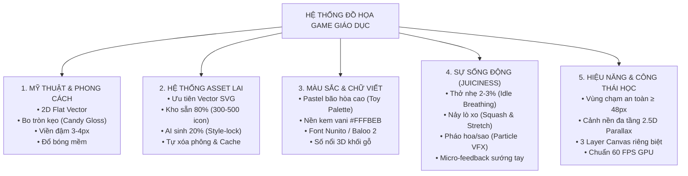

# Đồ họa game

> **Tiêu chuẩn Đồ họa**: [[Tiêu chuẩn Đồ họa và Asset Pipeline]]

> **Tài liệu nguồn gốc**: `Đồ họa game.pdf`  
> **Chủ đề**: Tiêu chuẩn Đồ họa, Trải nghiệm Thị giác & Asset Pipeline cho Game Giáo dục K-5  
> **Chuyển đổi & Tinh chỉnh định dạng**: 2026-11-04

---

## BẢNG CHỐT HẠ: 5 TRỤ CỘT ĐỒ HỌA GAME GIÁO DỤC

---

## NỘI DUNG CHI TIẾT CỦA TỪNG TRỤ CỘT

### 1. Phong cách Mỹ thuật chủ đạo (Art Style)
* **Định hình phong cách**: **2D Cute Flat Vector / Chibi Kawaii** (tương tự *Duolingo, Toca Boca, Khan Academy Kids*). Tuyệt đối tránh 3D tả thực làm nặng máy và gây rối mắt cho trẻ em lứa tuổi mầm non và tiểu học.
* **Quy chuẩn đường nét**:
  * Mọi góc cạnh đều bo tròn mềm mại (`border-radius` lớn), tạo cảm giác thân thiện và an toàn về mặt tâm lý.
  * Có **đường viền đậm màu tối** (`Stroke 3 - 4px`) bao quanh vật thể để tách bạch rõ ràng khỏi phông nền.
  * Có **vệt sáng cong màu trắng mờ** ở góc trên tạo hiệu ứng nổi khối như viên kẹo ngọt (*Candy Gloss*).

---

### 2. Hệ thống Tài nguyên Đồ họa (Asset Pipeline)
* **Định dạng tối thượng: Vector SVG**:
  * Phóng to vô cực không bao giờ bị vỡ hạt trên màn hình iPad Retina hay màn hình tương tác thông minh 65–85 inch.
  * Dung lượng siêu nhẹ ($2 - 5\text{ KB}$/file), mở game là hiển thị ngay tức thì.
  * Đổi màu sắc linh hoạt bằng mã CSS/Konva mà không cần vẽ ảnh mới.
* **Chiến lược Kho Asset Lai (Hybrid 80/20)**:
  * **80% từ Kho chuẩn bị sẵn (Asset Bank)**: Gom sẵn $300 - 500$ icon/sprite SVG chuẩn (hoa quả, con vật, xe cộ, cung tên, cá...).
  * **20% sinh tức thì bằng AI**: Khi gặp yêu cầu lạ, AI sinh ảnh với prompt khóa phong cách (*Style-lock*) $\to$ Tự động cắt phông trong suốt $\to$ Lưu cache dùng lại.

---

### BẢNG ĐÁNH GIÁ 16 NGUỒN TÀI NGUYÊN ĐỒ HỌA & ÂM THANH QUỐC TẾ

| STT | Nguồn (Platform / Source) | Nhóm tài nguyên | Hợp nhất với (Best for K-5) | Định dạng file | Giấy phép bản quyền (License) | Đánh giá & Khuyến nghị thực tế cho Đề tài |
| :---: | :--- | :--- | :--- | :--- | :--- | :--- |
| **1** | **itch.io** *(tag: cute, kids, vector)* | Nhân vật, Cảnh nền, Full Themes | Trọn bộ theme hoạt hình đồng bộ (Nông trại, Biển, Vũ trụ, Rừng xanh) | PNG, SVG, Vector EPS | Tùy từng gói (Nhiều gói CC0 / Miễn phí thương mại) | ⭐⭐⭐⭐⭐ **(Khuyên dùng số 1 cho Nhân vật & Theme)**: Đẹp nhất, chuẩn phong cách kẹo ngọt Duolingo/Toca Boca. |
| **2** | **Kenney.nl** | Nút bấm UI, Hình khối, Âm thanh | Giao diện nút bấm bo tròn, thanh tiến trình, icon cơ bản | SVG, PNG, Audio MP3/OGG | CC0 1.0 (Public Domain) - Miễn phí 100%, không cần ghi nguồn | ⭐⭐⭐⭐⭐ **(Khuyên dùng số 1 cho UI & Sound FX)**: Siêu sạch, chuẩn vector, không bao giờ sợ rủi ro bản quyền khi chấm đồ án. |
| **3** | **LottieFiles** | Hiệu ứng động (VFX & Celebration) | Pháo hoa giấy (Confetti), 3 ngôi sao nảy, Cúp vàng xoay, ngón tay chỉ dẫn | File JSON vector (Lottie) | Từng file riêng (Rất nhiều file miễn phí) | ⭐⭐⭐⭐⭐ **(Khuyên dùng số 1 cho Hiệu ứng ăn mừng)**: File nhẹ chỉ 10KB, chạy cực mượt trên Canvas, tạo độ "chuyên nghiệp" cho game. |
| **4** | **SVG Repo** *(svgrepo.com)* | Icon, Đồ vật học tập rời | Trái cây, con vật, phương tiện giao thông, dụng cụ học tập | 100% Vector SVG | Có bộ lọc riêng: CC0, MIT, Apache | ⭐⭐⭐⭐⭐ **(Khuyên dùng số 1 cho Học liệu bài học)**: 500k+ hình vector siêu nhẹ ($2-5\text{ KB}$), phóng to vô cực trên iPad Retina. |
| **5** | **Glitch Public Domain Archive** | Nhân vật, Đồ vật, Môi trường | Cây cối, thức ăn, thú cưng, nhà cửa vẽ tay kiểu sách tranh thiếu nhi | PNG trong suốt, SVG | CC0 1.0 (Public Domain) - Bản quyền giải phóng từ game Glitch | ⭐⭐⭐⭐⭐ **(Kho báu vẽ tay)**: Hơn 10.000 hình vẽ tay siêu dễ thương từ cựu đội ngũ sáng lập Slack, hoàn toàn miễn phí. |
| **6** | **OpenMoji / Twemoji** | Biểu tượng, Động vật, Đồ vật | Các con vật quen thuộc, hoa quả, nốt nhạc, hình học toán học | 100% Vector SVG | CC-BY 4.0 / MIT | ⭐⭐⭐⭐ **(Bí kíp của Duolingo)**: Hệ thống icon chuẩn quốc tế, nét vẽ cực kỳ tối giản, mắt trẻ em nhận diện siêu nhanh. |
| **7** | **CraftPix.net** *(Mục Freebies)* | 2D Sprites, Background phân tầng | Game đi cảnh, game kéo thả, thú cưng hoạt hình cắt sẵn sprite | PNG trong suốt, PSD, Vector | Miễn phí có điều kiện (Dùng tốt cho đồ án) | ⭐⭐⭐⭐ **(Rất tốt)**: Chuyên sâu cho game casual, có sẵn cảnh nền đa tầng 2.5D Parallax rất đẹp. |
| **8** | **Openclipart.org** | Học liệu trường học, Tranh vẽ nét | Bảng đen, thước kẻ, compa, quả địa cầu, sách vở | 100% Vector SVG | CC0 1.0 (Public Domain) | ⭐⭐⭐⭐ **(Tốt cho môn Toán/Tiếng Việt)**: Đầy đủ mọi đồ vật đời thực nhưng phong cách vẽ hơi cổ điển một chút. |
| **9** | **ZapSplat.com** | Âm thanh hiệu ứng (SFX) | Tiếng Cartoon Boing, tiếng Pop, tiếng chuông leng keng, tiếng nảy lò xo | MP3, WAV chất lượng cao | Miễn phí (Yêu cầu ghi nguồn hoặc tài khoản free) | ⭐⭐⭐⭐ **(Rất tốt cho âm thanh hoạt hình)**: Hơn 100k âm thanh chuyên nghiệp, tiếng rất nảy và vui tai cho trẻ nhỏ. |
| **10** | **OpenGameArt.org** | Đồ họa, Âm thanh tổng hợp | Bổ sung lẻ cây cối, đá, đám mây, nhạc nền chiptune | Đa dạng (PNG, OGG, WAV) | Mỗi file một kiểu (CC0, CC-BY, GPL...) | ⭐⭐⭐ **(Dùng bổ sung)**: Rất nhiều tài nguyên nhưng giao diện cũ, chất lượng không đều, cần để ý tránh file dính giấy phép GPL. |
| **11** | **GameArt2D.com** *(Mục Free)* | Nhân vật hoạt hình 2D | Nhân vật trẻ em, quái vật dễ thương, bối cảnh rừng xanh | PNG, Vector EPS | Miễn phí cho cá nhân và thương mại | ⭐⭐⭐ **(Dự phòng tốt)**: Đồ họa chất lượng cao nhưng số lượng gói miễn phí hơi ít. |
| **12** | **Freepik / Flaticon / Storyset** | Minh họa câu hỏi, Icon phẳng | Tranh minh họa tình huống bài học (Gia đình, lớp học, bác sĩ) | SVG, PNG | Thường yêu cầu ghi nguồn (Attribution) bản Free | ⭐⭐⭐ **(Chỉ nên dùng cho Ảnh bài học)**: Không nên dùng làm sprite chuyển động vì phong cách các tác giả bị lệch nhau. |
| **13** | **Leonardo.ai / Scenario.com** | Tạo ảnh bằng AI (Generative) | Sinh các con vật/vật phẩm độc lạ khi kho có sẵn không tìm thấy | PNG (sau đó dùng xóa phông) | Bản quyền theo tài khoản người dùng | ⭐⭐⭐ **(Dùng cho 20% ngoại lệ)**: Khóa phong cách (*Style-lock*) để sinh ảnh mới khi giáo viên yêu cầu đề tài lạ. |
| **14** | **Vectorizer.ai / PixelVibe** | Công cụ chuyển đổi kỹ thuật | Biến ảnh PNG/JPG từ AI thành file Vector SVG chuẩn nét | Xuất ra SVG | Miễn phí dùng thử / Tool web | ⭐⭐⭐⭐ **(Cầu nối AI sang Vector)**: Giúp ảnh AI vẽ không bao giờ bị mờ khi đưa vào Canvas. |
| **15** | **Rive Marketplace** | Nhân vật có máy trạng thái | Nhân vật tương tác động cao cấp | Rive Runtime format | Tùy tác giả | ⭐⭐ **(Không khuyến khích)**: Quá phức tạp để nhúng vào React-Konva Canvas, dễ xung đột Render Loop. |
| **16** | **Pixabay / Pexels** | Ảnh chụp stock, Nhạc nền | Nhạc nền nhẹ nhàng không lời (BGM) | JPG, MP3 | Miễn phí theo giấy phép nền tảng | ⭐ **(Chỉ dùng lấy nhạc nền)**: Không dùng ảnh chụp vì làm nát phong cách hoạt hình của trẻ em. |

---

### 3. Bảng màu & Chữ viết dành cho Trẻ em (Color & Typography)
* **Bảng màu đồ chơi (Toy Palette)**:
  * Tuyệt đối cấm dùng màu chói gắt nguyên bản (`#FF0000`, `#00FF00`).
  * Dùng gam màu kẹo ngọt bão hòa cao:
    * Vàng mật ong (`#FBBF24`)
    * Xanh bạc hà (`#34D399`)
    * Hồng san hô (`#F87171`)
    * Xanh biển mây (`#60A5FA`)
    * Nền kem vani ấm áp (`#FFFBEB`) — bảo vệ mắt trẻ khi chơi lâu.
* **Font chữ bo tròn thân thiện**:
  * Sử dụng các font chuẩn giáo dục: **Nunito**, **Quicksand**, hoặc **Baloo 2**.
  * Chữ số và phép tính có **viền trắng dày** và **bóng đổ nổi khối 3D** trông như các khối gỗ xếp hình Montessori.

---

### 4. Độ sống động của Chuyển động ("Juiciness" & Micro-Feedback)
1. **Thế giới chuyển động (Idle Breathing)**: Nhân vật, tấm bia, cây cung luôn nhấp nhô nhẹ $2 - 3\%$ theo nhịp thở, không bao giờ đứng im đơ.
2. **Nảy lò xo khi bấm (Squash & Stretch)**: Chạm vào vật thể thì nó hơi co lại rồi bật nảy to ra $\to$ Tạo cảm giác bấm chạm rất "sướng tay".
3. **Bắn hạt ăn mừng (Particle VFX)**: Trả lời đúng phải có mưa sao vàng lấp lánh hoặc pháo hoa giấy ngũ sắc tung tóe tạo cảm xúc chiến thắng.

---

### 5. Công thái học Thị giác & Tối ưu Phần cứng (Ergonomics & Performance)
* **Vùng chạm an toàn (Hitbox)**: Vùng bấm ngón tay tối thiểu $\ge 48\text{px} \times 48\text{px}$ (khuyến nghị $56\text{px}$) để trẻ mầm non không bị bấm trượt.
* **Cảnh nền đa tầng (2.5D Parallax)**: Chia 3 lớp (Bầu trời mây trôi xa $\to$ Rặng cây trung cảnh $\to$ Bãi cỏ tương tác) tạo chiều sâu như cuốn sách tranh 3D.
* **Tối ưu 60 FPS trên Canvas (Multi-Layer Architecture)**:
  Tách 3 lớp thẻ `<canvas>` độc lập:
  * *Layer 1 (Nền tĩnh)*: Vẽ đúng 1 lần duy nhất, tắt bắt sự kiện (`listening: false`) $\to$ Tiết kiệm $70\%$ CPU.
  * *Layer 2 (Trò chơi động)*: Chứa cung tên, bia ngắm, cá bơi $\to$ Vẽ lại cục bộ bằng `batchDraw()`.
  * *Layer 3 (Hiệu ứng UI)*: Chứa thanh điểm, đồng hồ, pháo hoa nổ $\to$ Nằm trên cùng để không cản trở chuyển động bên dưới.
  Giúp máy tính bảng cũ ở trường học chạy mượt mà, không nóng máy, không hao pin.
