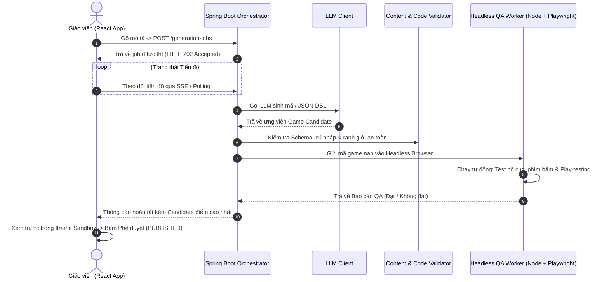

# Báo cáo Phân tích Kỹ thuật & Quản trị Rủi ro (OOD Technical Spike)

> **Kiến trúc CPF (Luận điểm kỹ thuật)**: [[Mô tả ngoài danh mục game]] | [[00. Tổng quan vấn đề giáo viên mô tả ngoài danh mục game|Vấn đề OOD]] | [[Giải pháp cho vấn đề nếu như giáo viên gửi mô tả nằm ngoài cơ chế game hiện có|Giải pháp Tổng thể CPF]]

---

## 1. Bức tranh Kỹ thuật Tổng thể

Hệ thống xử lý bài toán giáo viên nhập mô tả nằm ngoài danh mục game có sẵn đòi hỏi kiến trúc xử lý công việc bất đồng bộ (Asynchronous Jobs) vì một lần sinh game kết hợp kiểm định QA có thể mất từ $30$ đến $90$ giây:



> **Điểm quan trọng**: Quá trình sinh game kéo dài từ $30$–$90$ giây, do đó bắt buộc thiết kế luồng xử lý bất đồng bộ (Background Job với Job ID và thông báo tiến độ thời gian thực), tuyệt đối không dùng Request HTTP đồng bộ giữ kết nối kéo dài.

---

## 2. Phân tích Các Phần Khó Xếp Theo Mức độ Rủi ro

### 2.1. Rủi ro Cao nhất: Tự động Chơi thử Game Bất kỳ (Automated Playtesting)
- **Thực trạng**: Việc QA Headless kiểm tra lỗi tĩnh như "chữ tràn màn hình", "nút bấm quá nhỏ" khá dễ dàng. Tuy nhiên, để máy tự động xác minh xem *"học sinh có thể chơi từ đầu đến khi chiến thắng được không"* trên một tựa game do AI tự do sinh ra là bài toán rất phức tạp nếu không có cơ chế dẫn đường.
- **Giải pháp - Khế ước Game (`Game Contract`)**: Mọi game được sinh ra bắt buộc phải tuân theo một giao diện điều khiển chuẩn mực:

```typescript
// Giao diện bắt buộc Game phải expose ra môi trường Window
window.__game = {
  getState(): { phase: 'INIT' | 'PLAYING' | 'WON' | 'LOST', score: number, finished: boolean },
  getActions(): Array<{ id: string, type: string, targetSelector: string }>, // Danh sách các hành vi hợp lệ tại thời điểm hiện tại
  perform(actionId: string): void // Thực thi hành động
};
```

Worker Playwright không cần phải "hiểu" ngữ nghĩa của game. Worker chỉ cần lặp:
$$\text{Lấy } \texttt{getActions()} \longrightarrow \text{Thực hiện hành động} \longrightarrow \text{Kiểm tra } \texttt{finished} == \text{true}$$
Đây chính là kỹ thuật **Contract Testing** trong kiến trúc phần mềm, và Game Kit cung cấp sẵn lớp bọc này.

---

### 2.2. Rủi ro Cao: Môi trường Sandbox Cách ly An toàn
Chạy mã nguồn do AI tự động sinh ra trong trình duyệt của giáo viên và học sinh đòi hỏi 5 lớp bảo vệ nghiêm ngặt:
1. **Thẻ Iframe cách ly**: `<iframe sandbox="allow-scripts">` — tuyệt đối không cấp quyền `allow-same-origin`.
2. **Chính sách An toàn Nội dung (CSP)**: Thiết lập chặn triệt để mọi truy cập mạng bên ngoài (`default-src 'none'`), chỉ cho phép tải tài nguyên tĩnh được ký duyệt từ CDN của Kit.
3. **Kênh liên lạc một chiều**: Giao tiếp qua `postMessage`, kiểm tra chặt chẽ `origin` và schema định dạng thông điệp.
4. **Phân tích Tĩnh Chặn Mã Độc (Static AST Analysis)**: Cấm tuyệt đối các lời gọi `fetch`, `XMLHttpRequest`, `eval`, `import()` động, cũng như việc đọc `window.parent` và `document.cookie`.
5. **Tách biệt Miền (Dedicated Domain/Origin)**: Phục vụ trang Iframe trên một domain riêng biệt (ví dụ: `sandbox.gamestudio.edu.vn`), không dùng chung domain với cổng chính.

---

### 2.3. Rủi ro Trung bình: Xây dựng Game Kit
- Đây là phần tốn công sức lập trình nhất nhưng không có rủi ro kỹ thuật bế tắc.
- Mỗi khối nguyên tử (Kéo thả, Bộ đếm, Tween, Âm thanh, Layout Responsive) cần được viết và kiểm thử đơn vị kỹ lưỡng.
- **Chiến lược**: Không cố gắng làm dàn trải toàn bộ. Chỉ tập trung hoàn thiện 4–5 khối cơ sở để phục vụ $3$–$4$ mẫu game phổ biến nhất trong giai đoạn đầu.

---

### 2.4. Rủi ro Trung bình: Tính Không Xác định của LLM (Non-determinism)
- Cùng một câu mô tả đầu vào có thể cho ra kết quả mã khác nhau.
- **Giải pháp**: Áp dụng Schema cưỡng bức (Constrained Decoding / JSON Mode), đặt `temperature` thấp ($0.1$–$0.2$) ở bước sinh logic, ghi log đầy đủ kèm `seed`, và xây dựng bộ **Golden Prompts** để đo lường tỷ lệ thành công khách quan qua nhiều lần lặp.

---

### 2.5. Các Rủi ro Vận hành Cần Kiểm soát
- **Chi phí & Hạn mức (Rate Limits)**: Giới hạn số lần sinh game mỗi ngày đối với từng giáo viên, đặt ngân sách token tối đa cho mỗi job và thiết lập hard-timeout ($120$s).
- **Tài nguyên Worker**: Playwright chạy trình duyệt Headless tốn RAM/CPU; cần giới hạn hàng đợi xử lý song song ($2$–$4$ jobs đồng thời).
- **Quản lý Phiên bản (Versioning)**: Game sinh ra phải lưu kèm Metadata (phiên bản Game Kit, Prompt template, Model version) để đảm bảo game vẫn chơi lại được trong tương lai.

---

## 3. Lộ trình Triển khai Giảm thiểu Rủi ro (Staged Roadmap)

Mỗi cấp độ đều có kết quả cụ thể, độc lập và có thể dừng lại an toàn để phục vụ báo cáo KLTN/TLCN:

| Cấp | Nội dung Triển khai | Thời gian Ước tính | Giá trị Đạt được nếu Dừng ở Cấp này |
| :-: | :--- | :-: | :--- |
| **Cấp 0** | **Golden Prompts & Baseline Measurement**<br>Đo lường tỷ lệ sinh thành công trên luồng sinh hiện tại | 2 – 3 ngày | Có số liệu thực nghiệm định lượng chuẩn xác cho Chương 4 của báo cáo |
| **Cấp 1** | **GDD + Age Profile + Pedagogical Validator**<br>Thêm bộ kiểm định toán học & vòng lặp tự sửa (Repair Loop) trên 10 dạng game có sẵn | 1 – 1.5 tuần | Vượt trội so với các web tool phổ thông về độ tin cậy và an toàn sư phạm cho trẻ |
| **Cấp 2** | **Spike Sandbox Cách ly**<br>Chạy 1 game sinh tự do trong môi trường iframe an toàn, thực thi khế ước `__game` | ~1 tuần | Chứng minh tính khả thi kỹ thuật, có demo thực tế hoạt động an toàn |
| **Cấp 3** | **Headless QA Worker**<br>Tự động phát hiện lỗi tràn màn hình, nút bấm nhỏ, console error và chơi thử theo contract | ~1 tuần | Có hệ thống QA tự động đo đạc được chất lượng game trước khi giao cho giáo viên |
| **Cấp 4** | **Game Kit Tối thiểu & Best-of-N Selection**<br>Hoàn thiện các Primitives cơ bản + 2–3 mẫu game tự sinh + chọn ứng viên tốt nhất | 1.5 – 2 tuần | Tạo ra tính năng "sinh game mới ngoài danh mục" hoàn chỉnh, ổn định và có kiểm định |

> **Nguyên tắc cốt lõi**: Mỗi cấp là một chốt chặn an toàn. Nếu Cấp 3 gặp khó khăn về thời gian, nhóm vẫn có đầy đủ kết quả thực nghiệm hoàn chỉnh từ Cấp 0 đến Cấp 2 để trình bày trước Hội đồng.

---

## 4. Các Quyết định Kỹ thuật Cần Chốt Sớm

1. **Thống nhất Khế ước `__game`**: Xác nhận giao diện expose này có phù hợp và được chấp thuận trong kiến trúc tổng thể hay không (rất quan trọng cho QA tự động).
2. **Môi trường Triển khai Worker**: Chạy Worker Playwright cùng máy chủ Spring Boot (đơn giản, đủ cho quy mô đồ án tốt nghiệp) hay tách riêng Container Docker.
3. **Tiêu chí Đạt (Pass Criteria) cho Spike**: Đặt mục tiêu kiểm thử rõ ràng: ví dụ *"Thử nghiệm 30 mô tả giáo viên, đạt $\ge 80\%$ qua QA tự động trong $\le 3$ vòng sửa chữa"*. Nếu không đạt, sẽ chốt phạm vi ở Cấp 1 để bảo toàn tiến độ.
