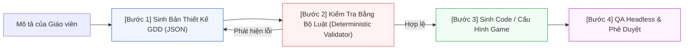

# Thiết Kế Trước, Viết Code Sau: Game Design Document (GDD-First Generation)

> **Kiến trúc CPF (Luận điểm kỹ thuật 1/6)**: [[Mô tả ngoài danh mục game]] | [[00. Tổng quan vấn đề giáo viên mô tả ngoài danh mục game|Vấn đề OOD]] | [[Giải pháp cho vấn đề nếu như giáo viên gửi mô tả nằm ngoài cơ chế game hiện có|Giải pháp Tổng thể CPF]]

---

## 1. Vấn đề mà Kỹ thuật Này Giải quyết

Nếu yêu cầu LLM *"tạo game cho bé học phép cộng"*, theo mặc định nó sẽ sinh thẳng ra mã nguồn HTML/JavaScript. Khi kết quả không như ý, hệ thống chỉ phát hiện lỗi sau khi đã tốn $30$–$90$ giây và một lượt gọi LLM đắt đỏ. Hơn nữa, lỗi logic nằm lẫn trong hàng trăm dòng code nên rất khó chẩn đoán và khắc phục.

Từ góc nhìn của kỹ nghệ phần mềm chuyên nghiệp, việc sinh code trực tiếp là bỏ qua giai đoạn thiết kế kiến trúc. Thay vì bắt tay vào code ngay khi nhận yêu cầu, kỹ sư phần mềm luôn viết Design Doc, Review kỹ lưỡng, rồi mới lập trình. Quy trình AI sinh game giáo dục cũng phải tuân thủ nguyên lý này:



### Lợi ích Cốt lõi của Hướng Tiếp cận GDD-First:
1. **Sửa lỗi sớm và chi phí cực thấp**: Bản thiết kế chỉ gồm vài chục dòng JSON, được kiểm tra trong mili-giây bằng code kiểm định tiền định (Deterministic Code), hoàn toàn không cần gọi thêm LLM.
2. **Định danh lỗi chính xác (Actionable Errors)**: Ví dụ *"Độ tuổi mầm non nhưng có đồng hồ đếm ngược áp lực"* là lỗi tường minh ở trường `failureHandling.timer`, hệ thống dễ dàng báo lỗi và tự động sửa chữa.
3. **Giáo viên tham gia đồng sáng tạo**: Giáo viên có thể đọc bản tóm tắt *"Game này làm gì, dạy kiến thức gì"* và phê duyệt/điều chỉnh trước khi hệ thống tiêu tốn tài nguyên sinh code.
4. **Kiểm thử tự động bằng Unit Test**: Nhóm phát triển có thể viết hàng trăm Unit Test kiểm tra các luật sư phạm, điều bất khả thi nếu đối diện với một khối code sinh tự do.

---

## 2. Cấu trúc của Game Design Document (GDD)

Khi giáo viên nhập: *"Game cho bé lớp 1 học phép cộng trong phạm vi 10"*, LLM sẽ trả về một cấu trúc GDD theo JSON Schema chuẩn:

```json
{
  "title": "Hái táo cho thỏ",
  "audience": {
    "gradeLevel": "GRADE_1",
    "ageRange": [6, 7]
  },
  "learningObjective": {
    "curriculumRef": "Toán 1 - Phép cộng trong phạm vi 10",
    "statement": "Bé cộng hai số có tổng ≤ 10",
    "bloomLevel": "APPLY"
  },
  "coreLoop": {
    "playerAction": "Kéo số quả táo vào giỏ sao cho tổng đúng bằng số thỏ yêu cầu",
    "learningAction": "Cộng các số để đạt tổng mục tiêu",
    "loopDescription": "Thỏ nói 'Con cho thỏ 7 quả táo' -> bé kéo các quả táo -> giỏ đếm tổng"
  },
  "mechanics": ["drag-drop", "counter"],
  "winCondition": "Hoàn thành 5 yêu cầu của thỏ",
  "failureHandling": {
    "type": "GENTLE_RETRY",
    "lives": false,
    "timer": false
  },
  "feedback": {
    "onCorrect": "Thỏ nhảy múa vui vẻ, âm thanh chuông leng keng",
    "onWrong": "Thỏ nghiêng đầu tò mò, gợi ý bé đếm lại số quả"
  },
  "difficulty": {
    "levels": 3,
    "progression": "Tổng mục tiêu tăng dần từ 3 -> 10"
  },
  "content": {
    "targets": [3, 5, 7, 8, 10]
  },
  "ageConstraints": {
    "minTouchTargetPx": 56,
    "maxTextWords": 6,
    "voiceOver": true
  }
}
```

### Ý nghĩa của Các Trường trong GDD:
| Trường | Câu hỏi Thiết kế được Trả lời |
| :--- | :--- |
| `learningObjective` | Học sinh tiếp thu được gì, đối chiếu với chuẩn nào trong Chương trình GDPT 2018? |
| `coreLoop` | Người chơi thực hiện chuỗi hành vi lặp nào trong từng giây? |
| `winCondition` & `failureHandling` | Khi nào đạt chiến thắng, và khi thao tác sai thì hệ thống ứng xử ra sao? |
| `feedback` | Trẻ nhận phản hồi thị giác và âm thanh như thế nào để khích lệ tinh thần? |
| `difficulty` | Độ khó của bài học tăng tiến theo quy luật nào? |
| `ageConstraints` | Những giới hạn kỹ thuật bắt buộc để phù hợp với đặc điểm tâm sinh lý của lứa tuổi? |

---

## 3. Kiểm định "Bằng Luật" (Deterministic Rule Validation)

Kiểm tra bằng luật nghĩa là sử dụng logic lập trình tiền định không qua LLM để đảm bảo tính an toàn:

```java
// Minh họa mã giả bộ luật kiểm định tiền định
if (audience.getGradeLevel() == GradeLevel.PRESCHOOL && (failure.hasTimer() || failure.hasLives())) {
    throw new ValidationError("Mầm non không được dùng đồng hồ đếm ngược hoặc cơ chế trừ mạng sống.");
}

if (mechanics.contains("drag-drop") && audience.getMinTouchTargetPx() < 48) {
    throw new ValidationError("Vùng tương tác cảm ứng < 48px, quá nhỏ đối với ngón tay trẻ mầm non.");
}

if (!CurriculumRegistry.contains(objective.getCurriculumRef())) {
    throw new ValidationError("Không tìm thấy mã chuẩn kiến thức này trong khung GDPT 2018.");
}

if (content.getTargets().stream().anyMatch(t -> t > 10)) {
    throw new ValidationError("Tồn tại số vượt quá giới hạn phạm vi 10 của học sinh Lớp 1.");
}

if (winCondition.getRequiredRounds() > content.getTargets().size()) {
    throw new ValidationError("Điều kiện thắng không thể đạt được do thiếu dữ liệu câu hỏi.");
}
```

### Ba Tầng Luật Kiểm định:
1. **Luật Cấu trúc (Structural Rules)**: Kiểm tra đủ trường dữ liệu, đúng kiểu số/chuỗi, đúng biên giá trị (JSON Schema).
2. **Luật Tính Nhất quán (Consistency Rules)**: Đảm bảo các thành phần logic không xung đột, game có thể thắng được và không có nhánh bế tắc vô tận.
3. **Luật Sư phạm Theo Độ tuổi (Pedagogical Age Rules)**: Bảng quy tắc chuyên biệt (Mầm non không dùng văn bản dài, không phạt gắt gao, hitbox cảm ứng lớn $\ge 48\text{px}$).

---

## 4. Nguyên lý Sống còn: Tích hợp Nội tại (Intrinsic Integration)

Trong nghiên cứu thiết kế trò chơi giáo dục, **Tích hợp Nội tại** là tiêu chuẩn vàng: *Hành động người chơi thực hiện để tương tác với game chính là hành động tư duy kiến thức.*

| Tiêu chí | Tích hợp Ngoại lai (Extrinsic - Kém) | Tích hợp Nội tại (Intrinsic - Xuất sắc) |
| :--- | :--- | :--- |
| **Ví dụ thực tế** | Nhân vật chạy nhảy ăn xu, thi thoảng bật popup câu hỏi *"2 + 3 = ?"* | Bé kéo các quả táo vào giỏ sao cho tổng đúng bằng số thỏ yêu cầu |
| **Bản chất Chơi & Học**| Hai hoạt động tách rời. Bé học chỉ để được tiếp tục chơi | Chơi và học là một thể thống nhất. Chơi tốt đồng nghĩa với hiểu phép cộng |
| **Tâm lý Người học** | Trẻ coi việc học là rào cản cần vượt qua, dễ bấm bừa để qua ải | Trẻ bắt buộc phải vận dụng tư duy toán học mới đạt được chiến thắng |

> **Giá trị bảo vệ đồ án**: Đây là vũ khí giúp hệ thống vượt trội so với các công cụ web phổ biến (như Kahoot hay Wordwall - vốn chỉ là trắc nghiệm quiz hoặc minigame bọc ngoài).

### Kiểm tra Tích hợp Nội tại Bằng Máy:
- **Ràng buộc Schema**: Bắt buộc khai báo cả `learningAction` và `playerAction`, đối soát qua ma trận tương thích (ví dụ kỹ năng `addition` chỉ hợp với các hành động thuộc nhóm `{gom, ghép, đếm, kéo vào tổng}`). Nếu hành động là `jump-over-obstacle` kết hợp `learningAction: addition` sẽ bị đánh dấu vi phạm.
- **Cờ Cấu trúc (Structural Flag)**: Nếu phát hiện `learningAction` nằm dưới dạng popup chen ngang thay vì nằm trong `coreLoop`, hệ thống từ chối cấu hình.
- **LLM Rubric Evaluator**: Đặt câu hỏi giám định: *"Nếu loại bỏ nội dung học tập, cơ chế game có còn chơi được không?"*. Nếu game vẫn vận hành bình thường mà không cần kiến thức, đó là tích hợp ngoại lai.

---

## 5. Kết luận & Giới hạn Thực tế

- **GDD đảm bảo tính hợp lý và an toàn**, nhưng sự hấp dẫn cảm xúc vẫn cần dựa trên các cơ chế đã được kiểm chứng (Pattern Bank).
- **Luật sư phạm cần sự tinh chỉnh của con người**: Bảng ánh xạ độ tuổi phải được chuẩn hóa từ Chương trình GDPT 2018 và ý kiến chuyên gia sư phạm tiểu học.
- **Chi phí thời gian hoàn toàn xứng đáng**: Thêm một bước sinh GDD chỉ mất khoảng $2$–$4$ giây, nhưng ngăn chặn triệt để nguy cơ thất bại ở bước sinh mã phức tạp.

---

## Liên kết Điều hướng 6 Luận điểm Kỹ thuật
1. [[Chuyên đề 1 - Thiết kế trước, viết code sau (GDD-First)|1. Thiết kế trước, viết code sau (GDD-First)]]
2. [[Chuyên đề 2 - Ngân hàng mẫu cơ chế trò chơi (Pattern Bank & RAG)|2. Ngân hàng Mẫu Cơ chế (Pattern Bank)]]
3. [[Chuyên đề 3 - Hồ sơ độ tuổi kiểm tra được bằng máy (Age Profiles)|3. Hồ sơ Độ tuổi Kiểm tra Được bằng Máy]]
4. [[Chuyên đề 4 - Nội dung kiểm chứng độc lập (Pedagogical Verification)|4. Nội dung Kiểm chứng Độc lập]]
5. [[Chuyên đề 5 - Kỹ thuật tạo sự hấp dẫn và game feel (Juiciness)|5. Kỹ thuật Hấp dẫn (Juiciness & Game Feel)]]
6. [[Chuyên đề 6 - Quy trình sinh nhiều bước & quản trị hồi quy (Multi-Step Pipeline)|6. Quy trình Sinh Nhiều Bước]]
