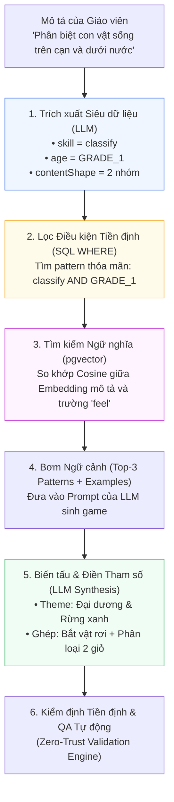

# Ngân Hàng Mẫu Cơ Chế Trò Chơi (Pattern Bank & RAG Retrieval)

> **Kiến trúc CPF (Luận điểm kỹ thuật 2/6)**: [[Mô tả ngoài danh mục game]] | [[00. Tổng quan vấn đề giáo viên mô tả ngoài danh mục game|Vấn đề OOD]] | [[Giải pháp cho vấn đề nếu như giáo viên gửi mô tả nằm ngoài cơ chế game hiện có|Giải pháp Tổng thể CPF]]

---

## 1. Ý tưởng Cốt lõi

Nếu chỉ đưa mô tả tự do của giáo viên cho LLM và yêu cầu *"hãy tạo game đi"*, mô hình sẽ sinh ra các tựa game ở mức trung bình, đơn điệu và na ná nhau (quanh quẩn trắc nghiệm bấm nút hoặc kéo thả thô sơ) vì thiếu một kho kinh nghiệm thiết kế game đáng tin cậy.

**Pattern Bank** là kho lưu trữ các công thức cơ chế trò chơi đã được kiểm chứng về mặt sư phạm và giải trí. Mỗi mục trong kho mô tả một cơ chế (ví dụ: *"Bắt vật rơi"*, *"Cân thăng bằng"*, *"Bắn bia"*) kèm siêu dữ liệu để máy tính hiểu: cơ chế đó dạy được kỹ năng gì, phù hợp độ tuổi nào và được lắp ghép từ những khối nguyên tử nào. 

AI không sáng tạo từ con số không mà sẽ thực hiện truy vấn kho, chọn công thức tối ưu, rồi biến tấu bối cảnh:
> Tương tự như **Design Patterns** trong kỹ nghệ phần mềm: Kỹ sư không phát minh lại mẫu *Observer* hay *Factory* mỗi lần viết code, mà chọn mẫu phù hợp nhất và áp dụng vào ngữ cảnh dự án.

---

## 2. Cấu trúc Dữ liệu của một Mục trong Pattern Bank

Mỗi Pattern được đặc tả dưới dạng một bản ghi có cấu trúc rõ ràng:

```json
{
  "id": "catch-falling",
  "name": "Bắt vật rơi",
  "feel": "Vật thể rơi từ trên xuống với gia tốc tự nhiên, người chơi di chuyển giỏ/khay để hứng đúng vật theo yêu cầu",
  "learningSkills": ["classify", "recognize", "count"],
  "ageBands": ["PRESCHOOL", "GRADE_1_2"],
  "fitsContentShape": "Một tập các phần tử thuộc 2-3 nhóm (đúng/sai hoặc phân loại thuộc tính)",
  "params": {
    "fallSpeed": [1, 3],
    "lanes": [2, 4],
    "lives": false
  },
  "kitPrimitives": ["spawner", "drag-x", "collision", "score", "sfx"],
  "antiPatterns": [
    "Không áp dụng đồng hồ đếm ngược với trẻ mầm non",
    "Không cho quá 3 vật rơi cùng một lúc gây quá tải nhận thức"
  ],
  "examples": ["game-hung-trai-cay.json"]
}
```

### Ý nghĩa của Các Trường Siêu dữ liệu:
- `learningSkills` & `ageBands`: Các nhãn phân loại phục vụ lọc điều kiện theo mục tiêu học tập và độ tuổi.
- `fitsContentShape`: Dạng cấu trúc kiến thức phù hợp, ngăn chặn việc gán sai (ví dụ: gán bài toán chia số có dư phức tạp vào game hứng đồ vật tốc độ cao).
- `params`: Không gian tham số mà LLM được phép tinh chỉnh, được giới hạn trong ngưỡng an toàn để Validator kiểm soát.
- `kitPrimitives`: Danh sách các khối nguyên tử dựng sẵn trong Game Kit, đảm bảo AI lắp ráp thành phần chứ không sinh lại logic va chạm hay kéo thả từ đầu.
- `antiPatterns`: Những cấm kỵ thiết kế mà AI bắt buộc phải né tránh.
- `examples`: Kịch bản game mẫu hoàn chỉnh dùng cho kỹ thuật Few-shot Prompting.

---

## 3. Cơ chế Truy hồi Thông tin (RAG Retrieval Workflow)

Quy trình xử lý khi giáo viên nhập yêu cầu: *"Game giúp bé lớp 1 phân biệt con vật sống trên cạn và con vật sống dưới nước"*:



> **Ưu điểm lớn nhất**: Tính sáng tạo của AI được gò bó trong một hành lang kỹ thuật an toàn. AI chỉ sáng tạo ở tầng *"chọn lựa, phối ghép và biên kịch"*, hoàn toàn không can thiệp vào tầng *"lập trình Engine đồ họa"*.

---

## 4. Bước Chuyển Dịch từ Template sang Composable Primitives

- **Hiện tại (Mức B - Template + Parameters)**: 10 loại game có sẵn (`QUIZ`, `MATCHING`, `MEMORY_CARD`...) tương ứng với 10 mẫu game nguyên khối.
- **Tiến hóa (Mức C - Composable Primitives)**: Pattern Bank không chỉ chứa các tựa game trọn vẹn mà chứa các vi cơ chế (*Micro-mechanics* như Spawner, Collector, Slider, Bubble-pop). Hệ thống có thể phối ghép $2$ vi cơ chế với nhau (ví dụ: *Bắt vật rơi* + *Bộ đếm mục tiêu* $\to$ *Hái đủ 5 quả táo vào giỏ*).

---

## 5. Giới hạn Kỹ thuật & Biện pháp Giảm thiểu

1. **Chất lượng truy hồi quyết định chất lượng đầu ra**: Nếu trích xuất sai nhãn, AI sẽ chọn nhầm cơ chế. Giải pháp là xây dựng bộ đánh giá gồm $30$ câu mô tả mẫu để kiểm tra tỷ lệ Top-3 Recall.
2. **Quy mô của Pattern Bank**: Cần tối thiểu $15$–$25$ patterns chất lượng cao để bao phủ tốt các yêu cầu học đường phổ thông mà không cần cơ sở dữ liệu vector đồ sộ.
3. **Nguy cơ xung đột khi ghép nối (Composition Conflicts)**: Việc tự do ghép 2 pattern có thể sinh ra logic mâu thuẫn. Hệ thống cần thiết lập ma trận tương thích giữa các Pattern (Compatibility Matrix) trước khi cho phép AI kết hợp.

---

## Liên kết Điều hướng 6 Luận điểm Kỹ thuật
1. [[Chuyên đề 1 - Thiết kế trước, viết code sau (GDD-First)|1. Thiết kế trước, viết code sau (GDD-First)]]
2. [[Chuyên đề 2 - Ngân hàng mẫu cơ chế trò chơi (Pattern Bank & RAG)|2. Ngân hàng Mẫu Cơ chế (Pattern Bank)]]
3. [[Chuyên đề 3 - Hồ sơ độ tuổi kiểm tra được bằng máy (Age Profiles)|3. Hồ sơ Độ tuổi Kiểm tra Được bằng Máy]]
4. [[Chuyên đề 4 - Nội dung kiểm chứng độc lập (Pedagogical Verification)|4. Nội dung Kiểm chứng Độc lập]]
5. [[Chuyên đề 5 - Kỹ thuật tạo sự hấp dẫn và game feel (Juiciness)|5. Kỹ thuật Hấp dẫn (Juiciness & Game Feel)]]
6. [[Chuyên đề 6 - Quy trình sinh nhiều bước & quản trị hồi quy (Multi-Step Pipeline)|6. Quy trình Sinh Nhiều Bước]]
