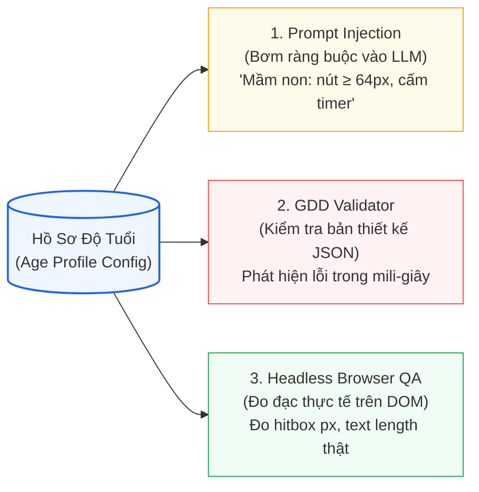

# Hồ Sơ Độ Tuổi Kiểm Tra Được Bằng Máy (Machine-Verifiable Age Profiles)

> **Kiến trúc CPF (Luận điểm kỹ thuật 3/6)**: [[Mô tả ngoài danh mục game]] | [[00. Tổng quan vấn đề giáo viên mô tả ngoài danh mục game|Vấn đề OOD]] | [[Giải pháp cho vấn đề nếu như giáo viên gửi mô tả nằm ngoài cơ chế game hiện có|Giải pháp Tổng thể CPF]]

---

## 1. Ý tưởng: Biến "Kinh nghiệm Sư phạm Trẻ em" Thành Dữ liệu Cấu hình

Một giáo viên mầm non dày dặn kinh nghiệm chỉ cần nhìn lướt qua một trò chơi là biết ngay: *"Game này không phù hợp với đứa trẻ 4 tuổi"*. Tuy nhiên, máy tính và các mô hình LLM không sở hữu trực giác tâm lý học tự nhiên đó.

**Hồ sơ Độ tuổi (Age Profile)** là giải pháp chuẩn hóa trực giác sư phạm thành dữ liệu có cấu trúc mà phần mềm có thể đọc, hiểu và tự động thực thi.
> Dưới góc độ kỹ nghệ phần mềm, đây là **Policy Configuration**: Mỗi cấp học sở hữu một bộ ràng buộc (Constraints), và Validator sẽ nạp chính sách tương ứng để ngăn chặn vi phạm hoặc phát cảnh báo. Các quy tắc nằm trong dữ liệu cấu hình thay vì viết cứng trong các câu lệnh `if/else`, giúp hệ thống linh hoạt cập nhật mà không phải biên dịch lại mã nguồn.

---

## 2. Cấu trúc của một Hồ sơ Độ tuổi (Age Profile Schema)

Dưới đây là đặc tả mẫu cấu hình cho hai lứa tuổi trọng tâm (Mầm non và Lớp 1–2):

```json
{
  "PRESCHOOL": {
    "ageRange": [3, 5],
    "reading": {
      "maxWordsPerScreen": 5,
      "requireVoiceOver": true,
      "textOnlyInstructions": "FORBIDDEN"
    },
    "input": {
      "minTouchTargetPx": 64,
      "allowedGestures": ["tap", "drag"],
      "forbidden": ["double-tap", "long-press", "precise-draw"]
    },
    "pacing": {
      "timer": "FORBIDDEN",
      "lives": "FORBIDDEN",
      "autoAdvanceMs": null,
      "maxSessionMinutes": 5
    },
    "failure": {
      "mode": "GENTLE_RETRY",
      "negativeSound": false,
      "showScoreLoss": false
    },
    "cognitive": {
      "maxChoicesPerQuestion": 3,
      "maxSimultaneousObjects": 5,
      "numberRange": [1, 10]
    }
  },
  "GRADE_1_2": {
    "ageRange": [6, 7],
    "reading": {
      "maxWordsPerScreen": 15,
      "requireVoiceOver": false
    },
    "input": {
      "minTouchTargetPx": 56,
      "forbidden": ["precise-draw"]
    },
    "pacing": {
      "timer": "OPTIONAL_GENTLE",
      "lives": "DISCOURAGED",
      "maxSessionMinutes": 10
    },
    "failure": {
      "mode": "RETRY_WITH_HINT",
      "negativeSound": false
    },
    "cognitive": {
      "maxChoicesPerQuestion": 4,
      "maxSimultaneousObjects": 8
    }
  }
}
```

### Bốn Trụ cột Ràng buộc Tâm sinh lý:
| Nhóm Ràng buộc | Câu hỏi Cốt lõi | Cơ sở Khoa học & Tâm lý Trẻ em |
| :--- | :--- | :--- |
| **`reading` (Đọc hiểu)** | Bé đọc được bao nhiêu chữ? | Trẻ mầm non chưa biết đọc thạo; hướng dẫn bắt buộc phải bằng hình ảnh trực quan và giọng đọc audio thuyết minh (`voiceOver`). |
| **`input` (Thao tác)** | Bé thao tác tay được những gì? | Cơ ngón tay nhỏ, kỹ năng vận động tinh chưa hoàn thiện; nút bấm phải lớn ($\ge 64\text{px}$), cử chỉ chạm/kéo đơn giản, cấm cử chỉ phức tạp. |
| **`pacing` & `failure` (Nhịp độ & Thất bại)** | Áp lực thời gian và phản ứng khi làm sai ra sao? | Đồng hồ đếm ngược và hình phạt trừ mạng dễ gây hoảng loạn, sợ hãi khiến trẻ bỏ chơi; cần cơ chế thử lại nhẹ nhàng (*Gentle Retry*). |
| **`cognitive` (Tải nhận thức)** | Bé xử lý được bao nhiêu đối tượng cùng lúc? | Dung lượng trí nhớ làm việc (*Working Memory*) còn non nớt; hiển thị quá nhiều lựa chọn hoặc quá nhiều vật thể chuyển động sẽ gây quá tải. |

---

## 3. Cách Thức Hoạt Động của Bộ Kiểm Định (Validator Engine)

```java
// Mã minh họa logic kiểm tra Age Profile trong Validator
AgeProfile profile = AgeProfileRegistry.get(gdd.getAudience().getGradeLevel());

// Kiểm tra áp lực thời gian (Timer)
if (profile.getPacing().getTimer() == PolicyConstraint.FORBIDDEN && gdd.getFailureHandling().hasTimer()) {
    return ValidationResult.error("timer", "Cấp học " + gradeLevel + " bị cấm dùng đồng hồ đếm ngược gây áp lực tâm lý.");
}

// Kiểm tra kích thước nút bấm cảm ứng (Hitbox Target)
if (gdd.getAgeConstraints().getMinTouchTargetPx() < profile.getInput().getMinTouchTargetPx()) {
    return ValidationResult.error("touchTarget", "Kích thước vùng chạm tối thiểu phải >= " + profile.getInput().getMinTouchTargetPx() + "px.");
}

// Kiểm tra tải nhận thức (Cognitive Load)
if (gdd.getContent().getChoicesPerQuestion() > profile.getCognitive().getMaxChoicesPerQuestion()) {
    return ValidationResult.warning("choices", "Số lượng lựa chọn (" + gdd.getContent().getChoicesPerQuestion() + ") vượt mức tối ưu cho độ tuổi.");
}

// Kiểm tra thuyết minh âm thanh (Voice-over)
if (profile.getReading().isRequireVoiceOver() && !gdd.getFeedback().hasVoiceOver()) {
    return ValidationResult.error("voiceOver", "Lứa tuổi mầm non bắt buộc phải có thuyết minh âm thanh cho mọi câu lệnh.");
}
```

### Phân cấp Mức độ Xử lý:
- **Mức ERROR (Chặn đứng)**: Vi phạm nghiêm trọng về an toàn tâm lý hoặc khả năng thao tác (ví dụ: mầm non có đồng hồ đếm ngược, nút bấm $< 48\text{px}$, không có giọng đọc). Bắt buộc phải quay lại vòng sửa chữa (*Repair Loop*).
- **Mức WARNING (Cảnh báo)**: Vi phạm mang tính khuyến nghị sư phạm (ví dụ: số lượng lựa chọn hơi nhiều). Hệ thống cho phép giáo viên quyết định giữ lại hoặc tự động điều chỉnh.

---

## 4. Hồ Sơ Được Thực Thi Tại Ba Chốt Chặn Kiến Trúc



1. **Chốt 1 - Prompt Injection**: Bơm trực tiếp các tham số ràng buộc vào ngữ cảnh sinh của LLM để AI thiết kế đúng ngay từ đầu, giảm tối đa số vòng sửa đổi.
2. **Chốt 2 - GDD Validator**: Kiểm tra tĩnh trên bản thiết kế JSON trong vài mili-giây trước khi tốn tài nguyên render mã.
3. **Chốt 3 - Headless QA (Playwright)**: Đo đạc kích thước thực tế của phần tử DOM trên trình duyệt ảo (bởi vì AI có thể khai báo nút $64\text{px}$ nhưng CSS render ra thực tế chỉ có $32\text{px}$).

---

## 5. Nguồn Gốc và Tính Minh Bạch của Dữ Liệu (Evidence-based Design)

Để bảo vệ thuyết phục trước Hội đồng Đồ án, mỗi quy tắc trong Age Profile cần được gắn kèm nhãn xuất xứ:
- **Tiêu chuẩn Giao diện Quốc tế**: Khuyến nghị kích thước vùng chạm từ **WCAG 2.1**, **Apple Human Interface Guidelines (HIG)**, và **Google Material Design** (tối thiểu $44$–$48\text{px}$, với trẻ nhỏ nâng lên $56$–$64\text{px}$).
- **Chương trình Giáo dục Chuẩn mực**: Mục tiêu năng lực Toán/Tiếng Việt đối chiếu trực tiếp theo **Thông tư 32/2018/TT-BGDĐT** (GDPT 2018) và **Chương trình Giáo dục Mầm non** của Bộ GD&ĐT.
- **Tính Minh Bạch Học Thuật**: Mỗi rule trong hệ thống cấu hình có trường `source` (nguồn tài liệu) và `confidence` (độ tin cậy kiểm chứng).

---

## Liên kết Điều hướng 6 Luận điểm Kỹ thuật
1. [[Chuyên đề 1 - Thiết kế trước, viết code sau (GDD-First)|1. Thiết kế trước, viết code sau (GDD-First)]]
2. [[Chuyên đề 2 - Ngân hàng mẫu cơ chế trò chơi (Pattern Bank & RAG)|2. Ngân hàng Mẫu Cơ chế (Pattern Bank)]]
3. [[Chuyên đề 3 - Hồ sơ độ tuổi kiểm tra được bằng máy (Age Profiles)|3. Hồ sơ Độ tuổi Kiểm tra Được bằng Máy]]
4. [[Chuyên đề 4 - Nội dung kiểm chứng độc lập (Pedagogical Verification)|4. Nội dung Kiểm chứng Độc lập]]
5. [[Chuyên đề 5 - Kỹ thuật tạo sự hấp dẫn và game feel (Juiciness)|5. Kỹ thuật Hấp dẫn (Juiciness & Game Feel)]]
6. [[Chuyên đề 6 - Quy trình sinh nhiều bước & quản trị hồi quy (Multi-Step Pipeline)|6. Quy trình Sinh Nhiều Bước]]
