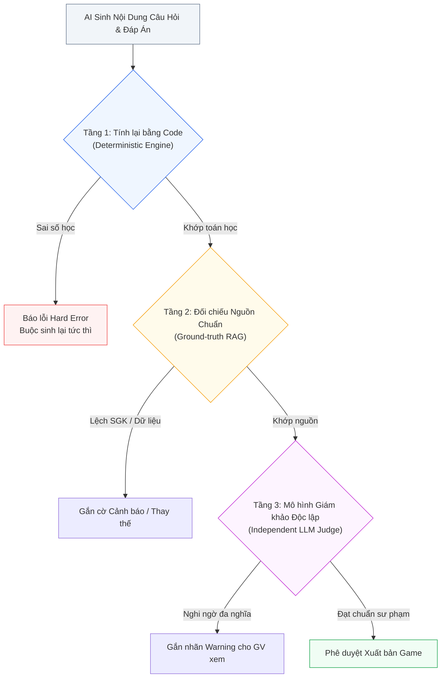

# Nội Dung Kiểm Chứng Độc Lập (Independent Pedagogical Verification)

> **Kiến trúc CPF (Luận điểm kỹ thuật 4/6)**: [[Mô tả ngoài danh mục game]] | [[00. Tổng quan vấn đề giáo viên mô tả ngoài danh mục game|Vấn đề OOD]] | [[Giải pháp cho vấn đề nếu như giáo viên gửi mô tả nằm ngoài cơ chế game hiện có|Giải pháp Tổng thể CPF]]

---

## 1. Vấn Đề Cốt Lõi: Nguy Cơ Từ Sự Tự Tin Sai Lệch của LLM

Các mô hình Ngôn ngữ Lớn (LLM) có khả năng sinh văn bản cực kỳ trôi chảy, thuyết phục nhưng lại có thể mắc các lỗi sai cơ bản mà vẫn hoàn toàn "tự tin". Trong bối cảnh phần mềm giáo dục mầm non và tiểu học, một **đáp án sai** nghiêm trọng hơn nhiều so với một lỗi giao diện:
- Trẻ nhỏ tiếp thu và ghi nhớ rất lâu những kiến thức sai lệch ban đầu.
- Giáo viên sẽ lập tức mất niềm tin vào toàn bộ nền tảng nếu phát hiện lỗi sai kiến thức.
- Lỗi này rất khó phát hiện bằng mắt thường: Giao diện game vẫn vận hành mượt mà, hoạt họa bắt mắt, chỉ có đáp án là sai bản chất.

> **Nguyên tắc Kỹ nghệ Phần mềm**: *Tuyệt đối không để cùng một thành phần vừa sinh ra dữ liệu vừa tự chấm điểm dữ liệu đó* (tương tự như nguyên lý người viết code không thể là người duy nhất duyệt Pull Request của chính mình). "Độc lập" đồng nghĩa với việc cơ chế kiểm tra phải sử dụng một phương pháp hoặc công cụ hoàn toàn tách biệt với mô hình sinh nội dung.

---

## 2. Ba Tầng Kiểm Chứng Độc Lập



### 2.1. Tầng 1: Tính Lại Bằng Code Tiền Định (Deterministic Code Verification)
LLM không thực hiện phép tính số học, nó chỉ dự đoán token số có xác suất xuất hiện cao. Ngược lại, máy tính tính toán chính xác $100\%$:
- **Ví dụ**: AI sinh bài toán: *"Một lớp có 500 học sinh, có 425 em đạt loại khá giỏi. Tỷ lệ là bao nhiêu?"* kèm đáp án `"85%"`.

```java
// Mã kiểm định số học độc lập trong Backend Spring Boot
public class ArithmeticVerifier implements ContentVerifier {
    public ValidationResult verifyPercentage(int total, int subset, double claimedAnswer) {
        double expected = ((double) subset / total) * 100.0;
        if (Math.abs(expected - claimedAnswer) > 0.001) {
            return ValidationResult.error("MATH_MISMATCH", 
                String.format("Đáp án AI khai báo là %.2f%% nhưng tính toán độc lập ra %.2f%%", claimedAnswer, expected));
        }
        return ValidationResult.ok();
    }
}
```
> **Đặc tính**: Chạy trong mili-giây, chi phí $\mathcal{O}(0)$ token LLM, và có thể bao phủ hoàn toàn bằng Unit Test. Áp dụng cho phép tính cộng trừ nhân chia, đếm số lượng, so sánh lớn bé, sắp xếp thứ tự và kiểm tra chính tả regex.

### 2.2. Tầng 2: Đối Chiếu Cơ Sở Tri Thức Chuẩn (Ground-truth Verification)
Với kiến thức tĩnh đã được đóng băng trong chương trình giáo dục:
- Danh mục từ vựng, quy tắc chính tả trích xuất từ **Sách Giáo khoa chuẩn**.
- Danh mục bảng tuần hoàn, địa danh hành chính, đặc tính sinh học của động vật trích xuất từ cơ sở dữ liệu đã kiểm duyệt.
- Hệ thống so khớp trực tiếp kết quả với dữ liệu chuẩn thay vì hỏi lại LLM.

### 2.3. Tầng 3: Mô Hình Giám Khảo Độc Lập (Independent LLM as a Judge)
Với các câu hỏi mở, ngữ cảnh ngôn ngữ hoặc kiến thức xã hội:
- Sử dụng một LLM độc lập (khác dòng model hoặc prompt thẩm định riêng biệt) đóng vai trò giám khảo.
- **Quy tắc vàng**: Không cung cấp phần suy luận (Chain-of-Thought) của model sinh cho model giám sát, nhằm tránh hiện tượng "lây nhiễm thiên kiến" (*Bias Confirmation*).

---

## 3. Ma Trận Chiến Lược Kiểm Chứng Theo Loại Nội Dung

| Loại Nội dung Bài học | Phương pháp Kiểm chứng Độc lập | Độ Tin cậy Kỹ thuật | Hành động Hệ thống |
| :--- | :--- | :---: | :--- |
| **Toán học, số đếm, so sánh** | Tính toán lại $100\%$ bằng code tiền định | **Tuyệt đối (100%)** | **Hard Error**: Chặn xuất bản và buộc sinh lại |
| **Quy tắc chính tả, ngữ pháp** | Regex kết hợp từ điển tiếng Việt chuẩn | **Rất cao (>98%)** | **Hard Error**: Sửa lỗi tự động hoặc chặn |
| **Kiến thức khoa học thường thức** | Đối chiếu kho tri thức tĩnh (Knowledge Base) | **Cao (>95%)** | Gắn cờ cảnh báo nếu không tìm thấy nguồn |
| **Đọc hiểu & Kiến thức xã hội** | LLM Giám khảo độc lập với rubric chuẩn | **Trung bình (85-90%)** | Đưa ra cảnh báo (Warning) cho giáo viên |
| **Nội dung đạo đức, ứng xử** | Giáo viên duyệt trực tiếp trên giao diện | **Phụ thuộc con người** | Giáo viên là chốt chặn quyết định cuối cùng |

---

## 4. Giá Trị Thực Nghiệm Đo Đạc Cho Báo Cáo KLTN/TLCN

Cơ chế kiểm chứng độc lập cung cấp cho đồ án chỉ số định lượng thuyết phục:
$$\text{Error Reduction Rate} = \frac{\text{Lỗi phát hiện và chặn đứng}}{\text{Tổng số câu hỏi sinh ra}} \times 100\%$$

> **Bằng chứng thực nghiệm**: Nhóm có thể công bố số liệu rõ ràng trong Chương 4 của báo cáo: *"Trong 200 câu hỏi toán học ngẫu nhiên do LLM sinh ra, hệ thống phát hiện 14 câu sai lệch đáp án ở bước tiền kiểm; qua bộ lọc ArithmeticVerifier, tỷ lệ đáp án sai lọt tới học sinh giảm về đúng 0%"*.

---

## Liên kết Điều hướng 6 Luận điểm Kỹ thuật
1. [[Chuyên đề 1 - Thiết kế trước, viết code sau (GDD-First)|1. Thiết kế trước, viết code sau (GDD-First)]]
2. [[Chuyên đề 2 - Ngân hàng mẫu cơ chế trò chơi (Pattern Bank & RAG)|2. Ngân hàng Mẫu Cơ chế (Pattern Bank)]]
3. [[Chuyên đề 3 - Hồ sơ độ tuổi kiểm tra được bằng máy (Age Profiles)|3. Hồ sơ Độ tuổi Kiểm tra Được bằng Máy]]
4. [[Chuyên đề 4 - Nội dung kiểm chứng độc lập (Pedagogical Verification)|4. Nội dung Kiểm chứng Độc lập]]
5. [[Chuyên đề 5 - Kỹ thuật tạo sự hấp dẫn và game feel (Juiciness)|5. Kỹ thuật Hấp dẫn (Juiciness & Game Feel)]]
6. [[Chuyên đề 6 - Quy trình sinh nhiều bước & quản trị hồi quy (Multi-Step Pipeline)|6. Quy trình Sinh Nhiều Bước]]
