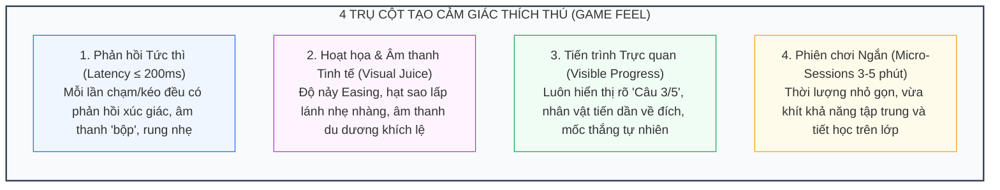

# Kỹ Thuật Hấp Dẫn & Tâm Lý Học Trẻ Em (Game Feel & Juiciness)

> **Kiến trúc CPF (Luận điểm kỹ thuật 5/6)**: [[Mô tả ngoài danh mục game]] | [[00. Tổng quan vấn đề giáo viên mô tả ngoài danh mục game|Vấn đề OOD]] | [[Giải pháp cho vấn đề nếu như giáo viên gửi mô tả nằm ngoài cơ chế game hiện có|Giải pháp Tổng thể CPF]]

---

## 1. Bản Chất Vấn Đề: Phân Biệt "Hấp Dẫn" và "Gây Nghiện"

Một trò chơi giáo dục dù đúng kiến thức và phù hợp lứa tuổi vẫn có thể thất bại nếu thiếu đi cảm giác thích thú: Trẻ chỉ chơi đúng một lần rồi chán nản bỏ cuộc. Ngược lại, nếu lạm dụng các thủ thuật tâm lý tiêu cực, game sẽ biến thành công cụ gây hại cho sức khỏe tinh thần của trẻ nhỏ.

Hệ thống phân biệt rạch ròi hai khái niệm:
- **Hấp dẫn Lành mạnh (Engaging / Game Feel)**: Trẻ cảm thấy vui vẻ, tự hào vì vượt qua thử thách (*Self-efficacy*), muốn tiếp tục khám phá vì trí tò mò và cảm giác làm chủ kiến thức.
- **Gây nghiện Cưỡng chế (Compulsive / Dark Patterns)**: Trẻ bị cuốn vào vòng xoáy tâm lý sợ mất mát (*FOMO*), bị phụ thuộc vào các phần thưởng ngẫu nhiên mang tính cờ bạc, hoặc áp lực từ sự so sánh xã hội.

---

## 2. Bốn Trụ Cột Tạo Độ Hấp Dẫn Tự Nhiên (Juiciness)



1. **Phản hồi Tức thì (Immediate Feedback)**: Mỗi hành động chạm hoặc kéo thả phải có phản hồi thị giác và thính giác trong vòng $\le 200\text{ms}$. Nếu độ trễ cao, trẻ mầm non sẽ tưởng máy bị đơ, dẫn tới việc bấm liên tục hoặc bỏ cuộc.
2. **Kỹ xảo & Âm thanh Tinh tế ("Juice")**: Chuyển động mượt mà với các hàm Easing nảy nhẹ (`easeOutBack`), 20–30 hạt sao vàng bay lên khi đúng, âm thanh vui tươi ngắn gọn. Tuyệt đối không dùng đèn chớp giật liên tục hoặc âm lượng chói tai.
3. **Tiến trình Rõ ràng (Visible Progress)**: Luôn cho trẻ biết rõ vị trí của mình (ví dụ: *"Câu 3/5"* hoặc nhân vật bước lên từng bậc thang) để tạo cảm giác tự tin và kiểm soát mục tiêu.
4. **Phiên chơi Ngắn gọn (Micro-Sessions)**: Mỗi ván chơi chỉ kéo dài từ $3$–$5$ phút, có điểm dừng tự nhiên, phù hợp với tâm lý lứa tuổi và thời lượng phân bổ của giáo viên trong một tiết học.

---

## 3. Bảng Kiểm Tra Chặn Cơ Chế Độc Hại (Dark Patterns Checklist)

Hệ thống đặt ra câu hỏi kiểm định cốt lõi: *"Cơ chế này giúp trẻ em học tập vui vẻ hơn, hay chỉ nhằm mục đích giữ chân trẻ trước màn hình?"*. Nếu là vế sau, hệ thống sẽ loại bỏ:

| Cơ chế Độc hại | Tác hại Đối với Tâm lý Trẻ em | Biện pháp Xử lý của Hệ thống |
| :--- | :--- | :--- |
| **Đồng hồ đếm ngược áp lực** | Gây hoảng loạn tâm lý, trẻ đoán bừa đáp án để kịp giờ thay vì tư duy | Cấm tuyệt đối ở Mầm non; chỉ áp dụng đếm xuôi không phạt ở Tiểu học |
| **Trừ mạng sống (Lives / Hearts)** | Khiến trẻ sợ hãi cảm giác thất bại, ngại thử nghiệm và ghét môn học | Thay bằng cơ chế thử lại nhẹ nhàng (*Gentle Retry with Hints*) |
| **Chuỗi ngày chơi liên tục (Streaks)** | Tạo cảm giác lo âu, cảm giác bị ép buộc vì sợ đứt chuỗi | Loại bỏ hoàn toàn khỏi mô hình trò chơi học đường |
| **Hộp quà ngẫu nhiên (Loot Boxes)** | Cơ chế tâm lý tương tự cờ bạc, dễ gây nghiện cưỡng chế | Thay bằng phần thưởng cố định dựa trên sự nỗ lực (Sticker, Huy hiệu) |
| **Âm thanh chê bai gay gắt** | Làm tổn thương sự tự tin của trẻ khi trả lời chưa chính xác | Thay bằng âm thanh tò mò nhẹ nhàng khích lệ thử lại |
| **Bảng xếp hạng công khai (Public Shame)**| Gây mặc cảm tự ti cho các học sinh tiếp thu chậm hơn trong lớp | Chỉ hiển thị kết quả cá nhân khích lệ sự tiến bộ của chính bản thân trẻ |

---

## 4. Chuẩn Hóa Cấu Hình Kiểm Định Tự Động Bằng Máy

Toàn bộ nguyên lý trên được quy ước thành JSON Policy để Validator kiểm tra tự động:

```json
{
  "engagementPolicy": {
    "feedbackLatencyMs": { "max": 200 },
    "everyActionHasFeedback": true,
    "progressIndicator": "REQUIRED",
    "maxSessionMinutes": 5,
    "flashingHz": { "max": 2 },
    "audio": {
      "mutable": true,
      "negativeSoundOnWrong": false
    },
    "forbiddenMechanics": [
      "streak-loss",
      "loot-box",
      "punitive-lives",
      "public-shame-leaderboard",
      "auto-next-round",
      "push-reminder"
    ]
  }
}
```

### Ba Chốt Chặn Kiểm Tra Kỹ thuật:
- **Tầng Thiết kế GDD**: Nếu AI tự ý cấu hình bất kỳ mục nào trong danh sách `forbiddenMechanics`, Validator sẽ báo lỗi vi phạm chính sách bảo vệ trẻ em.
- **Tầng Game Kit**: Các component dựng sẵn (Hiệu ứng sao rơi, Thanh tiến trình, Thư viện Web Audio) được cấu hình cố định ở mức nhã nhặn, dịu mắt.
- **Tầng QA Tự động (Playwright)**: Đo lường độ trễ phản hồi thao tác click/touch, đếm tần số nhấp nháy màn hình (đảm bảo $\le 2\text{ Hz}$ theo chuẩn y khoa chống động kinh quang học), và kiểm tra tính năng tắt/mở âm thanh.

---

## Liên kết Điều hướng 6 Luận điểm Kỹ thuật
1. [[Chuyên đề 1 - Thiết kế trước, viết code sau (GDD-First)|1. Thiết kế trước, viết code sau (GDD-First)]]
2. [[Chuyên đề 2 - Ngân hàng mẫu cơ chế trò chơi (Pattern Bank & RAG)|2. Ngân hàng Mẫu Cơ chế (Pattern Bank)]]
3. [[Chuyên đề 3 - Hồ sơ độ tuổi kiểm tra được bằng máy (Age Profiles)|3. Hồ sơ Độ tuổi Kiểm tra Được bằng Máy]]
4. [[Chuyên đề 4 - Nội dung kiểm chứng độc lập (Pedagogical Verification)|4. Nội dung Kiểm chứng Độc lập]]
5. [[Chuyên đề 5 - Kỹ thuật tạo sự hấp dẫn và game feel (Juiciness)|5. Kỹ thuật Hấp dẫn (Juiciness & Game Feel)]]
6. [[Chuyên đề 6 - Quy trình sinh nhiều bước & quản trị hồi quy (Multi-Step Pipeline)|6. Quy trình Sinh Nhiều Bước]]
