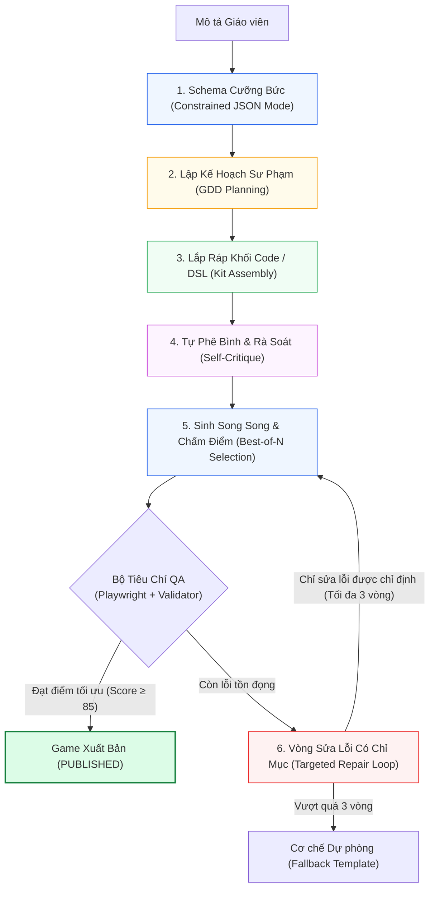

# Quy Trình Sinh Nhiều Bước & Quản Trị Hồi Quy (Multi-Step Pipeline & Best-of-N)

> **Kiến trúc CPF (Luận điểm kỹ thuật 6/6)**: [[Mô tả ngoài danh mục game]] | [[00. Tổng quan vấn đề giáo viên mô tả ngoài danh mục game|Vấn đề OOD]] | [[Giải pháp cho vấn đề nếu như giáo viên gửi mô tả nằm ngoài cơ chế game hiện có|Giải pháp Tổng thể CPF]]

---

## 1. Ý Tưởng Chung: Phân Rã Đường Ống (Pipeline Decomposition)

Trong kỹ nghệ sinh mã AI, tuyệt đối **không bắt LLM thực hiện toàn bộ tác vụ khổng lồ trong một lời gọi duy nhất** (*"Từ mô tả tự do của giáo viên sinh thẳng ra game HTML5 hoàn chỉnh"*). Cách làm này biến LLM thành một hộp đen không thể kiểm soát, khi xảy ra lỗi sẽ không biết gãy ở khâu nào.

Giải pháp chuẩn mực là chia nhỏ bài toán thành một **Đường ống (Pipeline) nhiều bước độc lập**, mỗi bước có đầu vào (Input), đầu ra (Output) và khế ước kiểm tra (Validation Contract) riêng biệt:
> Tương tự như trong kỹ nghệ phần mềm: Ta không bao giờ viết một hàm `main()` nguyên khối dài 2000 dòng, mà phân tách thành các module chuyên trách để dễ dàng Unit Test và cô lập điểm lỗi.

---

## 2. Kiến Trúc 6 Bước của Quy Trình Sinh Game



### Chi Tiết Từng Bước Kỹ Thuật:

1. **Bước 1 - Schema Cưỡng Bức (Constrained Structured Output)**: Sử dụng cơ chế JSON Schema Decoding ở tầng suy luận của LLM API. Ngăn chặn triệt để lỗi cú pháp, thiếu trường hay sai kiểu dữ liệu ngay từ tầng sinh token.
2. **Bước 2 - Lập Kế Hoạch Sư Phạm (GDD Planning)**: Sinh bản thiết kế GDD ngắn gọn ($\sim 40$ dòng JSON) và kiểm định qua bộ luật độ tuổi, tính nhất quán trước khi sinh code. Sửa lỗi ở bước này chỉ mất vài mili-giây.
3. **Bước 3 - Lắp Ráp Khối Code (Assembly from Game Kit)**: LLM đóng vai trò ghép nối các Primitives dựng sẵn trong Game Kit thay vì viết lại từ đầu logic va chạm, vật lý hay quản lý bộ nhớ.
4. **Bước 4 - Tự Phê Bình (Self-Critique Pass)**: Sử dụng một prompt thẩm tra nhanh với checklist chuyên biệt: *"Chữ có bị tràn nút không? Tỷ lệ tương phản có đạt chuẩn? Có xuất hiện timer ở cấp mầm non không?"*.
5. **Bước 5 - Sinh N Biến Thể & Chọn Bản Tối Ưu (Best-of-N Candidate Selection)**:
   - Sinh đồng thời $N=3$ hoặc $N=4$ ứng viên game song song.
   - Chạy Headless QA tự động kiểm tra: Không lỗi Console, hitbox cảm ứng $\ge 48\text{px}$, không che khuất chữ, FPS $\ge 50$.

```java
// Logic chấm điểm và chọn ứng viên tốt nhất trong Backend
List<GameCandidate> candidates = parallelGenerator.generateCandidates(spec, 4);
candidates.forEach(candidate -> {
    candidate.setScore(headlessQaWorker.evaluate(candidate));
});
GameCandidate bestCandidate = candidates.stream()
    .max(Comparator.comparingInt(GameCandidate::getScore))
    .orElseThrow();
```

6. **Bước 6 - Vòng Sửa Lỗi Có Chỉ Mục (Targeted Repair Loop)**:
   - Không bắt AI sinh lại từ đầu (vừa tốn tiền vừa dễ sinh lỗi mới ở chỗ khác).
   - Đưa thông báo lỗi chính xác kèm tọa độ: *"Lỗi: Nút 'Bắt đầu' bị tràn ra ngoài khung 360x640 khoảng 24px. Hãy giữ nguyên toàn bộ logic game, chỉ điều chỉnh tọa độ Y của nút."*.
   - Khống chế tối đa $3$ vòng sửa. Nếu không đạt thì kích hoạt Fallback an toàn.

---

## 3. Bộ Kiểm Thử Hồi Quy (Golden Prompts Suite)

Mọi hệ thống sử dụng LLM đều đối mặt với rủi ro hồi quy (*Regression Risk*): Khi kỹ sư sửa một câu prompt để giải quyết một ca lỗi đặc biệt, nó có thể âm thầm làm hỏng 5 ca sử dụng khác mà không ai hay biết.

Hệ thống thiết lập bộ **Golden Prompts** ($30$–$50$ đề bài chuẩn mực) đóng vai trò như bộ Regression Test trong CI/CD:
- Bao phủ đủ các khối lớp: Mầm non, Lớp 1–2, Lớp 3–5.
- Bao phủ đủ môn học: Toán, Tiếng Việt, Tiếng Anh, Tự nhiên & Xã hội.
- Bao phủ các mức độ mô tả: Rõ ràng, sơ sài, mơ hồ, và cả các ca cố tình nhập nội dung vi phạm sư phạm.
- Mỗi khi nâng cấp Prompt Template, Model hoặc Game Kit, hệ thống tự động chạy lại toàn bộ Golden Suite và đo đạc tỷ lệ vượt qua:

$$\text{Pass Rate} = \frac{\text{Số ca qua 100\% tiêu chí QA}}{\text{Tổng số ca trong Golden Suite}} \times 100\%$$

---

## 4. Minh Họa Hiệu Suất Thời Gian của Đường Ống

| Bước Xử lý | Kết quả Đạt được | Thời gian Ước tính |
| :--- | :--- | :---: |
| **Bước 2: GDD Planning** | GDD JSON hợp lệ, tự động sửa 1 lỗi timer | $\sim 4$ – $6$ giây |
| **Bước 3 & 5: Sinh 4 biến thể** | Sinh song song 4 ứng viên, điểm số: 62, 71, 48, 80 | $\sim 25$ – $30$ giây |
| **Bước 6: Targeted Repair** | Nhận lỗi tràn nút của bản 80, sửa thành công $\to$ 95 điểm | $\sim 10$ – $12$ giây |
| **Tổng Thời Gian Toàn Luồng** | **Game hoàn chỉnh, an toàn, đã qua kiểm định QA** | **$\sim 45$ – $50$ giây** |

> Thời lượng này hoàn toàn nằm trong ngưỡng chờ đợi chấp nhận được của giáo viên ($30$–$60$ giây), được thể hiện qua thanh tiến trình sinh động trên giao diện React.

---

## Liên kết Điều hướng 6 Luận điểm Kỹ thuật
1. [[Chuyên đề 1 - Thiết kế trước, viết code sau (GDD-First)|1. Thiết kế trước, viết code sau (GDD-First)]]
2. [[Chuyên đề 2 - Ngân hàng mẫu cơ chế trò chơi (Pattern Bank & RAG)|2. Ngân hàng Mẫu Cơ chế (Pattern Bank)]]
3. [[Chuyên đề 3 - Hồ sơ độ tuổi kiểm tra được bằng máy (Age Profiles)|3. Hồ sơ Độ tuổi Kiểm tra Được bằng Máy]]
4. [[Chuyên đề 4 - Nội dung kiểm chứng độc lập (Pedagogical Verification)|4. Nội dung Kiểm chứng Độc lập]]
5. [[Chuyên đề 5 - Kỹ thuật tạo sự hấp dẫn và game feel (Juiciness)|5. Kỹ thuật Hấp dẫn (Juiciness & Game Feel)]]
6. [[Chuyên đề 6 - Quy trình sinh nhiều bước & quản trị hồi quy (Multi-Step Pipeline)|6. Quy trình Sinh Nhiều Bước]]
