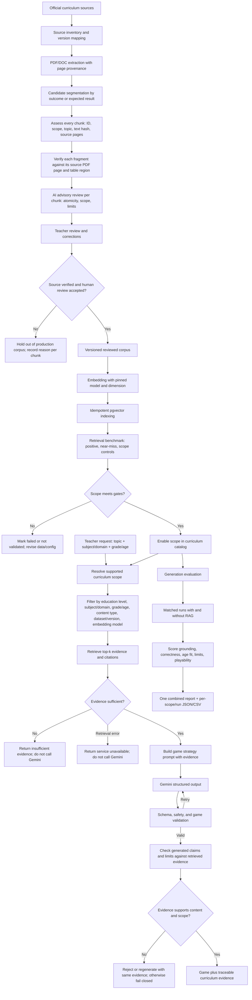

# Curriculum RAG flow

**Current spike position (2026-10-12):** target denominator is 15 primary scopes; source extraction, 558/558 chunk provenance, and 558/558 Supabase vectors are complete. Reingest wrote 0 and skipped all 558. Exploratory retrieval ran on 8/15 scopes: 80/80 positive Hit@3, 19/24 negative rejection, 5 false acceptances, 33/33 controls excluded and zero leakage; the aggregate gate FAILS. Seven scopes remain NOT_RUN after Gemini's 1,000-request daily embedding quota was exhausted. Independent holdout is still only MATH G1–G3 and all three FAIL; calibration is NOT_RUN. Semantic/pedagogical chunk review, live claim-checker review, teacher review and production end-to-end generation across the 15 scopes remain NOT_RUN/PENDING. Strategy comparison remains Math G1 level: 6 paired outputs, 4 provider errors. See the consolidated report and linked JSON/CSV evidence.

## Ready-to-post team summary

> Flow triển khai hiện tại: nguồn chính thức → extract theo trang → chunk theo yêu cầu cần đạt → lưu ID/scope/topic/hash/trang → đối chiếu text hoặc transcription với ảnh → ingest pgvector idempotent → benchmark theo scope. Corpus 15/15 và vector 558/558 đã sẵn sàng. Retrieval exploratory chỉ 8/15 do quota; 7 scope NOT_RUN, kết quả tổng thể FAIL vì false acceptance. Holdout ba scope đều FAIL nên chưa có cơ sở gọi cả hệ thống đạt ngưỡng. Khi sinh game: subject/lớp/topic → filter bắt buộc → retrieval kèm nguồn → evidence check → prompt strategy + context → Gemini structured output → schema/safety validation → advisory claim review. Live generation E2E, live claim-checker review, cảnh báo trên UI và teacher review vẫn NOT_RUN/PENDING. Kết quả so sánh có/không RAG còn ở strategy level. Xem báo cáo tổng hợp và liên kết JSON/CSV để biết từng scope/run.

