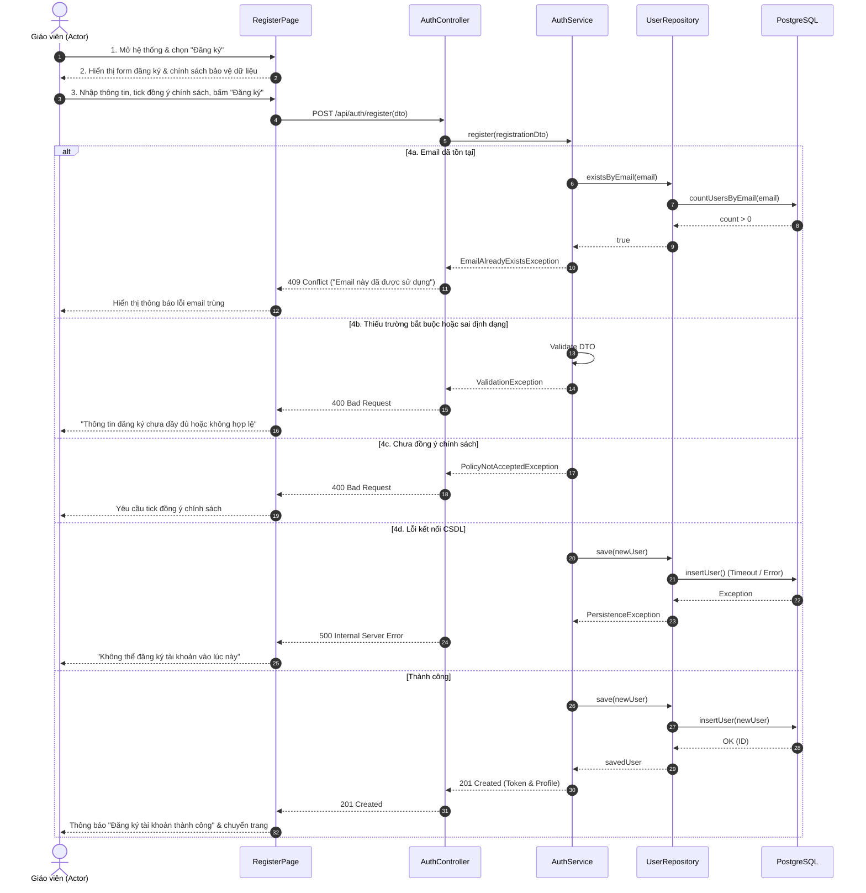

# 4.2.1. Đặc tả Ca sử dụng UC-01: Đăng ký

> **Điều hướng SRS**: [[srs/README|Mục lục SRS]] | [[Ca sử dụng|Tóm tắt 18 UC]]

| Mã & Tên Ca sử dụng | UC-01: Đăng ký |
| --- | --- |
| Tác nhân chính | Giáo viên |
| Purpose | Cho phép Actor tạo tài khoản mới và đăng nhập xác thực an toàn vào hệ thống. |
| Tiền điều kiện (Pre-conditions) | Actor chưa có tài khoản trên hệ thống. |
| Hậu điều kiện (Post-conditions) | Tài khoản Actor mới được tạo thành công. Thông tin đăng ký của Actor được lưu lại. Actor có thể sử dụng tài khoản vừa tạo để đăng nhập vào hệ thống. |
| Luồng sự kiện chính (Main Flow) | 1. Actor mở hệ thống và chọn chức năng Đăng ký. 2. Hệ thống hiển thị biểu mẫu đăng ký và chính sách bảo vệ dữ liệu cá nhân. 3. Actor nhập họ tên, email, mật khẩu (từ 8 đến 72 ký tự, gồm chữ hoa, chữ thường, số và ký tự đặc biệt), trường/đơn vị công tác (không bắt buộc), xác nhận đã đọc và đồng ý với chính sách bảo vệ dữ liệu cá nhân, sau đó chọn Đăng ký. 4. Hệ thống kiểm tra thông tin, tạo tài khoản mới, lưu thông tin giáo viên và hiển thị thông báo: "Đăng ký tài khoản thành công." |
| Luồng rẽ nhánh (Alternative Flows) | None. |
| Luồng ngoại lệ (Exception Flows) | 4a. Email đã được sử dụng: 1. Tại bước 4, hệ thống phát hiện email đã được đăng ký cho một tài khoản khác. 2. Hệ thống thông báo: "Email này đã được sử dụng. Vui lòng sử dụng email khác." 3. Quay lại bước 3 của Main Flow. 4b. Thông tin đăng ký chưa đầy đủ hoặc không hợp lệ: 1. Tại bước 4, hệ thống phát hiện một hoặc nhiều thông tin bắt buộc còn thiếu hoặc không hợp lệ. 2. Hệ thống thông báo "Thông tin đăng ký chưa đầy đủ hoặc không hợp lệ. Vui lòng kiểm tra và nhập lại." 3. Quay lại bước 3 của Main Flow. 4c. Giáo viên chưa đồng ý với chính sách bảo vệ dữ liệu: 1. Tại bước 4, hệ thống phát hiện Actor chưa xác nhận đồng ý với chính sách bảo vệ dữ liệu cá nhân. 2. Hệ thống yêu cầu Actor đọc và xác nhận đồng ý trước khi tiếp tục đăng ký. 3. Quay lại bước 3 của Main Flow. 4d. Hệ thống gặp sự cố: 1. Tại bước 4, hệ thống không thể hoàn tất việc tạo tài khoản. 2. Hệ thống thông báo: "Không thể đăng ký tài khoản vào lúc này. Vui lòng thử lại sau." 3. Actor có thể thử lại đăng ký sau khi hệ thống khắc phục sự cố. |

## Sơ đồ Tuần tự (Sequence Diagram)

---

## Liên kết Nghiệp vụ
- **Ca sử dụng kế trước**: [[UC-15]]
- **Ca sử dụng kế tiếp**: [[UC-16]], [[UC-02]]
- **Yêu cầu chức năng**: Xem phân rã tại [[FR-summary]]
- **Từ điển dữ liệu liên quan**: Xem cấu trúc trường tại [[FLD]]
- **Đặc tả SRS tổng thể**: [[srs/SRS-full]]
