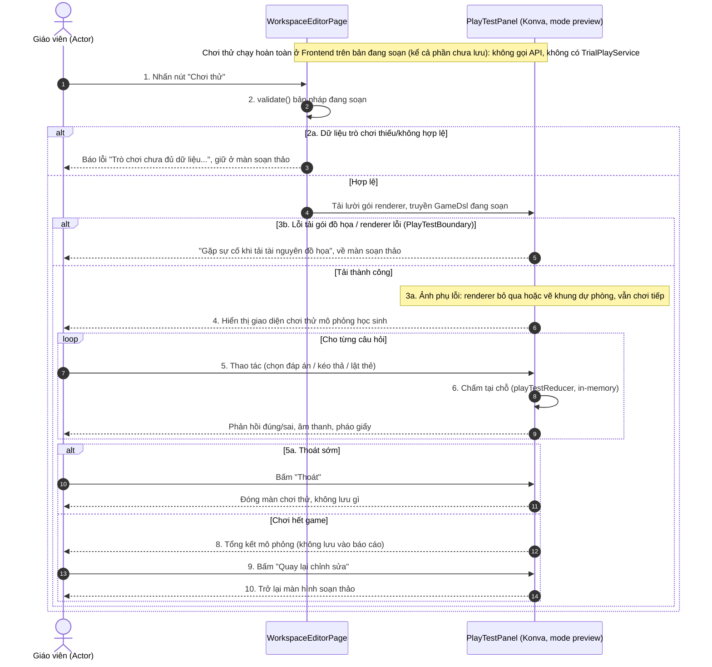

# 4.2.3. Đặc tả Ca sử dụng UC-03: Chơi thử

> **Điều hướng SRS**: [[srs/README|Mục lục SRS]] | [[Ca sử dụng|Tóm tắt 18 UC]]

| Mã & Tên Ca sử dụng | UC-03: Chơi thử |
| --- | --- |
| Tác nhân chính | Giáo viên |
| Purpose | Cho phép Actor trải nghiệm trực tiếp trò chơi dưới góc nhìn và thao tác của học sinh nhằm kiểm tra nội dung, đáp án, hình ảnh, âm thanh và hiệu ứng tương tác trước khi lưu bản nháp hoặc chính thức xuất bản. |
| Tiền điều kiện (Pre-conditions) | Actor đã đăng nhập thành công vào hệ thống. Trò chơi đã được khởi tạo (ở trạng thái bản nháp hoặc đã xuất bản). |
| Hậu điều kiện (Post-conditions) | Actor kết thúc phiên chơi thử và quay lại màn hình chi tiết/chỉnh sửa trò chơi hoặc kho học liệu. Kết quả chơi thử như điểm số, thời gian và tiến độ không được ghi nhận như kết quả của học sinh. Phiên chơi thử không làm thay đổi trạng thái xuất bản của trò chơi. |
| Luồng sự kiện chính (Main Flow) | 1. Actor chọn trò chơi muốn kiểm tra và nhấn chức năng "Chơi thử". 2. Hệ thống tiếp nhận yêu cầu và rà soát tính toàn vẹn của dữ liệu cấu hình trò chơi. 3. Hệ thống khởi tạo giao diện trò chơi trong môi trường kiểm thử, đồng thời tải các tài nguyên đồ họa và âm thanh cần thiết. 4. Hệ thống hiển thị giao diện trò chơi giống với giao diện mà học sinh sẽ sử dụng. 5. Actor thực hiện các thao tác tương ứng với loại trò chơi như chọn đáp án, kéo thả, ghép cặp hoặc lật thẻ. 6. Hệ thống tiếp nhận thao tác, kiểm tra kết quả và hiển thị phản hồi đúng/sai, âm thanh hoặc hiệu ứng tương ứng. 7. Actor trải nghiệm lần lượt các nội dung cho đến khi hoàn thành toàn bộ trò chơi. 8. Hệ thống hiển thị màn hình tổng kết kết quả mô phỏng của phiên chơi thử và ghi rõ kết quả này không được lưu vào báo cáo học sinh. 9. Actor chọn "Kết thúc" hoặc "Quay lại chỉnh sửa". 10. Hệ thống đóng phiên chơi thử và đưa actor trở lại màn hình chi tiết/chỉnh sửa trò chơi. |
| Luồng rẽ nhánh (Alternative Flows) | 5a. Actor chủ động thoát khi chưa hoàn thành trò chơi: 1. Trong quá trình chơi, actor chọn nút "Thoát" trên thanh công cụ. 2. Hệ thống kết thúc phiên chơi thử hiện tại và không lưu kết quả, thời gian hoặc tiến độ của phiên chơi thử. 3. Hệ thống đưa actor trở lại màn hình chi tiết/chỉnh sửa trò chơi và tiếp tục tại bước 10 của Main Flow. 9a. Actor phát hiện nội dung chưa phù hợp và chọn quay lại chỉnh sửa: 1. Actor chọn nút "Quay lại chỉnh sửa" tại màn hình tổng kết. 2. Hệ thống đóng môi trường chơi thử và mở màn hình chỉnh sửa trò chơi. 3. Actor chỉnh sửa lại câu hỏi, đáp án, hình ảnh hoặc thẻ nội dung chưa phù hợp, có thể sử dụng chức năng AI làm lại để hỗ trợ việc chỉnh sửa. |
| Luồng ngoại lệ (Exception Flows) | 2a. Dữ liệu trò chơi không hợp lệ hoặc thiếu thông tin: 1. Hệ thống phát hiện trò chơi không đủ dữ liệu hoặc thiếu thông tin bắt buộc để hiển thị. 2. Hệ thống từ chối khởi tạo môi trường chơi thử và hiển thị thông báo: "Trò chơi chưa đủ dữ liệu hoặc thiếu thông tin bắt buộc để chơi thử. Vui lòng kiểm tra và hoàn thiện nội dung trong màn hình soạn thảo." và giữ actor tại màn hình chỉnh sửa trò chơi. 3a. Không tải được tài nguyên không bắt buộc: 1. Hệ thống phát hiện tài nguyên không bắt buộc (hình ảnh/âm thanh phụ) không thể tải. 2. Hệ thống tự động thay thế bằng tài nguyên dự phòng hoặc bỏ qua tài nguyên đó. 3. Hệ thống tiếp tục phiên chơi thử, quay lại bước 4 của Main Flow. 3b. Không tải được tài nguyên bắt buộc: 1. Hệ thống phát hiện tài nguyên bắt buộc không thể tải và không có tài nguyên thay thế. 2. Hệ thống hiển thị thông báo lỗi: "Hệ thống gặp sự cố khi tải tài nguyên đồ họa của trò chơi. Vui lòng kiểm tra lại kết nối mạng hoặc cập nhật lại tài nguyên." 3. Hệ thống đóng phiên chơi thử và đưa actor trở lại màn hình chỉnh sửa. |

## Sơ đồ Tuần tự (Sequence Diagram)

> **Phạm vi hiện tại**: lối vào duy nhất của "Chơi thử" là màn soạn thảo (UC-04); kho học liệu chưa có nút này (`docs/ui/SPEC.md` cũng không nêu).

---

## Liên kết Nghiệp vụ
- **Ca sử dụng kế trước**: [[UC-02]], [[UC-04]]
- **Ca sử dụng kế tiếp**: [[UC-04]], [[UC-07]]
- **Yêu cầu chức năng**: Xem phân rã tại [[FR-summary]]
- **Từ điển dữ liệu liên quan**: Xem cấu trúc trường tại [[FLD]]
- **Đặc tả SRS tổng thể**: [[SRS-full]]
