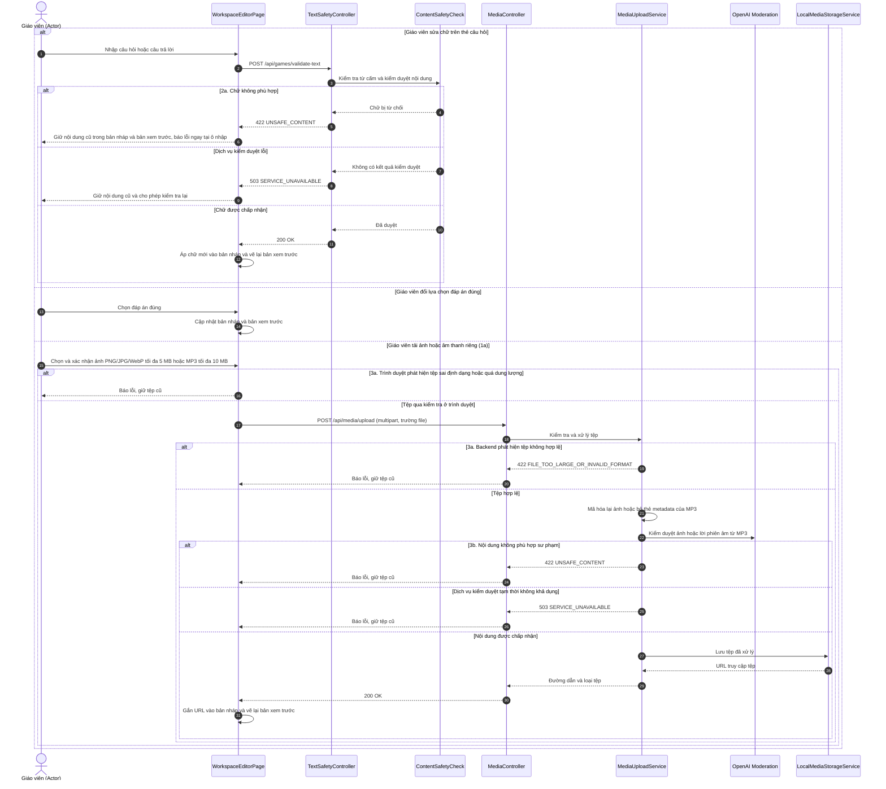

# 4.2.5. Đặc tả Ca sử dụng UC-05: Chỉnh sửa thủ công

> **Điều hướng SRS**: [[srs/README|Mục lục SRS]] | [[Ca sử dụng|Tóm tắt 18 UC]]

| Mã & Tên Ca sử dụng | UC-05: Chỉnh sửa thủ công |
| --- | --- |
| Tác nhân chính | Giáo viên |
| Purpose | Giúp Actor chủ động tự tay thay đổi câu chữ, điều chỉnh lựa chọn đáp án đúng, tự chọn hình ảnh tươi sáng hoặc tải lên tệp âm thanh thuyết minh từ thiết bị cá nhân. |
| Tiền điều kiện (Pre-conditions) | Actor đang ở giao diện soạn thảo tích hợp của ca sử dụng Chỉnh sửa trò chơi. Thẻ câu hỏi cần chỉnh sửa thủ công đang hiển thị rõ ràng trên bảng soạn thảo của Actor. |
| Hậu điều kiện (Post-conditions) | Hệ thống ghi nhận chính xác toàn bộ các nội dung chỉnh sửa thủ công của giáo viên và cập nhật thành công vào cấu hình trò chơi. Hệ thống tự động vẽ lại giao diện tương tác mới của trò chơi trên màn hình chơi thử trực quan để giáo viên kiểm duyệt. |
| Luồng sự kiện chính (Main Flow) | 1. Actor lựa chọn một thẻ câu hỏi cụ thể trên bảng soạn thảo, thực hiện gõ thay đổi trực tiếp nội dung chữ (câu hỏi, câu trả lời), hoặc thay đổi lựa chọn đáp án đúng. 2. Hệ thống tiếp nhận dữ liệu chỉnh sửa thủ công, tự động kiểm tra tính đầy đủ, hợp lệ của nội dung câu chữ Actor vừa nhập và cập nhật các thuộc tính nội dung mới này vào cấu hình hiện tại của trò chơi. 3. Hệ thống tự động vẽ lại màn hình chơi thử trực quan trên giao diện Canvas tương tác để hiển thị nội dung Actor vừa thay đổi. |
| Luồng rẽ nhánh (Alternative Flows) | 1a. Actor tải hình ảnh hoặc tệp âm thanh riêng lên từ máy tính cá nhân: 1. Actor nhấn nút "Tải tệp lên" ngay trên vùng quản lý ảnh hoặc âm thanh của thẻ câu hỏi. 2. Hệ thống hiển thị cửa sổ thư mục để Actor duyệt và chọn tệp tin tương ứng từ thiết bị cá nhân. 3. Actor chọn tệp tin hình ảnh (PNG/JPG/WebP) hoặc tệp tin âm thanh thuyết minh (MP3) từ máy tính và nhấn Xác nhận tải lên. 4. Hệ thống kiểm tra định dạng thực tế và giới hạn dung lượng, xử lý lại tệp và kiểm duyệt nội dung ảnh hoặc lời phiên âm của MP3. 5. Hệ thống lưu tệp đã xử lý vào kho cục bộ, gắn đường dẫn mới vào bản nháp của thẻ câu hỏi và cập nhật bản xem trước. |
| Luồng ngoại lệ (Exception Flows) | 2a. Nội dung Actor sửa tay chứa ngôn từ chưa phù hợp sư phạm: 1. Hệ thống tự động kích hoạt bộ lọc rà quét đối với nội dung câu chữ Actor vừa chỉnh sửa và phát hiện có từ ngữ nhạy cảm, bạo lực hoặc không lành mạnh phát sinh trong nội dung sửa tay. 2. Hệ thống dừng tiến trình cập nhật, giữ nguyên nội dung cũ trước khi chỉnh sửa của Actor, hiển thị thông báo hỗ trợ thân thiện trên màn hình: "Nội dung chỉnh sửa của giáo viên chưa đạt chuẩn an toàn học đường dành cho trẻ nhỏ. Vui lòng điều chỉnh lại từ ngữ." và giữ nguyên trạng thái màn hình soạn thảo để Actor tiếp tục chỉnh sửa. 3a. Tệp đa phương tiện tải lên bị lỗi định dạng hoặc vượt quá dung lượng: 1. Hệ thống phát hiện tệp tin hình ảnh hoặc âm thanh tải lên không đúng định dạng hỗ trợ (không phải ảnh PNG/JPG/WebP hoặc âm thanh MP3), hoặc vượt quá dung lượng giới hạn quy định. 2. Hệ thống từ chối tiếp nhận tệp tin bị lỗi, hiển thị thông báo hướng dẫn cụ thể trên màn hình: "Tệp tải lên không đúng định dạng hỗ trợ (Ảnh cần là dạng PNG/JPG/WebP tối đa 5 MB, âm thanh thuyết minh cần là dạng MP3 tối đa 10 MB). Vui lòng chọn tệp tin khác." và giữ nguyên hình ảnh hoặc âm thanh cũ của thẻ câu hỏi, khôi phục trạng thái bảng soạn thảo để giáo viên có thể thao tác lại.  3b. Tệp tải lên chứa nội dung không an toàn / không phù hợp sư phạm: 1. Hệ thống rà quét nội dung tệp hình ảnh hoặc âm thanh vừa tải lên và phát hiện yếu tố không an toàn hoặc không phù hợp sư phạm cho học sinh. 2. Hệ thống hủy tiến trình tải tệp, hiển thị thông báo lỗi: "Tệp tải lên không đáp ứng tiêu chuẩn an toàn nội dung dành cho môi trường giáo dục. Vui lòng chọn tệp khác." 3. Hệ thống giữ nguyên hình ảnh hoặc âm thanh cũ của thẻ câu hỏi và khôi phục trạng thái bảng soạn thảo để Actor chọn tệp khác. |

## Sơ đồ Tuần tự (Sequence Diagram)

---

## Liên kết Nghiệp vụ
- **Ca sử dụng kế trước**: [[UC-04]]
- **Ca sử dụng kế tiếp**: [[UC-03]], [[UC-07]]
- **Yêu cầu chức năng**: Xem phân rã tại [[FR-summary]]
- **Từ điển dữ liệu liên quan**: Xem cấu trúc trường tại [[FLD]]
- **Đặc tả SRS tổng thể**: [[srs/SRS-full]]
