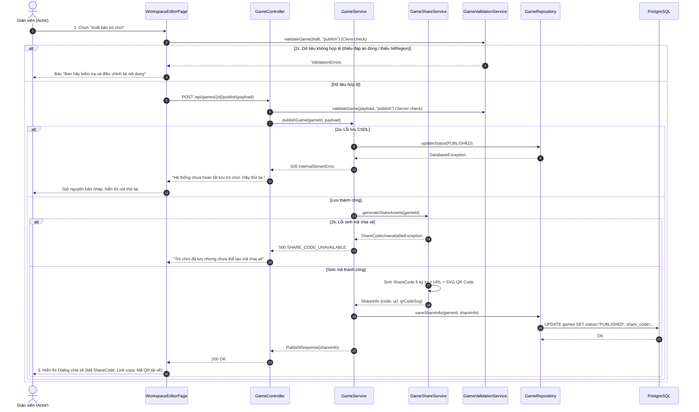

# 4.2.7. Đặc tả Ca sử dụng UC-07: Lưu và Xuất bản trò chơi

> **Điều hướng SRS**: [[srs/README|Mục lục SRS]] | [[Ca sử dụng|Tóm tắt 18 UC]]

| Mã & Tên Ca sử dụng | UC-07: Lưu và Xuất bản trò chơi |
| --- | --- |
| Tác nhân chính | Giáo viên |
| Purpose | Cho phép Actor lưu lại trò chơi đã tạo hoặc xuất bản trò chơi để học sinh có thể truy cập và tham gia. |
| Tiền điều kiện (Pre-conditions) | Actor đã đăng nhập vào hệ thống. Actor đã có một trò chơi được tạo hoặc đang chỉnh sửa. Trò chơi đang được hiển thị trong khu vực soạn thảo của giáo viên. |
| Hậu điều kiện (Post-conditions) | Nội dung trò chơi được lưu lại thành công. Nếu Actor chọn xuất bản, trò chơi chuyển sang trạng thái đã xuất bản. Hệ thống cung cấp mã chia sẻ, đường dẫn truy cập và mã QR để Actor gửi cho học sinh. |
| Luồng sự kiện chính (Main Flow) | 1. Actor xem lại nội dung trò chơi đã tạo và chọn chức năng Xuất bản trò chơi. 2. Hệ thống lưu lại nội dung mới nhất của trò chơi, chuyển trò chơi sang trạng thái Đã xuất bản, tạo mã chia sẻ, đường dẫn truy cập và mã QR tương ứng. 3. Hệ thống hiển thị thông tin chia sẻ cho giáo viên. |
| Luồng rẽ nhánh (Alternative Flows) | 1a. Actor chỉ muốn lưu trò chơi để tiếp tục chỉnh sửa sau: 1. Tại bước 1, Actor chọn Lưu bản nháp thay vì xuất bản. 2. Hệ thống lưu nội dung trò chơi ở trạng thái bản nháp và thông báo lưu thành công: "Lưu trò chơi thành công." |
| Luồng ngoại lệ (Exception Flows) | 2a. Không thể lưu hoặc xuất bản trò chơi: 1. Tại bước 2, hệ thống gặp sự cố trong quá trình lưu hoặc xuất bản trò chơi. 2. Hệ thống thông báo cho giáo viên rằng thao tác chưa hoàn tất và yêu cầu thử lại: "Hệ thống chưa hoàn tất lưu trò chơi. Bạn hãy thử lại một lần nữa." 3. Trò chơi không được chuyển sang trạng thái đã xuất bản. 4. Quay lại bước 1 của Main Flow. 2b. Không thể tạo thông tin chia sẻ: 1. Tại bước 2, hệ thống không thể tạo mã chia sẻ, đường dẫn truy cập hoặc mã QR. 2. Hệ thống thông báo cho Actor: "Trò chơi đã lưu nhưng chưa thể tạo mã chia sẻ. Vui lòng thử xuất bản lại." 3. Trò chơi không được chuyển sang trạng thái Đã xuất bản. 4. Quay lại bước 1 của Main Flow. 2c. Dữ liệu trò chơi không hợp lệ: 1. Tại bước 2, hệ thống kiểm tra nội dung trò chơi và phát hiện một hoặc nhiều dữ liệu chưa hợp lệ, chẳng hạn câu hỏi chưa có đáp án đúng, trò chơi Tìm vật trong ảnh chưa chọn vùng đúng, thiếu nội dung cần thiết hoặc cấu trúc trò chơi chưa hoàn chỉnh. 2. Hệ thống thông báo cho Actor các nội dung cần chỉnh sửa: "Bạn hãy kiểm tra và điều chỉnh lại nội dung." 3. Trò chơi không được chuyển sang trạng thái Đã xuất bản. 4. Hệ thống đưa giáo viên trở lại khu vực chỉnh sửa trò chơi để hoàn thiện nội dung. 5. Sau khi chỉnh sửa, Actor có thể thực hiện lại chức năng Xuất bản trò chơi. |

## Sơ đồ Tuần tự (Sequence Diagram)

---

## Liên kết Nghiệp vụ
- **Ca sử dụng kế trước**: [[UC-04]], [[UC-05]], [[UC-06]]
- **Ca sử dụng kế tiếp**: [[UC-08]], [[UC-09]], [[UC-17]]
- **Yêu cầu chức năng**: Xem phân rã tại [[FR-summary]]
- **Từ điển dữ liệu liên quan**: Xem cấu trúc trường tại [[FLD]]
- **Đặc tả SRS tổng thể**: [[srs/SRS-full]]
