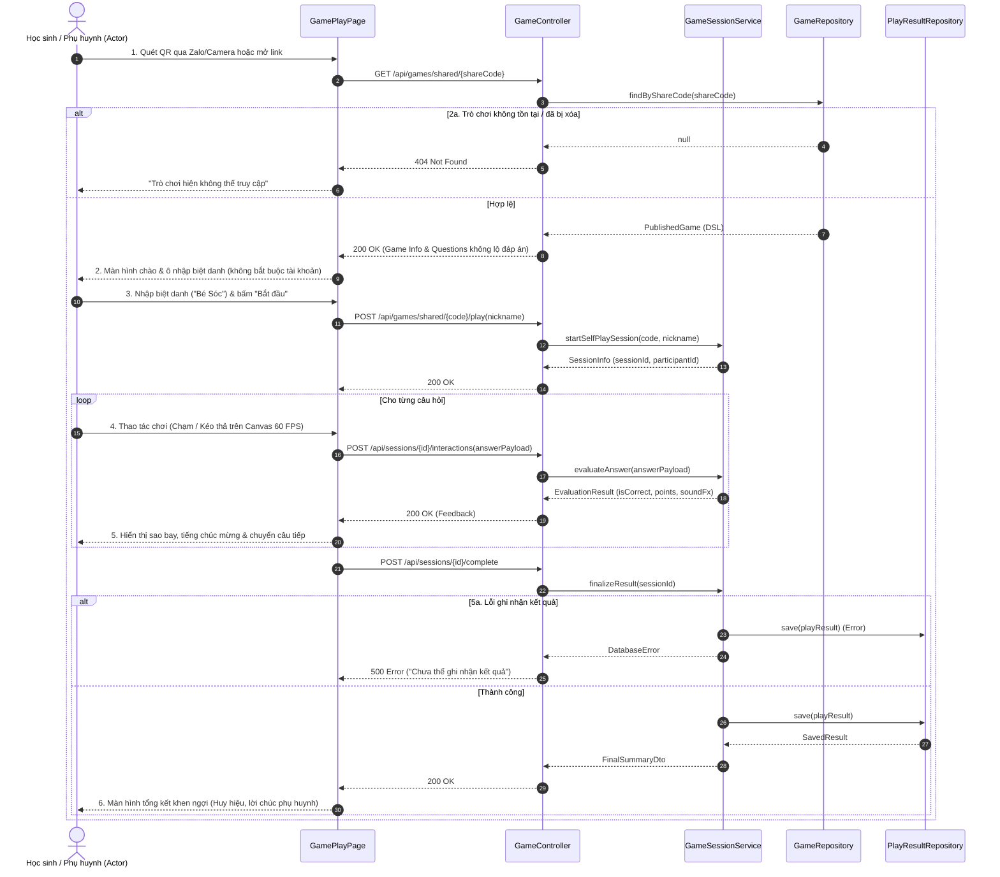

# 4.2.8. Đặc tả Ca sử dụng UC-08: Tự luyện tập cá nhân

> **Điều hướng SRS**: [[srs/README|Mục lục SRS]] | [[Ca sử dụng|Tóm tắt 18 UC]]

| Mã & Tên Ca sử dụng | UC-08: Tự luyện tập cá nhân |
| --- | --- |
| Tác nhân chính | Học sinh |
| Purpose | Cho phép Actor tự tham gia và hoàn thành một trò chơi học tập trên thiết bị cá nhân theo tốc độ của mình mà không cần đăng ký tài khoản. |
| Tiền điều kiện (Pre-conditions) | Giáo viên đã xuất bản trò chơi. Actor có mã QR hoặc đường dẫn truy cập trò chơi. Thiết bị của Actor có kết nối Internet và có thể mở trò chơi. |
| Hậu điều kiện (Post-conditions) | Actor hoàn thành hoặc kết thúc lượt chơi cá nhân. Hệ thống ghi nhận kết quả của lượt chơi hiện tại kèm theo tên hiển thị của Actor, không yêu cầu Actor đăng ký hoặc đăng nhập tài khoản. Hệ thống hiển thị kết quả và phản hồi khích lệ phù hợp với Actor. |
| Luồng sự kiện chính (Main Flow) | 1. Actor quét mã QR hoặc mở đường dẫn trò chơi do giáo viên cung cấp. 2. Hệ thống mở trò chơi và hiển thị nội dung, hướng dẫn cần thiết cho Actor. 3. Hệ thống yêu cầu Actor nhập tên hiển thị (biệt danh, tối đa 20 ký tự, không chứa từ ngữ không phù hợp) trước khi bắt đầu. 4. Actor thực hiện các yêu cầu của trò chơi và lần lượt hoàn thành các nội dung học tập. 5. Hệ thống ghi nhận câu trả lời, phản hồi kết quả trong quá trình chơi và tiếp tục hiển thị nội dung tiếp theo cho đến khi hoàn thành. 6. Hệ thống tổng hợp kết quả của lượt chơi và hiển thị phản hồi khích lệ cho Actor. |
| Luồng rẽ nhánh (Alternative Flows) | 4a. Actor muốn chơi lại: 1. Sau khi hoàn thành trò chơi, Actor chọn chức năng Chơi lại. 2. Hệ thống bắt đầu một lượt chơi mới và hiển thị lại trò chơi từ đầu. 3. Quay lại bước 4 của Main Flow. |
| Luồng ngoại lệ (Exception Flows) | 2a. Trò chơi không còn khả dụng: 1. Tại bước 2, hệ thống không tìm thấy hoặc không thể mở trò chơi từ mã QR hoặc đường dẫn mà học sinh sử dụng. 2. Hệ thống thông báo rằng trò chơi hiện không thể truy cập: "Trò chơi hiện không thể truy cập." và yêu cầu Actor kiểm tra lại thông tin do giáo viên cung cấp. 4a. Mất kết nối, khôi phục lại được: 1. Tại bước 5, hệ thống phát hiện kết nối Internet bị gián đoạn. 2. Hệ thống thông báo cho Actor rằng kết nối đã bị mất: "Kết nối hiện tại đã bị mất." và giữ trạng thái hiện tại của lượt chơi trên thiết bị. 3. Kết nối được khôi phục, Actor tiếp tục lượt chơi hiện tại. 4b. Mất kết nối, không khôi phục được trạng thái: 1. Hệ thống không thể khôi phục trạng thái lượt chơi đã lưu sau khi mất kết nối. 2. Hệ thống yêu cầu Actor tải lại trò chơi và bắt đầu lại lượt chơi. 5a. Không thể ghi nhận kết quả: 1. Tại bước 6, hệ thống gặp sự cố và không thể ghi nhận kết quả lượt chơi. 2. Hệ thống thông báo cho Actor: "Hệ thống chưa thể ghi nhận kết quả. Vui lòng thử lại lượt chơi." và cho phép thực hiện lại lượt chơi. |

## Sơ đồ Tuần tự (Sequence Diagram)

---

## Liên kết Nghiệp vụ
- **Ca sử dụng kế trước**: [[UC-07]]
- **Ca sử dụng kế tiếp**: [[UC-10]], [[UC-11]], [[UC-18]]
- **Yêu cầu chức năng**: Xem phân rã tại [[FR-summary]]
- **Từ điển dữ liệu liên quan**: Xem cấu trúc trường tại [[FLD]]
- **Đặc tả SRS tổng thể**: [[srs/SRS-full]]
