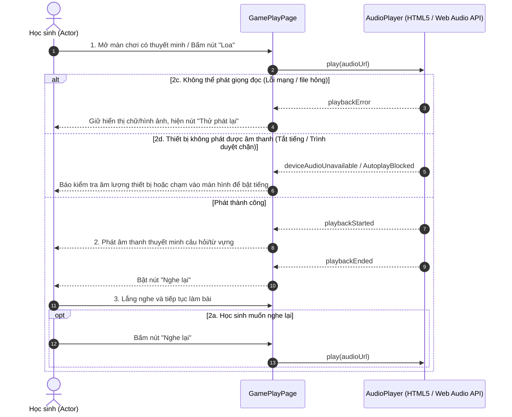

# 4.2.11. Đặc tả Ca sử dụng UC-11: Nghe giọng đọc thuyết minh

> **Điều hướng SRS**: [[srs/README|Mục lục SRS]] | [[Ca sử dụng|Tóm tắt 18 UC]]

| Mã & Tên Ca sử dụng | UC-11: Nghe giọng đọc thuyết minh |
| --- | --- |
| Tác nhân chính | Học sinh |
| Purpose | Cho phép Actor nghe hệ thống đọc to câu hỏi, từ vựng hoặc hướng dẫn trong trò chơi nhằm hỗ trợ việc tiếp nhận nội dung học tập, đặc biệt đối với Actor nhỏ tuổi hoặc chưa đọc thành thạo. |
| Tiền điều kiện (Pre-conditions) | Actor đã truy cập vào trò chơi. Nội dung đang hiển thị có hỗ trợ giọng đọc thuyết minh. Thiết bị của học sinh có thể phát âm thanh. |
| Hậu điều kiện (Post-conditions) | Nội dung cần thuyết minh được phát cho Actor nghe. Actor có thể tiếp tục thực hiện yêu cầu của trò chơi sau khi nghe nội dung. |
| Luồng sự kiện chính (Main Flow) | 1. Actor mở màn chơi có nội dung cần nghe thuyết minh hoặc chọn chức năng phát giọng đọc. 2. Hệ thống phát giọng đọc tương ứng với câu hỏi, từ vựng hoặc hướng dẫn đang hiển thị. 3. Actor nghe nội dung và tiếp tục thực hiện yêu cầu của trò chơi. |
| Luồng rẽ nhánh (Alternative Flows) | 2a. Actor muốn nghe lại nội dung: 1. Sau khi giọng đọc kết thúc, Actor chọn chức năng phát lại. 2. Hệ thống phát lại nội dung thuyết minh tương ứng. 3. Tiếp tục tại bước 3 của Main Flow. |
| Luồng ngoại lệ (Exception Flows) | 2c. Không thể phát giọng đọc: 1. Tại bước 2, hệ thống không thể phát nội dung thuyết minh. 2. Hệ thống vẫn hiển thị nội dung trò chơi để Actor tiếp tục thực hiện. 3. Hệ thống cho phép Actor thử phát lại giọng đọc. 2d. Thiết bị không phát được âm thanh: 1. Tại bước 2, âm thanh không thể phát trên thiết bị của học sinh. 2. Hệ thống thông báo cho Actor kiểm tra âm lượng hoặc khả năng phát âm thanh của thiết bị. 3. Hệ thống cho phép Actor tiếp tục trò chơi dựa trên nội dung hiển thị (hình ảnh, chữ) hiện có. |

## Sơ đồ Tuần tự (Sequence Diagram)

---

## Liên kết Nghiệp vụ
- **Ca sử dụng kế trước**: [[UC-08]], [[UC-09]]
- **Ca sử dụng kế tiếp**: [[UC-18]]
- **Yêu cầu chức năng**: Xem phân rã tại [[FR-summary]]
- **Từ điển dữ liệu liên quan**: Xem cấu trúc trường tại [[FLD]]
- **Đặc tả SRS tổng thể**: [[srs/SRS-full]]
