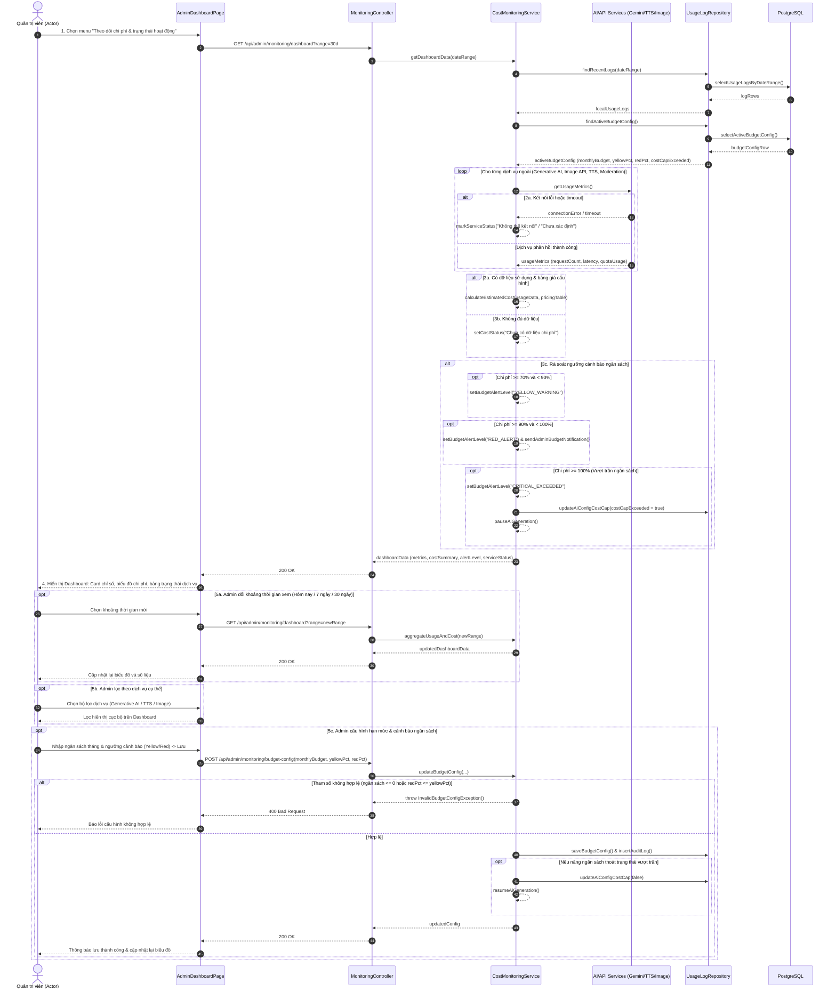

# 4.2.12. Đặc tả Ca sử dụng UC-12: Theo dõi chi phí và trạng thái hoạt động

> **Điều hướng SRS**: [[srs/README|Mục lục SRS]] | [[Ca sử dụng|Tóm tắt 18 UC]]

| Mã & Tên Ca sử dụng | UC-12: Theo dõi chi phí và trạng thái hoạt động |
| --- | --- |
| Tác nhân chính | Quản trị viên |
| Purpose | Cho phép Actor theo dõi trực quan mức độ tiêu thụ tài nguyên của các dịch vụ AI/API, chi phí phát sinh hoặc ước tính và trạng thái hoạt động của các thành phần trong hệ thống nhằm bảo đảm tính sẵn sàng và tối ưu hóa ngân sách vận hành. |
| Tiền điều kiện (Pre-conditions) | Actor đã đăng nhập thành công với quyền Quản trị viên và hệ thống đã có dữ liệu vận hành cần thiết. |
| Hậu điều kiện (Post-conditions) | Các thông tin thống kê chi phí, biểu đồ lưu lượng tiêu thụ và bảng trạng thái hoạt động của hệ thống được hiển thị đầy đủ và trực quan cho Quản trị viên. |
| Luồng sự kiện chính (Main Flow) | 1. Actor chọn chức năng "Theo dõi chi phí và trạng thái hoạt động" từ menu quản trị hệ thống. 2. Hệ thống truy xuất dữ liệu nhật ký vận hành từ các dịch vụ AI/API và tự động tổng hợp các chỉ số sử dụng cốt lõi như số lượt yêu cầu API, số lần tương tác AI, tỷ lệ thành công/thất bại và mức tiêu thụ hạn mức. 3. Hệ thống tính toán chi phí phát sinh hoặc chi phí ước tính dựa trên lượng tài nguyên tiêu thụ, đồng thời rà soát trạng thái hoạt động và độ ổn định của các dịch vụ chính. 4. Hệ thống hiển thị Dashboard trực quan gồm các thẻ chỉ số tổng quan, biểu đồ xu hướng chi phí và bảng thống kê trạng thái hoạt động của từng dịch vụ. 5. Actor xem các thông tin trên Dashboard để đánh giá tình trạng vận hành của hệ thống. |
| Luồng rẽ nhánh (Alternative Flows) | 5a. Actor thay đổi khoảng thời gian thống kê: 1. Actor chọn khoảng thời gian cần xem như hôm nay, 7 ngày, 30 ngày hoặc khoảng thời gian tùy chỉnh. 2. Hệ thống truy xuất lại dữ liệu theo khoảng thời gian đã chọn. 3. Hệ thống tự động cập nhật các chỉ số và biểu đồ trên Dashboard. 5b. Actor lọc dữ liệu theo một dịch vụ cụ thể: 1. Actor chọn một dịch vụ cụ thể từ bộ lọc, ví dụ Generative AI, Image API, TTS hoặc Moderation. 2. Hệ thống lọc dữ liệu và cập nhật Dashboard để chỉ hiển thị các số liệu, chi phí và trạng thái liên quan đến dịch vụ được chọn. |
| Luồng ngoại lệ (Exception Flows) | 2a. Không lấy được dữ liệu từ một dịch vụ bên thứ ba: 1. Dịch vụ trả về lỗi kết nối hoặc vượt quá thời gian phản hồi. 2. Hệ thống đánh dấu trạng thái dịch vụ là "Không thể kết nối" hoặc "Chưa xác định trạng thái", đồng thời hiển thị cảnh báo trực quan cho Actor. 3. Hệ thống tiếp tục tải và hiển thị dữ liệu từ các dịch vụ khác để Dashboard không bị gián đoạn hoàn toàn. 3a. Đủ dữ liệu để ước tính chi phí: 1. Hệ thống không nhận được dữ liệu billing chính thức từ nhà cung cấp API. 2. Hệ thống xác định có đủ dữ liệu sử dụng và bảng giá được cấu hình, tự động tính toán và hiển thị mức chi phí ước tính. 3b. Không đủ dữ liệu để ước tính chi phí: 1. Hệ thống xác định không đủ dữ liệu để tính toán chi phí ước tính. 2. Hệ thống hiển thị trạng thái "Chưa có dữ liệu chi phí" thay vì tự đưa ra giá trị giả định. |

## Sơ đồ Tuần tự (Sequence Diagram)

---

## Liên kết Nghiệp vụ
- **Ca sử dụng kế trước**: [[UC-02]], [[UC-06]]
- **Ca sử dụng kế tiếp**: [[UC-14]]
- **Yêu cầu chức năng**: Xem phân rã tại [[FR-summary]]
- **Từ điển dữ liệu liên quan**: Xem cấu trúc trường tại [[FLD]]
- **Đặc tả SRS tổng thể**: [[srs/SRS-full]]
