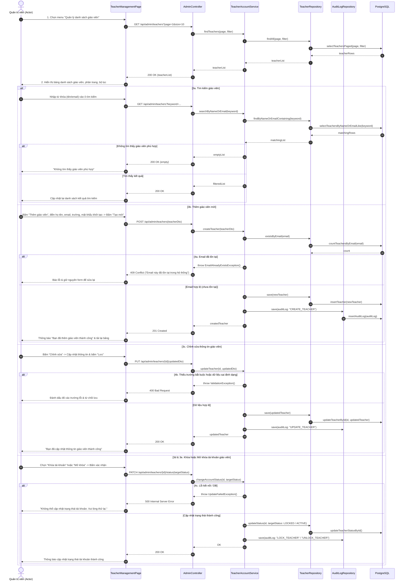

# 4.2.13. Đặc tả Ca sử dụng UC-13: Quản lý danh sách giáo viên

> **Điều hướng SRS**: [[srs/README|Mục lục SRS]] | [[Ca sử dụng|Tóm tắt 18 UC]]

| Mã & Tên Ca sử dụng | UC-13: Quản lý danh sách giáo viên |
| --- | --- |
| Tác nhân chính | Quản trị viên |
| Purpose | Cho phép Actor theo dõi và quản lý các tài khoản giáo viên trong hệ thống thông qua các chức năng xem danh sách, tìm kiếm, xem chi tiết, thêm mới, chỉnh sửa thông tin cá nhân, khóa/mở khóa trạng thái tài khoản nhằm bảo đảm an ninh hệ thống và hỗ trợ người dùng. |
| Tiền điều kiện (Pre-conditions) | Actor đã đăng nhập thành công vào hệ thống với quyền Quản trị viên. |
| Hậu điều kiện (Post-conditions) | Danh sách giáo viên được hiển thị đầy đủ, chính xác theo bộ lọc và từ khóa tìm kiếm. Các thay đổi về thông tin tài khoản hoặc trạng thái Hoạt động/Bị khóa được lưu thành công vào cơ sở dữ liệu. Nhật ký thao tác quản trị (Audit Log) được hệ thống ghi nhận đầy đủ. |
| Luồng sự kiện chính (Main Flow) | 1. Actor chọn chức năng "Quản lý danh sách giáo viên" từ menu quản trị hệ thống. 2. Hệ thống truy xuất dữ liệu từ cơ sở dữ liệu và hiển thị danh sách tài khoản giáo viên dưới dạng bảng trực quan, có hỗ trợ phân trang, bộ lọc trạng thái và thanh tìm kiếm. 3. Actor tìm kiếm, xem thông tin chi tiết hoặc lựa chọn một thao tác quản lý tài khoản phù hợp như thêm mới, chỉnh sửa thông tin, khóa hoặc mở khóa tài khoản. 4. Hệ thống thực hiện thao tác xử lý tương ứng, lưu dữ liệu cập nhật vào cơ sở dữ liệu và tự động tải lại danh sách giáo viên mới nhất. 5. Hệ thống hiển thị thông báo kết quả cho actor. |
| Luồng rẽ nhánh (Alternative Flows) | 3a. Actor tìm kiếm giáo viên: 1. Actor nhập tên hoặc email giáo viên vào thanh tìm kiếm. 2. Hệ thống thực hiện lọc và hiển thị danh sách các tài khoản phù hợp với từ khóa tìm kiếm. 3b. Actor thêm giáo viên mới: 1. Actor chọn "Thêm giáo viên". 2. Hệ thống hiển thị biểu mẫu tạo tài khoản giáo viên. 3. Actor nhập Họ tên, Email, Trường/Đơn vị, Mật khẩu khởi tạo và các thông tin bắt buộc khác, sau đó chọn "Tạo mới". 4. Hệ thống kiểm tra tính hợp lệ của dữ liệu, tạo tài khoản mới trong cơ sở dữ liệu, tự động cập nhật lại danh sách và hiển thị thông báo thành công: "Bạn đã thêm giáo viên thành công." 3c. Actor chỉnh sửa thông tin giáo viên: 1. Actor chọn "Chỉnh sửa" tại dòng thông tin giáo viên tương ứng. 2. Hệ thống hiển thị thông tin hiện tại của giáo viên. 3. Actor cập nhật các thông tin cần thiết và chọn "Lưu". 4. Hệ thống kiểm tra dữ liệu, lưu các thay đổi vào cơ sở dữ liệu, tự động cập nhật lại danh sách và hiển thị thông báo: "Bạn đã cập nhật thông tin giáo viên thành công." 3d. Actor khóa tài khoản giáo viên: 1. Actor chọn "Khóa tài khoản" tại tài khoản tương ứng. 2. Hệ thống hiển thị hộp thoại yêu cầu xác nhận thao tác. 3. Actor chọn "Xác nhận". 4. Hệ thống cập nhật trạng thái tài khoản thành "Đã khóa" trong cơ sở dữ liệu, cập nhật lại danh sách và hiển thị thông báo thành công: "Bạn đã khóa tài khoản của giáo viên [Tên giáo viên] thành công." 3e. Actor mở khóa tài khoản giáo viên: 1. Actor chọn tài khoản đang ở trạng thái "Đã khóa" và chọn "Mở khóa". 2. Hệ thống hiển thị hộp thoại yêu cầu xác nhận thao tác. 3. Actor chọn "Xác nhận". 4. Hệ thống cập nhật trạng thái tài khoản thành "Hoạt động", cập nhật lại danh sách và hiển thị thông báo: "Bạn đã mở khóa tài khoản giáo viên thành công." |
| Luồng ngoại lệ (Exception Flows) | 3a. Không tìm thấy giáo viên phù hợp với tiêu chí tìm kiếm: 1. Hệ thống không tìm thấy dữ liệu phù hợp với từ khóa hoặc tiêu chí lọc hiện tại. 2. Hệ thống hiển thị thông báo: "Không tìm thấy giáo viên phù hợp." 4a. Email giáo viên mới đã tồn tại khi tạo tài khoản: 1. Hệ thống phát hiện địa chỉ Email vừa nhập đã được sử dụng bởi một tài khoản khác. 2. Hệ thống từ chối tạo tài khoản mới và hiển thị thông báo: "Email này đã tồn tại trong hệ thống." 3. Hệ thống giữ nguyên các thông tin Actor đã nhập để actor chỉnh sửa lại. 4b. Thông tin chỉnh sửa không hợp lệ hoặc thiếu trường bắt buộc: 1. Hệ thống phát hiện dữ liệu không đúng định dạng hoặc thiếu trường thông tin bắt buộc. 2. Hệ thống từ chối lưu thay đổi, đánh dấu trường bị lỗi và hiển thị thông báo yêu cầu Actor chỉnh sửa. 4c. Không thể cập nhật trạng thái tài khoản: 1. Hệ thống gặp lỗi kết nối hoặc sự cố kỹ thuật trong quá trình cập nhật trạng thái tài khoản vào cơ sở dữ liệu. 2. Hệ thống giữ nguyên trạng thái hiện tại của tài khoản và không làm thay đổi dữ liệu. 3. Hệ thống hiển thị thông báo: "Không thể cập nhật trạng thái tài khoản. Vui lòng thử lại." |

## Sơ đồ Tuần tự (Sequence Diagram)

---

## Liên kết Nghiệp vụ
- **Ca sử dụng kế trước**: [[UC-01]]
- **Ca sử dụng kế tiếp**: [[UC-12]]
- **Yêu cầu chức năng**: Xem phân rã tại [[FR-summary]]
- **Từ điển dữ liệu liên quan**: Xem cấu trúc trường tại [[FLD]]
- **Đặc tả SRS tổng thể**: [[srs/SRS-full]]
