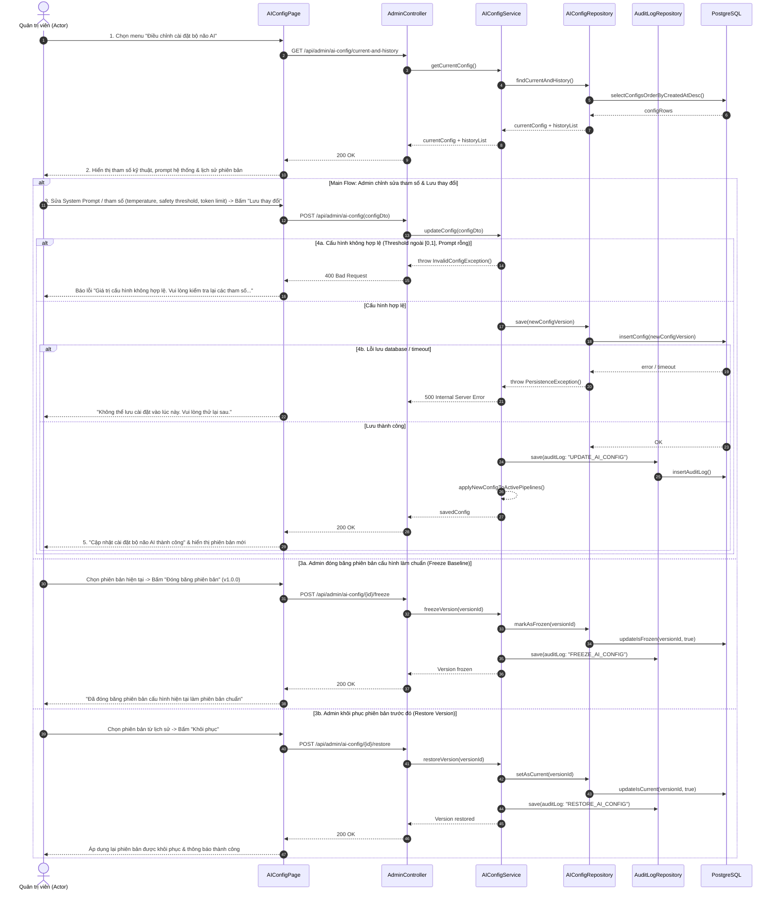

# 4.2.14. Đặc tả Ca sử dụng UC-14: Điều chỉnh cài đặt bộ não AI

> **Điều hướng SRS**: [[srs/README|Mục lục SRS]] | [[Ca sử dụng|Tóm tắt 18 UC]]

| Mã & Tên Ca sử dụng | UC-14: Điều chỉnh cài đặt bộ não AI |
| --- | --- |
| Tác nhân chính | Quản trị viên |
| Purpose | Cho phép Actor tinh chỉnh các tham số kỹ thuật điều khiển AI và nội dung câu lệnh hệ thống (System Instructions/Prompt) dùng để sinh trò chơi, quản lý phiên bản của các cấu hình này nhằm bảo đảm chất lượng nội dung sinh ra và phục vụ truy vết thực nghiệm. |
| Tiền điều kiện (Pre-conditions) | Actor đã đăng nhập thành công vào hệ thống với quyền Quản trị viên. |
| Hậu điều kiện (Post-conditions) | Cấu hình bộ não AI (câu lệnh hệ thống, các tham số kỹ thuật) được cập nhật và áp dụng cho các yêu cầu sinh nội dung AI tiếp theo. Lịch sử các phiên bản cấu hình được lưu trữ đầy đủ. Thao tác thay đổi cấu hình được ghi nhận vào nhật ký thao tác quản trị. |
| Luồng sự kiện chính (Main Flow) | 1. Actor chọn chức năng "Điều chỉnh cài đặt bộ não AI" từ menu quản trị hệ thống. 2. Hệ thống hiển thị cấu hình hiện đang áp dụng: nội dung câu lệnh hệ thống, các tham số kỹ thuật điều khiển AI (ví dụ: ngưỡng kiểm duyệt an toàn nội dung, mức độ sáng tạo trong câu trả lời, giới hạn độ dài nội dung sinh ra), cùng danh sách lịch sử các phiên bản cấu hình trước đó. 3. Actor chỉnh sửa nội dung câu lệnh hệ thống và/hoặc các tham số kỹ thuật, sau đó chọn "Lưu thay đổi". 4. Hệ thống kiểm tra tính hợp lệ của cấu hình mới, lưu thành một phiên bản cấu hình mới, ghi nhận thao tác vào nhật ký thao tác quản trị và áp dụng cấu hình này cho các yêu cầu sinh nội dung AI kế tiếp. 5. Hệ thống hiển thị thông báo: "Cập nhật cài đặt bộ não AI thành công." |
| Luồng rẽ nhánh (Alternative Flows) | 3a. Actor đóng băng một phiên bản cấu hình làm chuẩn: 1. Tại bước 3, Actor chọn phiên bản cấu hình hiện tại và chọn chức năng "Đóng băng phiên bản" (ví dụ gắn nhãn v1.0.0). 2. Hệ thống đánh dấu phiên bản này là bản chuẩn, không cho phép chỉnh sửa trực tiếp nội dung của phiên bản đã đóng băng; mọi thay đổi tiếp theo phải tạo thành một phiên bản mới kế thừa từ đó. 3. Hệ thống ghi nhận thao tác vào nhật ký thao tác quản trị và hiển thị thông báo "Đã đóng băng phiên bản cấu hình hiện tại làm phiên bản chuẩn." 3b. Actor khôi phục một phiên bản cấu hình trước đó: 1. Tại bước 3, Actor chọn một phiên bản trong lịch sử và chọn "Khôi phục". 2. Hệ thống thiết lập phiên bản được chọn thành phiên bản đang áp dụng và ghi nhận thao tác vào nhật ký thao tác quản trị. 3. Tiếp tục tại bước 5 của Main Flow. |
| Luồng ngoại lệ (Exception Flows) | 4a. Cấu hình không hợp lệ: 1. Tại bước 4, hệ thống phát hiện một hoặc nhiều tham số nhập vào không hợp lệ (ví dụ giá trị ngưỡng nằm ngoài phạm vi cho phép, nội dung câu lệnh hệ thống để trống). 2. Hệ thống thông báo "Giá trị cấu hình không hợp lệ. Vui lòng kiểm tra lại các tham số (ngưỡng kiểm duyệt, mức độ sáng tạo, giới hạn độ dài nội dung) hoặc nội dung câu lệnh hệ thống." và giữ nguyên cấu hình đang áp dụng. 3. Quay lại bước 3 của Main Flow để Actor kiểm tra, nhập lại cấu hình. 4b. Hệ thống gặp sự cố khi lưu cấu hình: 1. Tại bước 4, hệ thống không thể hoàn tất việc lưu cấu hình mới do sự cố kỹ thuật. 2. Hệ thống thông báo: "Không thể lưu cài đặt vào lúc này. Vui lòng thử lại sau." và giữ nguyên cấu hình đang áp dụng trước đó. |

## Sơ đồ Tuần tự (Sequence Diagram)

---

## Liên kết Nghiệp vụ
- **Ca sử dụng kế trước**: [[UC-12]]
- **Ca sử dụng kế tiếp**: [[UC-02]], [[UC-06]]
- **Yêu cầu chức năng**: Xem phân rã tại [[FR-summary]]
- **Từ điển dữ liệu liên quan**: Xem cấu trúc trường tại [[FLD]]
- **Đặc tả SRS tổng thể**: [[srs/SRS-full]]
