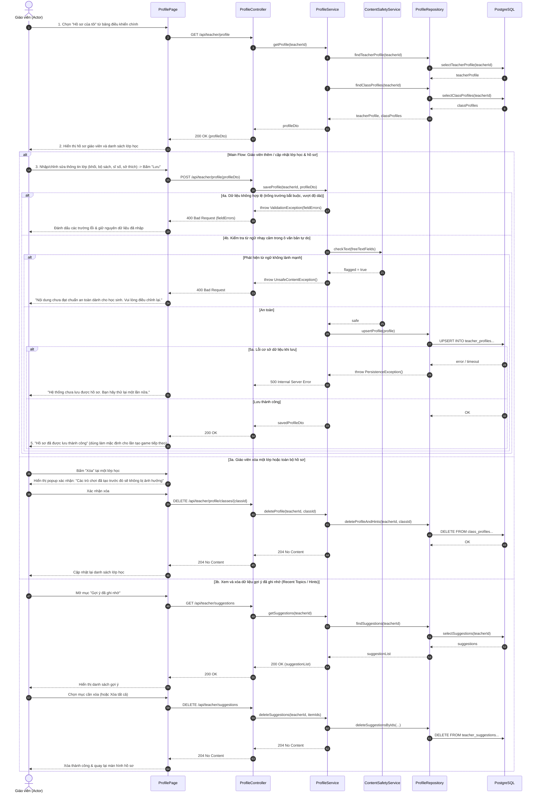

# 4.2.16. Đặc tả Ca sử dụng UC-16: Quản lý hồ sơ giáo viên và lớp học

> **Điều hướng SRS**: [[srs/README|Mục lục SRS]] | [[Ca sử dụng|Tóm tắt 18 UC]]

| Mã & Tên Ca sử dụng | UC-16: Quản lý hồ sơ giáo viên và lớp học |
| --- | --- |
| Tác nhân chính | Giáo viên |
| Mục đích | Cho phép giáo viên khai báo một lần thông tin về bản thân và về lớp mình phụ trách để hệ thống điền sẵn môn, khối lớp, giới hạn phạm vi kiến thức và tình huống sử dụng khi tạo trò chơi, giúp trò chơi phù hợp với đúng lớp học; đồng thời cho phép xem, sửa và xóa các thông tin đã lưu. |
| Tiền điều kiện | Giáo viên đã đăng nhập thành công vào tài khoản của mình trên hệ thống. |
| Hậu điều kiện | Hồ sơ giáo viên và hồ sơ lớp được lưu, cập nhật hoặc xóa theo yêu cầu của giáo viên. Từ lần tạo trò chơi tiếp theo, hệ thống dùng hồ sơ để điền sẵn thông tin và để AI tạo nội dung đúng với lớp học. Hệ thống không lưu bất kỳ thông tin cá nhân nào của học sinh trong hồ sơ. |
| Luồng chính | 1. Giáo viên chọn "Hồ sơ của tôi" từ bảng điều khiển chính. 2. Hệ thống hiển thị hồ sơ giáo viên (trường lấy từ thông tin đã nhập khi đăng ký, chỉ sửa khi cần; bộ sách giáo khoa, giọng đọc, môn và khối đang dạy) và danh sách các lớp đã khai báo; thông tin chưa khai báo được để trống hoặc dùng giá trị có sẵn. 3. Giáo viên chọn thêm lớp mới hoặc chọn một lớp cần sửa, rồi nhập hoặc chỉnh sửa thông tin: khối lớp, sĩ số, phạm vi kiến thức đã học, đặc điểm chung và chủ đề yêu thích của lớp, sau đó nhấn "Lưu". 4. Hệ thống kiểm tra thông tin nhập đúng yêu cầu (độ dài, giá trị cho phép) và từ ngữ phù hợp với học sinh ở các ô tự viết. 5. Hệ thống lưu hồ sơ, thông báo lưu thành công và dùng hồ sơ này làm giá trị mặc định ở lần tạo trò chơi tiếp theo. |
| Luồng thay thế | 3a. Giáo viên xóa một lớp hoặc xóa hồ sơ: 1. Tại bước 3, giáo viên chọn chức năng Xóa. 2. Hệ thống yêu cầu xác nhận và nêu rõ các trò chơi đã tạo không bị ảnh hưởng. 3. Giáo viên xác nhận; hệ thống xóa hồ sơ cùng các gợi ý hệ thống đã ghi nhớ liên quan, rồi quay lại bước 2 của Luồng chính. 3b. Giáo viên xem và xóa các gợi ý mà hệ thống đã ghi nhớ (nếu có): 1. Tại bước 2, giáo viên chọn xem dữ liệu gợi ý của mình (ví dụ chủ đề đã dùng gần đây). 2. Hệ thống hiển thị danh sách; giáo viên chọn xóa từng mục hoặc xóa toàn bộ. 3. Hệ thống xóa các mục đã chọn và quay lại bước 2 của Luồng chính. |
| Luồng ngoại lệ | 4a. Dữ liệu không hợp lệ: 1. Tại bước 4, hệ thống phát hiện trường bắt buộc còn trống hoặc giá trị nằm ngoài phạm vi cho phép. 2. Hệ thống đánh dấu các trường cần sửa, hiển thị thông báo cụ thể và giữ nguyên dữ liệu giáo viên đã nhập; quay lại bước 3. 4b. Phát hiện từ ngữ nhạy cảm trong nội dung nhập: 1. Tại bước 4, hệ thống phát hiện từ ngữ nhạy cảm hoặc không lành mạnh trong các ô văn bản tự do. 2. Hệ thống không lưu và hiển thị thông báo: "Nội dung chưa đạt chuẩn an toàn dành cho học sinh. Vui lòng điều chỉnh lại."; quay lại bước 3. 5a. Không thể lưu hồ sơ: 1. Tại bước 5, hệ thống gặp sự cố khi lưu. 2. Hệ thống thông báo: "Hệ thống chưa lưu được hồ sơ. Bạn hãy thử lại một lần nữa." và giữ nguyên dữ liệu đã nhập. |

## Sơ đồ Tuần tự (Sequence Diagram)

---

## Liên kết Nghiệp vụ
- **Ca sử dụng kế trước**: [[UC-15]]
- **Ca sử dụng kế tiếp**: [[UC-02]]
- **Yêu cầu chức năng**: Xem phân rã tại [[FR-summary]]
- **Từ điển dữ liệu liên quan**: Xem cấu trúc trường tại [[FLD]]
- **Đặc tả SRS tổng thể**: [[srs/SRS-full]]
