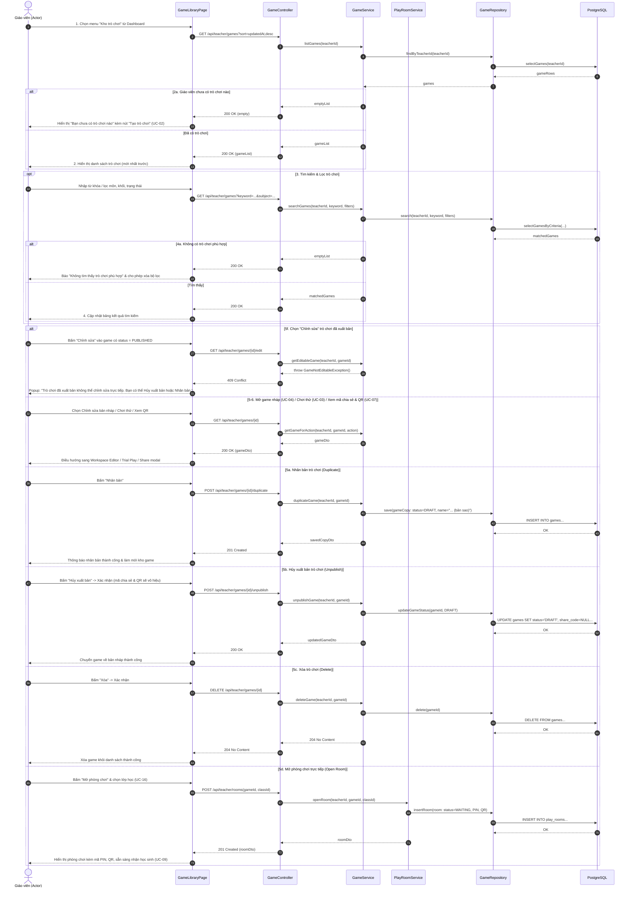

# 4.2.17. Đặc tả Ca sử dụng UC-17: Quản lý kho trò chơi

> **Điều hướng SRS**: [[srs/README|Mục lục SRS]] | [[Ca sử dụng|Tóm tắt 18 UC]]

| Mã & Tên Ca sử dụng | UC-17: Quản lý kho trò chơi |
| --- | --- |
| Tác nhân chính | Giáo viên |
| Mục đích | Cho phép giáo viên xem, tìm kiếm và quản lý toàn bộ trò chơi mình đã tạo; từ đó mở chỉnh sửa, chơi thử, chia sẻ, nhân bản, xóa trò chơi hoặc mở phòng chơi cho học sinh. |
| Tiền điều kiện | Giáo viên đã đăng nhập thành công vào tài khoản của mình trên hệ thống. |
| Hậu điều kiện | Danh sách trò chơi phản ánh đúng trạng thái mới nhất sau mỗi thao tác của giáo viên. Các thao tác nhân bản, hủy xuất bản, xóa và mở phòng chơi được hệ thống lưu lại. |
| Luồng chính | 1. Giáo viên chọn "Kho trò chơi" từ bảng điều khiển chính. 2. Hệ thống hiển thị danh sách trò chơi của giáo viên (tên, môn, khối, loại trò chơi, trạng thái Bản nháp hoặc Đã xuất bản, ngày cập nhật), sắp xếp mới nhất trước. 3. Giáo viên nhập từ khóa hoặc chọn bộ lọc theo môn, khối, trạng thái. 4. Hệ thống cập nhật danh sách theo điều kiện lọc. 5. Giáo viên chọn một trò chơi và một thao tác: Chỉnh sửa (chỉ với trò chơi bản nháp), Chơi thử hoặc xem mã chia sẻ và mã QR đối với trò chơi đã xuất bản. 6. Hệ thống chuyển giáo viên đến chức năng tương ứng. |
| Luồng thay thế | 5a. Giáo viên nhân bản trò chơi: 1. Tại bước 5, giáo viên chọn Nhân bản. 2. Hệ thống tạo bản sao ở trạng thái Bản nháp, thêm "(bản sao)" vào tên; không sao chép mã chia sẻ và kết quả chơi. 3. Quay lại bước 2 của Luồng chính. 5b. Giáo viên hủy xuất bản trò chơi: 1. Tại bước 5, giáo viên chọn Hủy xuất bản đối với trò chơi đã xuất bản. 2. Hệ thống yêu cầu xác nhận và nêu rõ mã chia sẻ, mã QR hiện tại sẽ không còn truy cập được. 3. Sau khi giáo viên xác nhận, hệ thống chuyển trò chơi về Bản nháp, vô hiệu hóa mã chia sẻ; quay lại bước 2. 5c. Giáo viên xóa trò chơi: 1. Tại bước 5, giáo viên chọn Xóa. 2. Hệ thống yêu cầu xác nhận; nếu trò chơi đang xuất bản, hệ thống nêu rõ trò chơi sẽ bị hủy xuất bản và kết quả tổng hợp liên quan không còn hiển thị. 3. Sau khi giáo viên xác nhận, hệ thống xóa trò chơi khỏi kho và quay lại bước 2. 5d. Giáo viên mở phòng chơi: 1. Tại bước 5, giáo viên chọn Mở phòng chơi đối với trò chơi đã xuất bản và có thể chọn lớp (đã khai báo trong hồ sơ). 2. Hệ thống tạo phòng chơi, cấp mã PIN và mã QR, hiển thị trạng thái Chờ. 3. Học sinh tham gia phòng chơi bằng mã PIN hoặc mã QR. |
| Luồng ngoại lệ | 2a. Giáo viên chưa có trò chơi nào: 1. Tại bước 2, hệ thống hiển thị "Bạn chưa có trò chơi nào" kèm nút Tạo trò chơi. 4a. Không có trò chơi phù hợp bộ lọc: 1. Tại bước 4, hệ thống thông báo không tìm thấy trò chơi phù hợp và cho phép giáo viên xóa bộ lọc. 5e. Không thể thực hiện thao tác: 1. Tại bước 5, hệ thống gặp sự cố khi thực hiện thao tác. 2. Hệ thống thông báo: "Hệ thống chưa hoàn tất thao tác. Bạn hãy thử lại một lần nữa." và giữ nguyên danh sách. 5f. Giáo viên chọn Chỉnh sửa với trò chơi đã xuất bản: 1. Tại bước 5, giáo viên chọn Chỉnh sửa đối với trò chơi đang ở trạng thái Đã xuất bản. 2. Hệ thống không mở trình soạn thảo, hiển thị thông báo: "Trò chơi đã xuất bản không thể chỉnh sửa trực tiếp. Bạn có thể Hủy xuất bản hoặc Nhân bản để chỉnh sửa." kèm hai nút Hủy xuất bản và Nhân bản. 3. Giáo viên chọn một trong hai nút và tiếp tục theo luồng 5b hoặc 5a; sau đó sửa bản nháp trên màn hình soạn thảo. |

## Sơ đồ Tuần tự (Sequence Diagram)

---

## Liên kết Nghiệp vụ
- **Ca sử dụng kế trước**: [[UC-07]], [[UC-15]]
- **Ca sử dụng kế tiếp**: [[UC-02]], [[UC-04]], [[UC-09]]
- **Yêu cầu chức năng**: Xem phân rã tại [[FR-summary]]
- **Từ điển dữ liệu liên quan**: Xem cấu trúc trường tại [[FLD]]
- **Đặc tả SRS tổng thể**: [[srs/SRS-full]]
