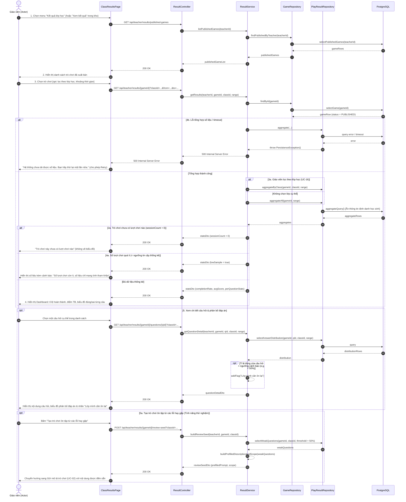

# 4.2.18. Đặc tả Ca sử dụng UC-18: Xem kết quả và thống kê lớp học

> **Điều hướng SRS**: [[srs/README|Mục lục SRS]] | [[Ca sử dụng|Tóm tắt 18 UC]]

| Mã & Tên Ca sử dụng | UC-18: Xem kết quả và thống kê lớp học                                                                                                                                                                                                                                                                                                                                                                                                                                                                                                                                                         |
| ------------------- | ---------------------------------------------------------------------------------------------------------------------------------------------------------------------------------------------------------------------------------------------------------------------------------------------------------------------------------------------------------------------------------------------------------------------------------------------------------------------------------------------------------------------------------------------------------------------------------------------- |
| Tác nhân chính      | Giáo viên                                                                                                                                                                                                                                                                                                                                                                                                                                                                                                                                                                                      |
| Mục đích            | Cho phép giáo viên xem kết quả chơi của một trò chơi đã xuất bản ở dạng tổng hợp theo lượt chơi và theo từng câu, nhận biết phần kiến thức lớp còn yếu để điều chỉnh việc dạy. Hệ thống không hiển thị thông tin định danh của học sinh.                                                                                                                                                                                                                                                                                                                                                       |
| Tiền điều kiện      | Giáo viên đã đăng nhập thành công vào tài khoản của mình. Giáo viên có ít nhất một trò chơi đã xuất bản.                                                                                                                                                                                                                                                                                                                                                                                                                                                                                       |
| Hậu điều kiện       | Giáo viên xem được số liệu tổng hợp của trò chơi đã chọn. Hệ thống không lưu thêm dữ liệu cá nhân của học sinh.                                                                                                                                                                                                                                                                                                                                                                                                                                                                                |
| Luồng chính         | 1. Giáo viên chọn "Kết quả lớp học" từ bảng điều khiển hoặc chọn "Xem kết quả" trên một trò chơi trong kho. 2. Hệ thống hiển thị danh sách trò chơi đã xuất bản và cho phép giáo viên chọn trò chơi. 3. Giáo viên chọn trò chơi và có thể chọn thêm lớp, khoảng thời gian. 4. Hệ thống tổng hợp và hiển thị số lượt chơi, tỉ lệ hoàn thành, điểm trung bình, biểu đồ tỉ lệ đúng theo từng câu và các đáp án sai thường gặp. 5. Giáo viên chọn một câu để xem chi tiết; hệ thống hiển thị nội dung câu hỏi, phân bố các lựa chọn và nhãn "Lớp mình cần ôn lại" nếu tỉ lệ đúng thấp. |
| Luồng thay thế      | 3a. Giáo viên lọc theo lớp: 1. Tại bước 3, giáo viên chọn một lớp đã khai báo trong hồ sơ. 2. Hệ thống chỉ tổng hợp kết quả của các phòng chơi gắn với lớp đó và tiếp tục tại bước 4. 5a. Giáo viên tạo trò chơi ôn tập (chức năng thử nghiệm): 1. Tại bước 5, giáo viên chọn "Tạo trò chơi ôn tập từ các lỗi hay gặp". 2. Hệ thống mở màn hình tạo trò chơi với mô tả và phạm vi kiến thức được điền sẵn từ các câu lớp làm sai nhiều. 3. Giáo viên tiếp tục tạo trò chơi như bình thường.                                                                                  |
| Luồng ngoại lệ      | 2a. Trò chơi chưa có lượt chơi nào: 1. Tại bước 4, hệ thống thông báo "Trò chơi này chưa có lượt chơi nào" và không hiển thị biểu đồ. 4a. Số lượt chơi quá ít: 1. Tại bước 4, hệ thống hiển thị số liệu kèm cảnh báo "Số lượt chơi còn ít, số liệu chỉ mang tính tham khảo." 4b. Không thể tải số liệu: 1. Tại bước 4, hệ thống gặp sự cố khi tổng hợp số liệu. 2. Hệ thống thông báo "Hệ thống chưa tải được số liệu. Bạn hãy thử lại một lần nữa." và cho phép giáo viên thử lại.                                                                                          |

## Sơ đồ Tuần tự (Sequence Diagram)

---

## Liên kết Nghiệp vụ
- **Ca sử dụng kế trước**: [[UC-08]], [[UC-09]]
- **Ca sử dụng kế tiếp**: [[UC-02]], [[UC-17]]
- **Yêu cầu chức năng**: Xem phân rã tại [[FR-summary]]
- **Từ điển dữ liệu liên quan**: Xem cấu trúc trường tại [[FLD]]
- **Đặc tả SRS tổng thể**: [[srs/SRS-full]]
