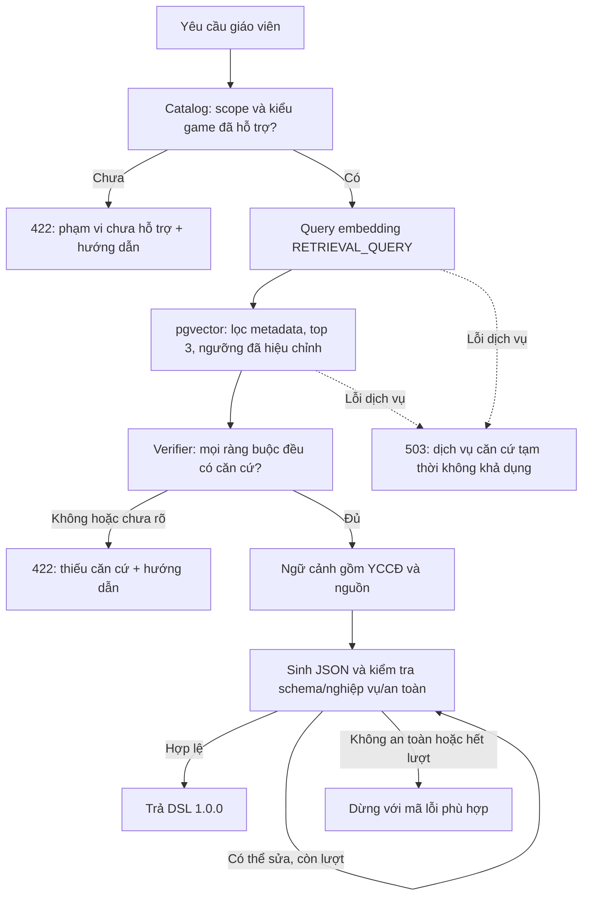

# Brainstorm: RAG có căn cứ và sinh game phù hợp chương trình

Ngày: 2026-10-30. Trạng thái: **đã được người dùng cho triển khai P0/P1; mã có kiểm thử local, chưa nghiệm thu phát hành**. Xem [execution ledger](../../rag-spike/implementation-progress.md) về các cổng duyệt dữ liệu và đo live còn mở. Phần hiện trạng dưới đây là baseline lúc lập thiết kế, không phải danh sách thành phần mới đã triển khai.

## 1. Mục tiêu và người sử dụng

Giáo viên tiểu học cần nhập chủ đề, môn, lớp, kiểu game và nhận game hợp lệ, an toàn, có căn cứ chương trình phù hợp với yêu cầu. Khi chưa hỗ trợ hoặc chưa đủ căn cứ, giáo viên cần hiểu lý do và biết bước tiếp theo, không phải đoán nguyên nhân từ một thông báo lỗi chung.

Nhóm phát triển cần kiểm chứng chất lượng, phát hiện gián đoạn và thay đổi thuật toán mà không phá DSL 1.0.0. Không coi “truy xuất đúng YCCĐ” là bằng chứng tự động cho “mọi câu hỏi sinh ra đúng YCCĐ”.

Phạm vi kế hoạch này là backend pilot và contract lỗi. Checkout mới có `AuthController`; `frontend/src/pages/GameGeneratorPlaceholder.tsx` còn là màn chờ, chưa có endpoint/UI sinh game để chứng minh trải nghiệm giáo viên đầu cuối. Các tiêu chí HTTP được kiểm qua `GlobalExceptionHandler` và service; việc đưa thông báo lên màn tạo game cần một đợt API/UI riêng. Không báo hoàn thành trải nghiệm giáo viên chỉ bằng unit test backend.

## 2. Hiện trạng đã kiểm tra và khác biệt với mô tả đầu vào

Đường dẫn trong phần này tính từ gốc repository.

| Nội dung | Bằng chứng trong checkout | Hệ quả thiết kế |
|---|---|---|
| Có đủ Retrieval, Augmentation, Generation | `CurriculumRAGService`, `CurriculumContextProvider`, `GameGenerationService`, `GeminiGameContentGenerator` trong `backend/src/main/java/com/aigameplatform/backend/service/` | Luồng hiện tại đã là RAG; đợt này củng cố tính đúng và vận hành |
| Pilot QUIZ / MATH / GRADE_1 | `service/generation/GameGenerationService.java#retrieveCurriculumContext` | Phân biệt phạm vi kiểu game với phạm vi dataset |
| 23 YCCĐ thật, 5 đối chứng | `backend/src/main/resources/curriculum/spike/math-grade1/manifest.json` | Chưa thể nhận là có 558 chunk hoặc hỗ trợ Mầm non |
| Lọc control, môn/lớp, nguồn, phiên bản, model; top 3 và ngưỡng 0.855 mặc định | `service/curriculum/CurriculumRAGService.java`, `CurriculumRagConfiguration.java` | Giữ bộ lọc; kiểm tra đúng thang điểm adapter trước khi mô tả bằng SQL |
| Kiểm tra corpus khi tạo bean | `CurriculumRagConfiguration.java#curriculumRagService` | Lỗi corpus/DB có thể ngăn khởi tạo RAG; cần tách readiness khỏi startup check của riêng RAG |
| Chỉ embedding topic; chưa thấy cache trong luồng này | `CurriculumRAGService.java#retrieve` và `CurriculumRagConfiguration.java` | Cache file/khóa toàn cục là vấn đề người dùng nêu, chưa xác nhận tại checkout |
| Chưa thấy catalog, verifier 616 dòng regex, reviewer Gemini | Không có các class tương ứng trong `backend/src/main` qua tìm kiếm | Thiết kế dưới đây là thành phần đề xuất, không phải refactor class đã có |
| DSL metadata hiện chỉ có title, subject, gradeLevel, topic | `backend/src/main/java/com/aigameplatform/backend/dto/dsl/GameMetadata.java` | Không cần gỡ `curriculumReview` khỏi checkout này; khóa tương thích để tránh thêm nhầm |
| Truy xuất một lần trước vòng retry; tối đa 10 lỗi phản hồi | `GameGenerationService.java#generate` | Giữ ngữ cảnh cố định giữa các lần thử |
| Lỗi đã có mã riêng | `backend/src/main/java/com/aigameplatform/backend/exception/ErrorCode.java` | Tái sử dụng mã hiện có; không tùy tiện đổi thành `UNSUPPORTED_SCOPE` |

Những khác biệt này có thể đến từ nhánh hoặc phiên bản khác. Trước triển khai phải kiểm tra lại diff và tái đối chiếu nếu có code mới; không sao chép một bộ regex hoặc cache chưa tìm thấy.

## 3. Phạm vi, ưu tiên và phương án

**P0:** catalog và lỗi rõ ràng; xác nhận căn cứ theo ràng buộc có cấu trúc; giữ DSL; kiểm thử holdout; giữ truy xuất một lần và các lớp kiểm tra an toàn.

**P1:** hướng dẫn khi từ chối, đo vận hành, tách kiểm tra RAG khỏi khởi tạo bean. Đây không phải cam kết toàn ứng dụng vẫn khởi động khi database lõi không hoạt động: JPA/Flyway vẫn có phụ thuộc riêng.

**P2:** benchmark cách tạo query có môn/lớp; tách công cụ offline thành module Maven riêng. Chỉ thêm cache nếu phép đo chứng minh cần thiết. Bổ sung dữ liệu Mầm non là đợt độc lập cần nguồn và người duyệt.

| Phương án | Lợi ích | Đánh đổi | Quyết định đề xuất |
|---|---|---|---|
| Chỉ similarity và ngưỡng | Ít thay đổi, ít độ trễ | Dễ nhận nhầm “1000” thành “100”, không chứng minh nội dung game | Giữ làm baseline so sánh |
| Retrieval + ràng buộc có cấu trúc + validation đầu ra | Giải thích được, kiểm thử được các điều kiện quan trọng; không thêm AI call trên luồng mặc định | Cần tác giả/giáo viên duyệt phạm vi và dữ liệu ràng buộc | **Chọn cho đợt cải thiện** |
| LLM duyệt mọi yêu cầu/game | Linh hoạt với ngôn ngữ | Thêm chi phí, độ trễ, lỗi ngẫu nhiên; không phải bằng chứng tuyệt đối | Chỉ nghiên cứu/đánh giá offline; chưa bật trên đường trả game |

## 4. Yêu cầu nghiệp vụ và nghiệm thu

Các chỉ tiêu định lượng ở đây là **đề xuất để duyệt**, chưa phải kết quả thực nghiệm.

| ID / ưu tiên | Tình huống và hành vi phải đạt | Nghiệm thu quan sát được |
|---|---|---|
| BR-01 / P0 | Giáo viên chọn scope chưa có dataset hoặc kiểu game chưa hỗ trợ: báo rõ giới hạn trước khi gọi embedding/sinh game | Mầm non nhận HTTP 422 `GENERATION_SCOPE_UNSUPPORTED`; số lần gọi query embedding và generation bằng 0; không ngụ ý môn/lớp đó sai về nghiệp vụ giáo dục |
| BR-02 / P0 | Topic hợp lệ nhận căn cứ đúng môn/lớp/phiên bản; đối chứng không bao giờ xuất hiện | Các fixture distractor gần hơn vẫn không lọt top 3; leakage = 0; chunk thiếu nhãn control cũng bị loại |
| BR-03 / P0 | Kiểm tra mọi ràng buộc quan trọng trước khi coi căn cứ là đủ | “Đếm từ 1 đến 5” được hỗ trợ bởi YCCĐ đếm trong phạm vi 100; “cộng trong phạm vi 1000” và “cộng có nhớ” không được suy ra từ cộng không nhớ trong phạm vi 100; thiếu điều kiện hoặc câu mơ hồ phải từ chối yêu cầu làm rõ |
| BR-04 / P0 | Có ứng viên gần nghĩa nhưng không chứng minh yêu cầu: không sinh game | HTTP 422 `CURRICULUM_EVIDENCE_NOT_FOUND`; generation không được gọi; không dùng score để vượt qua verifier |
| BR-05 / P1 | Khi từ chối, giáo viên nhận hướng dẫn có thể hành động | Thông báo tiếng Việt phân biệt scope chưa hỗ trợ với thiếu căn cứ; gợi ý chủ đề đã có nguồn trong cùng scope, không tự đổi yêu cầu rồi sinh game |
| BR-06 / P1 | Gemini embedding/pgvector gián đoạn được báo là lỗi dịch vụ | HTTP 503 `CURRICULUM_UNAVAILABLE`; không trả “chủ đề ngoài chương trình”; không sinh thiếu ngữ cảnh; lỗi RAG không gây gọi AI lặp vô hạn |
| BR-07 / P0 | Căn cứ và kiểm tra an toàn được giữ xuyên suốt sinh game | Retrieve 1 lần; tối đa 2 retry mặc định, tức tối đa 3 lần sinh; context không đổi; tối đa 10 lỗi phản hồi; UNSAFE dừng ngay, không retry |
| BR-08 / P0 | Client tiếp tục đọc DSL 1.0.0 như hiện tại | Không thêm `metadata.curriculumReview` hay đổi schema v1.0.0; tất cả ví dụ/schema/factory tests cũ còn hợp lệ; bước mặc định có 0 reviewer call bổ sung |
| BR-09 / P1 | Chẩn đoán vận hành không làm lộ nội dung giáo viên | Có count/status và thời gian mỗi giai đoạn; không log topic/prompt/output, user ID, chunk text hoặc secret; không dùng các giá trị này làm metric label |
| BR-10 / P0 | Kết luận chất lượng dựa trên bộ đánh giá độc lập | Holdout 60 query được duyệt, không trùng nhóm paraphrase với tập tune; Hit@3 ≥ 90% trên 30 query có căn cứ; verifier chấp nhận ≥ 90% của 30 query này; false acceptance = 0/30 query không đủ căn cứ; leakage = 0; báo cáo riêng từng nhóm và giới hạn mẫu nhỏ |
| BR-11 / P2 | Tối ưu embedding query/cache dựa trên số liệu và riêng tư | Mặc định chưa thêm cache; chỉ thử query topic so với query có môn/lớp trên tập tune; nếu thêm cache thì giới hạn 1000 entry, TTL 15 phút, chỉ RAM, khóa theo SHA-256 của model/dimension/task/query-format/query; không persisted topic; lỗi không được cache |
| BR-12 / P2 | Mở rộng corpus và công cụ có đường đi rõ ràng | Mầm non chỉ bật khi có nguồn, manifest, YCCĐ và benchmark được duyệt; CLI Extract/Ingest/Evaluate vẫn hoạt động sau tách module; chưa thêm ANN khi chưa có bottleneck đo được |

BR-03 là mục tiêu trong miền có thể biểu diễn, không phải cam kết hiểu toàn bộ tiếng Việt. Bản đầu hỗ trợ số tự nhiên, giới hạn phạm vi, cộng/trừ, điều kiện nhớ/không nhớ và đơn vị được gán nhãn trong Toán lớp 1. Ràng buộc không phân tích được trả kết quả cần làm rõ, không tự coi là phù hợp. Bộ mẫu phải có “đếm/đem”, phủ định, nhiều điều kiện và cách viết không dấu; không dùng bỏ dấu làm biểu diễn duy nhất.

BR-10 đo chất lượng tìm căn cứ và quyết định trước sinh game. Không dùng chỉ số đó để tuyên bố tất cả câu hỏi AI sinh ra đã được chứng nhận đúng chương trình. Nội dung sinh vẫn qua schema/nghiệp vụ/an toàn; đánh giá thủ công game là bằng chứng bổ sung trước mở rộng pilot.

## 5. Luồng và trách nhiệm đề xuất

- `CurriculumCatalog` (mới): danh mục dataset đã duyệt; phân biệt supported với ready. Không suy ra supported chỉ từ enum hoặc có vài dòng trong DB.
- `CurriculumRAGService` (có): chỉ tìm ứng viên; `FOUND` tại tầng này nghĩa có ứng viên, chưa đủ để quyết định được sinh game. Dùng thang score của LangChain4j, không ghi “cosine ≥ 0.855” nếu adapter có chuyển đổi score.
- `CurriculumEvidenceVerifier` (mới): parser → yêu cầu có kiểu → đối chiếu với sidecar ràng buộc do người duyệt. Giữ nguyên chunk text/ID; kiểm tra sidecar đầy đủ và trùng phiên bản khi xác nhận dataset ready. Không suy ra một yêu cầu phức hợp đã được đáp ứng chỉ vì mỗi số xuất hiện đâu đó trong top 3.
- `VerifiedCurriculumContextProvider` (mới): orchestration catalog → retrieval → verifier → context; giữ interface `CurriculumContextProvider` để hạn chế ảnh hưởng generation.
- `CurriculumAvailability` (mới): kiểm tra corpus khi có yêu cầu đầu tiên, TTL 30 giây, kiểm tra lại khi thất bại sau TTL; DB không truy cập được thì 503. Không lấy một kết quả ready cũ làm lý do bỏ qua lỗi truy vấn hiện tại. Phụ thuộc cơ sở dữ liệu lõi của Spring là phạm vi khác.
- `GameGenerationService` (có): dùng context đã xác minh, tái sử dụng giữa retry; không thêm reviewer đồng bộ.
- Hướng dẫn từ chối dùng `error.code` và `error.message` sẵn có. Chưa cần thêm trường vào envelope hoặc DSL. Message chọn từ template và mục tiêu học đã duyệt, không đưa exception provider/raw SQL cho giáo viên.
- Metrics có stage/status và duration; label hữu hạn: `stage`, `outcome`, `subject`, `gradeLevel`. Không thêm phụ thuộc Actuator nếu chưa kiểm tra dependency và cơ chế quan sát đang có; task instrumentation dùng Micrometer khi dependency sẵn có, bổ sung registry core nếu cần.

Ràng buộc số được so bằng quan hệ bao hàm: phạm vi yêu cầu phải nằm trong phạm vi YCCĐ tương ứng cùng phép/kỹ năng. Khi đếm trong 100 hỗ trợ đếm trong 5, đó là phép bao hàm được quy định và kiểm thử; không phải “5 phải xuất hiện nguyên văn trong YCCĐ”. Điều kiện nhớ, đơn vị, phép tính và phủ định không được mất khi ghép nhiều chunk.

Không thay đổi embedding text trong đợt đầu. So sánh cách thêm môn/lớp vào query là thí nghiệm riêng; nếu chọn cách mới phải version query format, ghi thí nghiệm và chạy lại holdout, không tự đổi mọi ngưỡng.

## 6. Đánh giá và điều kiện hoàn tất

1. Tập tune mới 30 query và holdout mới 60 query được lập theo nhóm ý định, duyệt đáp án/căn cứ trước khi gọi embedding. Holdout gồm 20 đúng phạm vi, 20 sát ranh giới (10 có căn cứ/10 thiếu căn cứ), 20 ngoài phạm vi. Người hiệu chỉnh không xem nhãn holdout cho tới khi khóa cấu hình; lần mở holdout được ghi nhận và bộ đó trở thành regression sau quyết định phát hành.
2. Tiếp tục dùng tập 10 positive/3 negative cũ làm regression, không gọi là holdout. Không chọn ngưỡng dựa trên holdout rồi báo lại trên chính holdout là kiểm tra độc lập.
3. Fixture local kiểm tra luật, lọc, lỗi và call count. Live pgvector/Gemini kiểm tra score mapping, SQL/filter thực, độ trễ, call count/chi phí thực tế; cần cấu hình hợp lệ và không ghi secret vào báo cáo.
4. Chỉ tiêu độ trễ chưa chốt số khi chưa có baseline. Báo cáo p50/p95 cho retrieval, verification, generation và tổng; cache/lựa chọn model/ANN phải có so sánh trước–sau và trade-off chất lượng.
5. Kiểm thử hợp đồng giữ DSL; smoke luồng sinh, từ chối, dịch vụ lỗi. Full backend test ghi riêng lỗi môi trường JDBC; không đổi test để che thiếu cấu hình.
6. Trước mở pilot, người duyệt nghiệp vụ kiểm tra thủ công ít nhất 20 game từ các nhóm chủ đề hợp lệ, ghi lỗi nội dung và ràng buộc; lỗi vượt phạm vi có thể tái hiện phải được xử lý trước khi phát hành. Đây là mẫu kiểm tra, không là chứng minh mọi game tương lai đúng.

## 7. Đối chiếu 12 vấn đề do người dùng nêu

| Vấn đề | Hướng xử lý | Yêu cầu / task |
|---|---|---|
| 1. Thêm review vào DSL | Giữ DSL; chưa có field này tại checkout | BR-08 / T1, T4 |
| 2. Chưa có Mầm non | Hiển thị giới hạn; mở dữ liệu theo đợt có duyệt riêng | BR-01, BR-12 / T1, T8 |
| 3. Benchmark dễ | Tune/holdout theo nhóm và boundary cases | BR-10 / T5 |
| 4. Chưa có số liệu online | Instrumentation không nội dung giáo viên | BR-09 / T6 |
| 5. Regex dễ vỡ | Verifier có kiểu, nhãn nguồn duyệt tay và từ chối mơ hồ | BR-03, BR-04 / T2, T3 |
| 6. Cache file/khóa toàn cục | Chưa thấy trong checkout; không bổ sung cache file; RAM có điều kiện | BR-09, BR-11 / T6, T7 |
| 7. Reviewer tăng độ trễ | Không reviewer đồng bộ mặc định; đánh giá offline nếu cần | BR-07, BR-08 / T4 |
| 8. Spike trong src/main | Tách module sau khi ổn định contract | BR-12 / T8 |
| 9. DB lỗi làm app không lên | Bỏ startup check corpus riêng RAG, có readiness; không hứa loại phụ thuộc DB lõi | BR-06 / T3 |
| 10. 422 không hướng dẫn | Template có căn cứ, không tự đổi yêu cầu | BR-05 / T4 |
| 11. Chỉ embedding topic | Thử nghiệm query format riêng; chỉ đổi nếu có bằng chứng | BR-11 / T7 |
| 12. Chưa ANN | Giữ exact search, đo trước khi tối ưu | BR-12 / T6, T8 |

## 8. Quyết định cần duyệt trước thực thi

### Cập nhật về biến thể RAG

Người dùng đã chọn cập nhật brainstorm/plan thử nghiệm và tiếp tục nghiệm thu pipeline hiện có. [Ma trận A–E và yêu cầu nghiệp vụ EX-01…05](../../rag-spike/rag-variants-experiment.md) là phụ lục thử nghiệm; chưa thay kiến trúc runtime. Hybrid, HyDE và LLM judge phải được đo riêng; guard phải giữ toàn bộ điều kiện, và gợi ý lớp khác chỉ khi có nguồn chính được duyệt. Kết quả nghiệm thu hiện tại luôn ghi rõ arm A.

- Duyệt phạm vi P0/P1, các chỉ tiêu BR-10 và người chịu trách nhiệm duyệt dữ liệu ràng buộc/benchmark.
- Duyệt lựa chọn giữ DSL và không thêm reviewer đồng bộ.
- Xác nhận có triển khai P2 ngay hay chỉ bàn giao kế hoạch; P2 không là điều kiện phát hành P0/P1.

Tài liệu kế hoạch đi kèm: `../plans/2026-10-30-rag-generation-business-plan.md`. Các lựa chọn bên trên là đề xuất cụ thể để review, không tự coi đã được chấp thuận.
