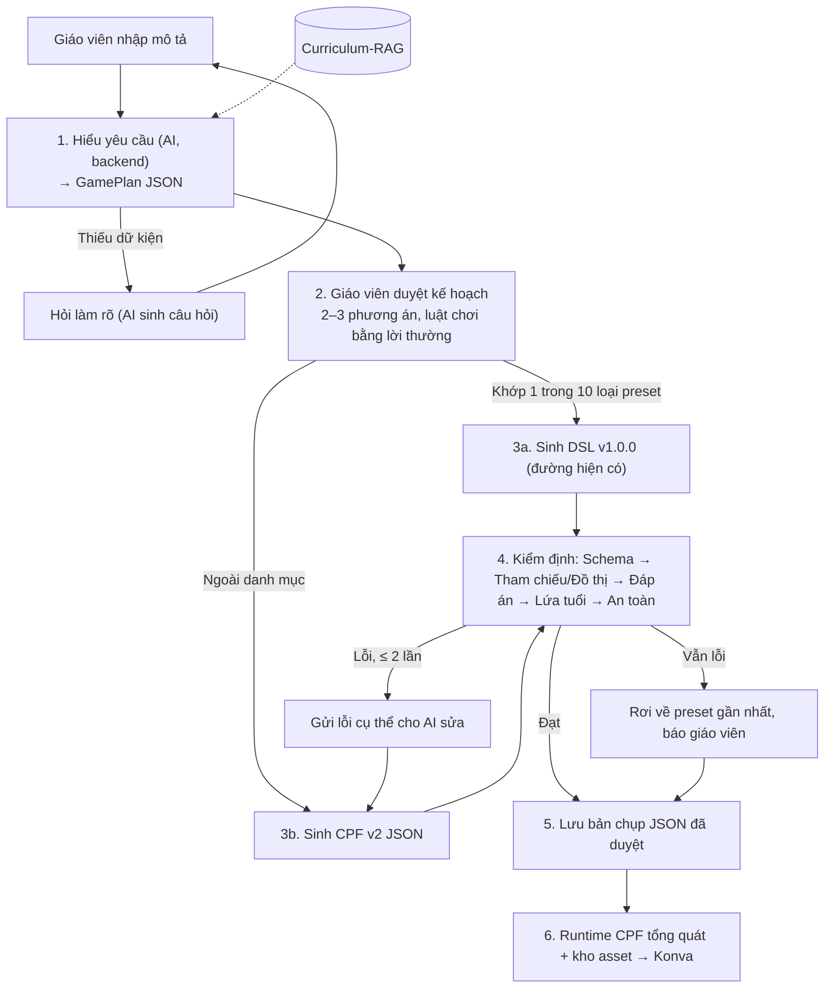

# Thiết kế Pipeline tạo game v2 (AI lập kế hoạch, code kiểm định và chạy)

Trạng thái: **Đã duyệt hướng và 4 quyết định** (2026-11-07, mục 5); nguồn asset và schema CPF v2 còn chờ duyệt ở Pha 0. Chưa có code theo tài liệu này.
Liên quan: [[Sơ đồ hệ thống]], [[Mô tả ngoài danh mục game]], [[Tiêu chuẩn Đồ họa và Asset Pipeline]], [[Trạng thái thực tế]], `docs/game-json-dsl-v1.0.0.md`, `docs/openapi/openapi.yaml`.

## 1. Vì sao cần v2

Đối chiếu code nhánh `dev` (commit `6c71f36` và thay đổi chưa commit, ngày 2026-11-07) với sơ đồ pipeline trong [[Sơ đồ hệ thống]]:

| Sơ đồ thiết kế | Code trên `dev` |
|---|---|
| AI phân tích ý định 3 tầng, có Curriculum-RAG | Regex và danh sách từ khóa trong `frontend/src/services/pipeline/` (`parseIntent`, `generateDynamicCpfSceneGraph`); không gọi AI |
| Hỏi làm rõ khi thiếu dữ kiện | Có `promptCompletenessAssessor`, dựa trên luật, chỉ Toán và Tiếng Việt |
| AI Game Planner + Pattern Bank | Không có; `recommendGames` trả 3 gợi ý cố định cho mọi mô tả |
| AI sinh CPF JSON, Module 1 kiểm định và tự sửa | Code TypeScript tự dựng scene graph; chỉ 3 cơ chế (bắn cung, hứng quả, chạm bong bóng), nội dung luôn là số chẵn/lẻ |
| 3 cổng chặn trước khi xuất bản | `runGamePipeline` chạy 3 cổng nhưng không màn hình nào gọi; các màn gọi thẳng `generateDynamicCpfSceneGraph` |
| Học sinh chơi bản đã duyệt | `PlayPage`, `PresentPlay` sinh lại scene graph từ prompt mỗi lần mở (số ngẫu nhiên) |
| Đồ họa từ kho asset SVG | Đường CPF vẽ bằng hình học Konva, không nạp asset |

Ví dụ lỗi định tuyến đo được (regex ở `dynamicCpfGenerator.ts`): "Trò chơi tô màu con vật" thành hứng quả (chuỗi "tro" chứa "ro"), "Đua xe phép nhân" thành bắn cung (chứa "na"), "Ghép tranh với tên con vật" thành bắn cung (chứa "ten").

Hệ quả người dùng gặp khi thử: mô tả ngoài các mẫu viết sẵn không ra game đúng ý; giao diện game chưa rõ ràng, chưa bắt mắt. 64 test của `services/pipeline` đều qua vì chỉ dùng câu mẫu.

## 2. Nguyên tắc

1. **AI quyết định "chơi gì", code quyết định "có đúng không".** AI (backend, LangChain4j/Gemini) lập kế hoạch và sinh JSON; code kiểm định, tự tính lại đáp án; runtime chỉ chạy JSON.
2. **Cơ chế tách khỏi nội dung.** Cùng bộ câu hỏi có thể chạy trên nhiều cơ chế; thêm game mới là thêm JSON, không thêm code.
3. **AI chỉ chọn trong danh mục.** Khối CPF và asset đều có danh sách trắng; AI không bịa khối hay ảnh.
4. **Bản đã duyệt là bản được chơi.** Lưu bản chụp JSON; không sinh lại lúc chơi.
5. **Đo bằng mô tả lạ, không bằng câu mẫu.**

Kiến trúc đã chốt trong `CLAUDE.md` giữ nguyên: Strategy, Chain of Responsibility (`AbstractGameValidator`), Factory, LangChain4j; DSL v1.0.0 không đổi.

## 3. Luồng v2

### 3.1 Hiểu yêu cầu (GamePlan)
Đầu ra AI có cấu trúc (Structured Outputs), gồm: môn, lớp, kỹ năng (có căn cứ RAG), cơ chế đề xuất, thế giới/nhân vật, độ khó, danh sách câu hỏi làm rõ nếu thiếu. Thay `parseIntent`, `recommendGames` và phần luật của `promptCompletenessAssessor`.

### 3.2 CPF v2 (phác thảo, chốt ở Pha 0)
Một game CPF gồm 5 phần:

- `world`: `backgroundId`, `mascotId`, nhạc nền.
- `entities`: vật thể, mỗi vật có `assetId` trong danh mục, vị trí theo %, nhãn, `slot` nối với nội dung.
- `behaviors`: `MOVE`, `PATROL`, `FALL`, `FLOAT`, `ADVANCE`, `MORPH`, `SPAWN`.
- `rules`: trigger (`TAP`, `DRAG_DROP`, `COLLIDE`, `TIMER`) → action (`CHECK`, `SCORE`, `EFFECT`, `MOVE`, `NEXT`, `END`).
- `content`: câu hỏi và đáp án, tách khỏi cơ chế.

Đây là cách hiện thực bộ 20 khối của [[Mô tả ngoài danh mục game]]. Giữ schema nông vì Gemini dễ vướng giới hạn với JSON lồng sâu (backend đã gặp, xem `decoderSchema` trong `GeminiGameContentGenerator`).

### 3.3 Kiểm định và tự sửa
Thêm validator CPF vào chuỗi `AbstractGameValidator` hiện có (không bỏ qua lớp nào):
- Schema: chỉ khối có trong danh mục; `assetId` tồn tại.
- Tham chiếu: ID trong `rules` phải có trong `entities`.
- Đồ thị luật: có đường thắng, có `END`, không có chu trình vô tận.
- Đáp án: code tự tính lại; mỗi câu đúng một đáp án; không trùng.
- Lứa tuổi: vùng chạm ≥ 64px, ≤ 15 vật cùng lúc, độ dài chữ.
- An toàn: Layer 3 như hiện tại.

Vòng tự sửa dùng mẫu `retryPrompt` đã có. Thông báo của cổng chỉ nói điều đã kiểm, không ghi "đạt 100%" chung chung.

### 3.4 Đồ họa
- Manifest asset JSON: id, loại (nhân vật/vật/nền/hiệu ứng), từ khóa tiếng Việt, giấy phép, nguồn.
- Runtime vẽ bằng ảnh (nạp trước), nền 3 lớp parallax; hiệu ứng hiện có (confetti, popup, rung) thành action `EFFECT` dùng chung.
- Hình vẽ thủ công trong `CpfUniversalCanvas.tsx` chỉ còn làm dự phòng.
- Nguồn asset lấy từ bảng 16 nguồn CC0/MIT trong [[Tiêu chuẩn Đồ họa và Asset Pipeline]]. Thêm file ảnh, không thêm thư viện.

### 3.5 Kiểm thử
- Bộ 40 mô tả đa dạng (cơ chế lạ, nhiều môn, mô tả mơ hồ, mô tả vô lý), mỗi mô tả có kỳ vọng.
- Chạy offline bằng output AI ghi sẵn (fixture), không gọi API thật (quy tắc `CLAUDE.md`).
- Test runtime: nạp JSON, giả lập thao tác, kiểm điểm và trạng thái kết thúc.

### 3.6 Code hiện có trên `dev`
- Bỏ: bộ định tuyến regex, `recommendGames` cố định, sinh lại scene graph lúc chơi.
- Giữ, đổi vai: `dynamicMathGenerator`, `dynamicLanguageGenerator` thành bộ kiểm chứng đáp án/sinh đáp án nhiễu và dữ liệu mô phỏng; `cpfRuntime.ts` tổng quát hóa thay vì viết lại; `soundBus`, `themeResolver` dùng tiếp.

## 4. Lộ trình

| Pha | Việc | Xong khi |
|---|---|---|
| 0 | Chốt schema CPF v2, tài liệu, kiểu TypeScript, bộ 40 mô tả kỳ vọng | Người dùng duyệt schema; 5 JSON mẫu viết tay hợp lệ |
| 1 | Runtime tổng quát + manifest asset (frontend) | 5 JSON mẫu (gồm đua xe, câu cá) chơi được, không có code riêng từng game |
| 2 | Validator CPF (backend) + test | Bắt đúng các lỗi cài sẵn trong JSON mẫu |
| 3 | AI sinh GamePlan + CPF, vòng tự sửa, endpoint | Bộ 40 mô tả (fixture) đạt ngưỡng người dùng chốt |
| 4 | Nối giao diện: hỏi làm rõ → duyệt kế hoạch → xem thử → lưu bản chụp | Đi trọn luồng trên trình duyệt; bỏ regex router |
| 5 | Làm đẹp: thêm asset, parallax, hiệu ứng | Người dùng xem trên trình duyệt và đồng ý |

Mỗi pha dừng chờ duyệt.

## 5. Quyết định đã chốt (2026-11-07, ghi ở `docs/decisions.md`)

1. **Lưu game CPF:** loại `CUSTOM` với bảng riêng giữ JSON CPF đã duyệt, migration Flyway mới. Mở rộng có chủ đích kiến trúc 10 subclass `QuestionGame`; cách ánh xạ cụ thể chốt ở Pha 0.
2. **Contract:** mở contract CPF v2 cạnh DSL v1.0.0, không sửa DSL; tài liệu, JSON Schema, endpoint trong `openapi.yaml` viết trước khi code.
3. **Nguồn asset:** Claude đề xuất bộ CC0 cụ thể, người dùng duyệt trước khi tải. Đề xuất hiện tại: mục 5.1.
4. **Nhánh:** commit phần đang sửa trên `dev`, rồi làm tiếp trên `dev`.

### 5.1 Đề xuất nguồn asset (chờ duyệt)

Chọn từ bảng 16 nguồn của [[Tiêu chuẩn Đồ họa và Asset Pipeline]], chỉ lấy nguồn ghi CC0 để khỏi phải theo dõi ghi công:

| Vai trò | Nguồn | Lý do |
|---|---|---|
| Chính: nhân vật, vật thể, nền, phương tiện, UI, âm thanh | Kenney.nl | Bảng ghi CC0 1.0; một tác giả nên phong cách đồng bộ; có cả SVG/PNG lẫn âm thanh |
| Bổ sung: đồ vật, thức ăn, cây cối vẽ tay | Glitch Public Domain Archive | Bảng ghi CC0 1.0; phong cách sách tranh hợp trẻ nhỏ |

Không chọn làm nguồn chính: itch.io (giấy phép tùy gói), OpenMoji (CC-BY, phải ghi công), Freepik/Flaticon (phải ghi công, phong cách lệch), ảnh chụp Pexels/Pixabay (lệch phong cách hoạt hình).

Giấy phép trong bảng là thông tin của tài liệu wiki, chưa kiểm lại trên trang gốc. Khi tải: kiểm giấy phép từng gói, ghi nguồn và giấy phép vào manifest asset, giữ dung lượng gọn (chỉ gói cần cho 5 JSON mẫu của Pha 1).

## 6. Ngoài phạm vi, rủi ro

- Ngoài phạm vi: AI sinh ảnh, CPF trong phòng Live, vật lý nhiều vật thể.
- Rủi ro: giới hạn structured output với schema lồng sâu; tỉ lệ khớp ý phụ thuộc prompt, đo bằng bộ 40 mô tả.
