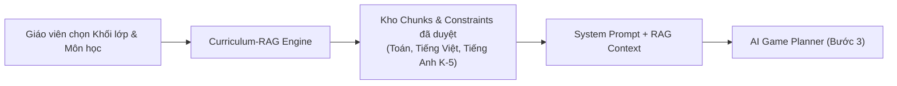

# Chương trình GDPT 2018 và Kiến trúc Curriculum-RAG

> **Nguồn tài liệu gốc**: Toàn bộ thư mục `docs/rag-spike/` (19 tài liệu kiểm toán và hợp đồng chuẩn kiến thức)  
> **Cập nhật**: 2026-11-04  
> **Liên kết liên quan**: [[Sơ đồ hệ thống]], [[24 Cơ chế game chuẩn hóa]], [[Cơ sở khoa học và GamED-AI]], [[UC-02]], [[index]]

---

## 1. Vai trò của Curriculum-RAG trong Pipeline Sinh Game AI

Trong **Sơ đồ Pipeline Hệ thống (Cột Trái - Tri thức & Tài nguyên)**, **Curriculum-RAG** đóng vai trò là "Bộ neo sư phạm" giúp AI không bao giờ bịa đặt kiến thức hay sinh bài tập vượt quá tầm nhận thức của học sinh:
- **Chuẩn hóa theo Chương trình Giáo dục Phổ thông 2018 (Bộ GD&ĐT)**: Khóa cứng phạm vi số, dạng toán, bảng chữ cái, quy tắc chính tả, và từ vựng theo từng khối lớp từ Mầm non đến Lớp 5.
- **Không suy diễn ngoài chuẩn**: AI chỉ được phép sinh các câu hỏi và cơ chế nằm trong danh mục Yêu cầu Cần đạt (YCCĐ) đã được kiểm toán.

---

## 2. Hệ Thống Tài Liệu Kiểm Toán Chuẩn Kiến Thức (Source Audits)

Toàn bộ 14 bản kiểm toán chi tiết chuẩn kiến thức kỹ năng theo từng môn học và khối lớp:

### 2.1. Môn Toán (Math)
- [[docs/rag-spike/source-audit-math-grade2|Kiểm toán Toán Lớp 2]]: Phép cộng/trừ có nhớ trong phạm vi 100, bảng nhân/chia 2 và 5.
- [[docs/rag-spike/source-audit-math-grade3|Kiểm toán Toán Lớp 3]]: Bảng nhân/chia từ 3 đến 9, số có 4 chữ số, chu vi/diện tích cơ bản.
- [[docs/rag-spike/source-audit-math-grade4|Kiểm toán Toán Lớp 4]]: Phân số, góc nhọn/tù, số có nhiều chữ số.
- [[docs/rag-spike/source-audit-math-grade5|Kiểm toán Toán Lớp 5]]: Số thập phân, tỉ số phần trăm, diện tích hình tam giác/hình thang.

### 2.2. Môn Tiếng Việt (Vietnamese)
- [[docs/rag-spike/source-audit-vietnamese-grade1|Kiểm toán Tiếng Việt Lớp 1]]: Âm vần, thanh điệu, ghép từ đơn, từ có hình ảnh.
- [[docs/rag-spike/source-audit-vietnamese-grade2|Kiểm toán Tiếng Việt Lớp 2]]: Từ chỉ sự vật, hoạt động, dấu câu (chấm, phẩy, hỏi).
- [[docs/rag-spike/source-audit-vietnamese-grade3|Kiểm toán Tiếng Việt Lớp 3]]: So sánh, nhân hóa, mở rộng vốn từ theo chủ điểm.
- [[docs/rag-spike/source-audit-vietnamese-grade4|Kiểm toán Tiếng Việt Lớp 4]]: Danh từ, động từ, tính từ, câu kể, câu hỏi.
- [[docs/rag-spike/source-audit-vietnamese-grade5|Kiểm toán Tiếng Việt Lớp 5]]: Từ đồng nghĩa, trái nghĩa, đại từ, liên từ.

### 2.3. Môn Tiếng Anh (English) & Mầm non (Kindergarten)
- [[docs/rag-spike/source-audit-kindergarten|Kiểm toán Mầm non (3-5 tuổi)]]: Nhận biết màu sắc, con vật, hình khối, số đếm 1-10.
- [[docs/rag-spike/source-audit-english-grade1-2|Kiểm toán Tiếng Anh Lớp 1-2]]: Từ vựng gia đình, đồ chơi, màu sắc, phát âm ngữ âm cơ bản.
- [[docs/rag-spike/source-audit-english-grade3|Kiểm toán Tiếng Anh Lớp 3]]: Từ vựng trường học, số đếm đến 20, mẫu câu chào hỏi/hỏi tuổi.
- [[docs/rag-spike/source-audit-english-grade4|Kiểm toán Tiếng Anh Lớp 4]]: Giờ giấc, nghề nghiệp, hoạt động hàng ngày.
- [[docs/rag-spike/source-audit-english-grade5|Kiểm toán Tiếng Anh Lớp 5]]: Quá khứ đơn, vị trí địa lý, cảm xúc.
- [[docs/rag-spike/source-audit|Báo cáo Tổng hợp Kiểm toán Nguồn]]: Quy chuẩn trích xuất và đối soát chunk văn bản SGK.

---

## 3. Hợp Đồng Ngữ Cảnh, Đánh Giá & Thẩm Định Kỹ Thuật

- [[docs/rag-spike/context-contract|Hợp đồng Ngữ cảnh (Context Contract)]]: Quy định cấu trúc JSON mà Curriculum-RAG bơm vào System Prompt để AI tuân thủ.
- [[docs/rag-spike/constraints-review|Biên bản Duyệt Ràng buộc]]: Bản phê chuẩn nhãn ràng buộc dữ liệu toán học lớp 1 (SHA-256).
- [[docs/rag-spike/evaluation|Khung Đánh giá RAG]]: Tiêu chí đo lường độ chính xác (Precision/Recall) của RAG khi tìm kiếm chuẩn bài học.
- [[docs/rag-spike/verification|Quy trình Thẩm định]]: Các bước kiểm tra chéo giữa file chunk và sách giáo khoa bản quyền Bộ GD&ĐT.
- [[docs/rag-spike/plan|Kế hoạch Triển khai RAG]]: Lộ trình số hóa và nhúng vector toàn bộ SGK K-5.

- [[2026-10-30-rag-generation-business-plan|Kế hoạch Kỹ thuật Triển khai Grounded RAG Generation]]
