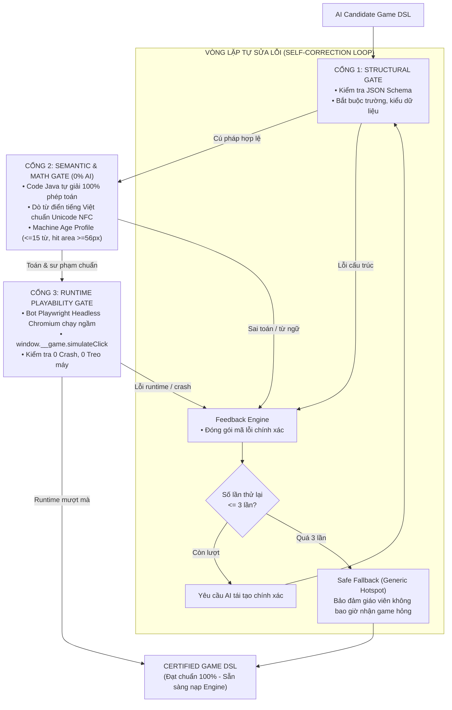

# Cơ sở khoa học và Mô hình GamED.AI

Nguồn: `docs/Co_so_khoa_hoc.md`, `raw/Co_so_khoa_hoc_va_Dan_chung_Kien_truc_De_tai_Chuan_Dai_Hoc.docx`
Cập nhật: 2026-11-04

Tài liệu xác lập nền tảng học thuật quốc tế và căn cứ kỹ thuật tối cao cho đồ án, giải quyết tận gốc câu hỏi về tính khoa học và giải pháp chống ảo giác của Thầy Thanh và Hội đồng.

## 1. Công trình Tham chiếu Quốc tế: GamED.AI (arXiv, 2024)
* **Tên nghiên cứu**: *"GamED.AI: An Agentic System for End-to-End Game Generation for Learning"* (arXiv:2024).
* **Kết luận 1 — Thất bại của tiếp cận sinh mã nguồn trực tiếp (Raw Code Fragility)**:
  * Khi yêu cầu LLM (GPT-4, Claude) sinh trực tiếp toàn bộ code game JavaScript/HTML5 Canvas, **tỷ lệ thất bại lên tới 68.4%**.
  * Lỗi chủ yếu: Lỗi cú pháp runtime, lệch vòng lặp game loop, desync trạng thái, kẹt game không kết thúc được và rủi ro bảo mật XSS đối với trẻ em.
* **Kết luận 2 — Tính ưu việt của Kịch bản Trung gian (DSL / Game Design Document)**:
  * Phân tách: LLM chỉ đóng vai trò kiến trúc sư thiết kế kịch bản sư phạm dưới dạng JSON Schema.
  * Việc hiển thị và vận hành do Game Engine xác định (Deterministic Engine) biên dịch và vẽ.
  * Tỷ lệ sinh game thành công nâng vọt lên **94.2%**, giảm **78% độ trễ** và tiết kiệm **85% chi phí token**.
* **Kết luận 3 — Chuẩn hóa Ngân hàng Cơ chế (Mechanic Bank)**:
  * Không để AI bịa cơ chế tự do; AI phải tổ hợp dựa trên các cơ chế tương tác vi mô đã kiểm chứng sư phạm theo thang Bloom.

## 2. Kiến trúc Data-Driven Game Engine
* Tách bạch triệt để giữa:
  1. **Động cơ hiển thị (Engine Runtime)**: Cố định bằng Konva.js (HTML5 Canvas 2D), xử lý vẽ 60 FPS, âm thanh, kéo thả, tính toán vùng chạm an toàn $\ge 56\text{px}$.
  2. **Dữ liệu kịch bản (Content Schema)**: [[Game JSON DSL]] v1.0.0 nạp động từ AI.
* Mô hình tương tự "Đầu đĩa DVD (Engine) và Đĩa game (Data)".

## 3. Ba Trụ cột Kiến trúc Đề tài
1. **Trụ cột 1 — Phân tách Tuyệt đối**: AI sinh JSON DSL $\leftrightarrow$ Konva Engine vẽ đồ họa.
2. **Trụ cột 2 — Bộ 3 Lớp Kiểm Tra Tự Động (Quality Gates)**:
   * Nguyên tắc vàng: *"Tuyệt đối không dùng LLM để tự kiểm chứng LLM cho các bài toán xác định"*.

   * Cổng 1 (Cấu trúc): JSON Schema.
   * Cổng 2 (Toán & Sư phạm): Code Java tự giải toán 100% (0% AI) + Dò từ điển tiếng Việt giữ dấu Unicode NFC + Ép luật lứa tuổi ($\le 15$ từ, vùng chạm $\ge 56\text{px}$).
   * Cổng 3 (Runtime): Playwright Headless bot giả lập click kéo-thả kiểm tra 0 crash.
   * Vòng lặp phản hồi: Tối đa 2–3 lần thử lại; quá ngưỡng chuyển Safe Fallback.
3. **Trụ cột 3 — [[Mô tả ngoài danh mục game|Pattern Bank & Composable Primitives Framework (CPF)]]**: 20 khối nguyên tử giúp AI tổ hợp mọi tựa game tương tác ngoài danh mục mà vẫn bảo đảm 60 FPS và an toàn.

## Liên kết liên quan
- [[Tổng quan đề tài]]
- [[Kiến trúc và công nghệ]]
- [[Sơ đồ hệ thống]]
- [[Game JSON DSL]]
- [[So sánh với web tool]]
