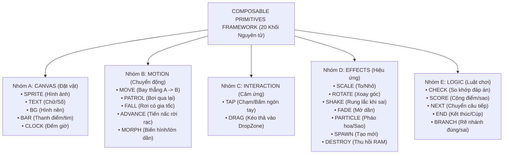
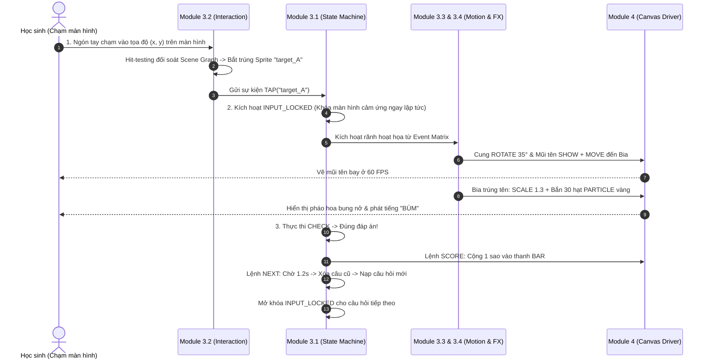

# Mô tả ngoài danh mục game & Composable Primitives Framework (CPF)

> **Nguồn tài liệu gốc**:  
> - `docs/Giáo viên mô tả ngoài danh sách game có sẵn/giải pháp/Giải pháp cho vấn đề nếu như giáo viên gửi mô tả nằm ngoài cơ chế game hiện có.pdf`  
> - `docs/Giáo viên mô tả ngoài danh sách game có sẵn/giải pháp/Module 1 Bộ Phân giải & Kiểm định Khối (Parser & Validator).pdf`  
> - `docs/Giáo viên mô tả ngoài danh sách game có sẵn/giải pháp/Module 2 Bộ Lắp ghép Đồ thị Trò chơi (Scene & Graph Assembler).pdf`  
> - `docs/Giáo viên mô tả ngoài danh sách game có sẵn/giải pháp/Module 3 Máy ảo Điều phối Đa năng (Virtual Runtime Engine).pdf`  
> - `docs/Giáo viên mô tả ngoài danh sách game có sẵn/giải pháp/Module 4 Tầng Kết xuất Phần cứng Canvas (Konva Driver).pdf`  
> - `docs/Dinh_huong_de_tai.md`, `raw/Pipeline_Tao_Tro_Choi_AI.drawio`  
> **Cập nhật**: 2026-11-07 (thêm mục 9 Hiện trạng cài đặt)  
> **Liên kết liên quan**: [[Game JSON DSL]], [[24 Cơ chế game chuẩn hóa]], [[Tiêu chuẩn Đồ họa và Asset Pipeline]], [[Sơ đồ hệ thống]], [[Cơ sở khoa học và GamED-AI]]

---

## 1. Căn cứ Khoa học & Hai Thảm họa Kỹ thuật khi Xử lý Yêu cầu Lạ (OOD)

Theo các nghiên cứu quốc tế về **Neurosymbolic Game Generation** và **Mixed-Initiative Co-Creation**, tồn tại một mâu thuẫn cốt lõi giữa Mô hình ngôn ngữ lớn (LLM) và Game Engine:
1. **LLM là Cỗ máy Dự đoán Xác suất (Plausibility Engine)**: Mô hình luôn cố gắng tạo ra chuỗi văn bản/mã trông *"có vẻ hợp lý"* dựa trên phân phối từ ngữ tiếp theo.
2. **Game Engine là Cỗ máy Logic Tiền định (Correctness Engine)**: Đòi hỏi tính đúng đắn tuyệt đối về máy trạng thái (state machine), tọa độ pixel, cây phả hệ (scene graph) và liên kết biến số.

Khi giáo viên đưa ra một yêu cầu nằm ngoài danh mục hỗ trợ có sẵn (**Out-of-Distribution - OOD Mechanics**, ví dụ: *"Bắn cung vào bia phép tính"*, *"Đua xe vượt chướng ngại vật"*, *"Câu cá chứa từ ghép"*...), nếu để AI tự do sinh mã JavaScript/HTML, hệ thống sẽ rơi vào **2 thảm họa kỹ thuật**:
- **Ảo giác Mã nguồn (Hallucinated Logic)**: LLM tự bịa ra các hàm, component, hoặc thuộc tính không tồn tại trong Engine $\to$ Runtime Crash $100\%$ khi mở game.
- **Thỏa mãn Giả tạo (Vacuous Satisfaction)**: LLM sinh ra JSON hợp lệ để vượt qua cú pháp, nhưng âm thầm bỏ qua cơ chế tương tác giáo viên muốn, biến thành trò chơi trống rỗng hoặc placeholder đơ cứng.

Do đó, hệ sinh thái AI sinh game của nhóm bắt buộc phải thiết lập **Composable Primitives Framework (CPF)** làm tầng trung gian tiền định.

---

## 2. Bóc Tách Bản Chất: Bộ 20 Khối Nguyên Tử (Universal Primitives)

Mọi trò chơi giáo dục 2D tương tác cảm ứng cho trẻ em K-5 đều có thể quy về **5 nhóm hành vi cơ bản**:



---

## 3. Ma Trận Chứng Minh: 20 Khối Bao Phủ 10 Thể Loại Game Khác Nhau

| Thể loại Game | Canvas | Motion | Interaction | Effects | Logic |
| :--- | :--- | :--- | :--- | :--- | :--- |
| **Bắn cung** | `SPRITE`, `TEXT` | `MOVE` | `TAP` | `ROTATE`, `SCALE`, `PARTICLE` | `CHECK`, `SCORE`, `NEXT` |
| **Câu cá** | `SPRITE`, `TEXT` | `PATROL`, `MOVE` | `TAP` | `SCALE`, `DESTROY` | `CHECK`, `SCORE`, `NEXT` |
| **Đua xe** | `SPRITE`, `TEXT`, `BAR` | `ADVANCE` | `TAP` | `PARTICLE`, `SHAKE` | `CHECK`, `SCORE`, `NEXT`, `END` |
| **Hứng trái cây** | `SPRITE`, `TEXT`, `CLOCK` | `FALL`, `SPAWN` | `TAP` / `DRAG` | `DESTROY`, `PARTICLE` | `CHECK`, `SCORE`, `END` |
| **Leo núi** | `SPRITE`, `TEXT`, `BAR` | `ADVANCE` | `TAP` | `SCALE`, `PARTICLE` | `CHECK`, `SCORE`, `NEXT`, `END` |
| **Nấu ăn** | `SPRITE`, `TEXT` | `MORPH` | `DRAG` | `SCALE`, `PARTICLE` | `CHECK`, `SCORE`, `NEXT` |
| **Bắt bướm** | `SPRITE`, `CLOCK` | `PATROL`, `SPAWN` | `TAP` | `DESTROY`, `PARTICLE` | `CHECK`, `SCORE`, `END` |
| **Xây tháp** | `SPRITE`, `BAR` | `ADVANCE`, `MOVE` | `TAP` | `SCALE`, `PARTICLE` | `CHECK`, `SCORE`, `NEXT`, `END` |
| **Phóng tên lửa** | `SPRITE`, `TEXT` | `MOVE`, `ADVANCE` | `TAP` | `SCALE`, `PARTICLE`, `SHAKE` | `CHECK`, `SCORE`, `NEXT` |
| **Tưới cây** | `SPRITE`, `TEXT` | `MORPH` | `TAP` | `SCALE`, `FADE`, `PARTICLE` | `CHECK`, `SCORE`, `NEXT`, `END` |

---

## 4. Ví Dụ Cụ Thể Về Cấu Trúc JSON DSL Custom (Cùng 1 bộ khối)

### Ví dụ 1: Game Câu cá (Từ vựng Tiếng Anh)
```json
{
  "mechanic": "CUSTOM",
  "background": "ocean.png",
  "elements": [
    { "type": "SPRITE", "id": "rod", "image": "fishing_rod.png", "x": 50, "y": 20 },
    { "type": "TEXT", "id": "question", "content": "Tap the fish: APPLE", "x": 50, "y": 8 },
    { "type": "SPRITE", "id": "fish_A", "image": "fish_red.png", "x": 10, "y": 60, "label": "🍎", "correct": true },
    { "type": "SPRITE", "id": "fish_B", "image": "fish_blue.png", "x": 30, "y": 75, "label": "🍌", "correct": false },
    { "type": "SPRITE", "id": "fish_C", "image": "fish_green.png", "x": 60, "y": 65, "label": "🍇", "correct": false }
  ],
  "flow": [
    {
      "trigger": { "type": "PATROL", "sprites": ["fish_A", "fish_B", "fish_C"], "axis": "x", "range": [5, 95], "speed": 2 }
    },
    {
      "trigger": { "type": "TAP", "on": "fish_*" },
      "actions": [
        { "type": "MOVE", "sprite": "$tapped", "to": "rod", "duration": 800 },
        {
          "type": "CHECK_ANSWER",
          "on_correct": [
            { "type": "SCALE", "sprite": "$tapped", "to": 1.5 },
            { "type": "PARTICLE", "effect": "stars", "at": "$tapped" },
            { "type": "SCORE", "add": 1 }
          ],
          "on_wrong": [
            { "type": "SHAKE", "sprite": "$tapped" },
            { "type": "MOVE", "sprite": "$tapped", "to_y": 70 }
          ]
        },
        { "type": "NEXT_QUESTION", "delay": 1000 }
      ]
    }
  ]
}
```

### Ví dụ 2: Game Đua xe (Bảng cửu chương Toán Lớp 2)
```json
{
  "mechanic": "CUSTOM",
  "background": "race_track.png",
  "elements": [
    { "type": "SPRITE", "id": "car", "image": "car.png", "x": 5, "y": 80 },
    { "type": "SPRITE", "id": "finish", "image": "finish_flag.png", "x": 95, "y": 80 },
    { "type": "BAR", "id": "progress", "current": 0, "max": 10 },
    { "type": "TEXT", "id": "question", "content": "4 x 6 = ?", "x": 50, "y": 30 },
    { "type": "SPRITE", "id": "opt_A", "image": "sign.png", "x": 25, "y": 50, "label": "24", "correct": true },
    { "type": "SPRITE", "id": "opt_B", "image": "sign.png", "x": 50, "y": 50, "label": "28", "correct": false },
    { "type": "SPRITE", "id": "opt_C", "image": "sign.png", "x": 75, "y": 50, "label": "22", "correct": false }
  ],
  "flow": [
    {
      "trigger": { "type": "TAP", "on": "opt_*" },
      "actions": [
        {
          "type": "CHECK_ANSWER",
          "on_correct": [
            { "type": "ADVANCE", "sprite": "car", "by_x": 9, "duration": 600 },
            { "type": "PARTICLE", "effect": "boost", "at": "car" },
            { "type": "SCORE", "add": 1 }
          ],
          "on_wrong": [
            { "type": "SHAKE", "sprite": "car" },
            { "type": "FADE", "sprite": "$tapped", "to": 0.3 }
          ]
        },
        { "type": "NEXT_QUESTION", "delay": 800 }
      ]
    }
  ]
}
```

---

## 5. Kiến Trúc 4 Tầng Chuyên Biệt Vận Hành CPF

```mermaid
flowchart TD
    JSON["AI Generated Custom JSON DSL"] --> M1["MODULE 1: BỘ PHÂN GIẢI & KIỂM ĐỊNH KHỐI (PARSER & VALIDATOR)<br/>• Schema Integrity Verifier (Chuẩn 20 Primitives)<br/>• Dangling Pointer Checker (Khớp ID Sprite)<br/>• Deadlock & Loop Guard (Toán đồ thị DFS)<br/>• Resource & Pedagogy Budget (≤15 Sprites, 200-2000ms)"]
    
    M1 -- "JSON hợp lệ & an toàn" --> M2["MODULE 2: BỘ LẮP GHÉP ĐỒ THỊ TRÒ CHƠI (SCENE & GRAPH ASSEMBLER)<br/>• 2.1 Scene Graph Builder (% sang Px, Z-Index 4 tầng, Hitbox ≥48px)<br/>• 2.2 Timeline Compiler (Chuỗi Sequence/Parallel, Easing)<br/>• 2.3 Event-Action Matrix (Bảng tra cứu Hash Map O(1))<br/>• 2.4 Asset Preloader (Nạp trước 100% SVG/Audio vào RAM)"]
    
    M2 -- "CompiledGameInstance" --> M3["MODULE 3: MÁY ẢO ĐIỀU PHỐI ĐA NĂNG (VIRTUAL RUNTIME - 60 FPS LOOP)<br/>• 3.1 State Machine: [INIT] -> [SERVED] -> [LOCKED] -> [EVALUATE] -> [NEXT]<br/>• 3.2 Interaction Engine: Hit-Testing vật chuyển động & DropZone AABB > 50%<br/>• 3.3 Motion Engine: Tịnh tiến v, Dao động Xmax, Trọng trường y = y0 + 1/2gt²<br/>• 3.4 FX & Particle Engine: Bắn 50 hạt sao/pháo hoa, thu hồi DESTROY"]
    
    M3 -- "Lệnh vẽ từng frame" --> M4["MODULE 4: TẦNG KẾT XUẤT PHẦN CỨNG CANVAS (KONVA HARDWARE DRIVER)<br/>• 4.1 Multi-Layer Rendering: Layer 1 (Nền tĩnh 0% CPU) | Layer 2 (Gameplay batchDraw) | Layer 3 (UI FX WebGL)<br/>• 4.2 Viewport Scaler: Khóa 16:9 Letterbox, Virtual Stage 1920x1080<br/>• 4.3 GPU Texture Caching (node.cache) & Tween Pooling (No GC lag)<br/>• 4.4 Web Audio Bus: Đa kênh đồng bộ, bypass Autoplay"]
```



---

## 6. Đi Sâu Vào Chi Tiết Kỹ Thuật Từng Module

### 6.1. Module 1: Parser & Validator (Trạm Đăng Kiểm Zero-Trust AI)
Module 1 đóng vai trò như một **Compiler Frontend** đứng giữa AI và Game Engine:
1. **Kiểm định Cú pháp & Danh mục Trắng (Whitelist Schema)**: Chặn đứng mọi thuộc tính lạ do LLM bịa đặt (`EXPLODE_3D`, `GRAVITY_PHYSICS`). Bắt buộc tọa độ $x, y \in [0.0, 100.0]\%$, thời lượng `duration > 0`.
2. **Kiểm tra Tính toàn vẹn Liên kết (Dangling Pointer Check)**: Khi lệnh `flow` gọi `MOVE` sprite `arrow_gold` đến `target_A`, Validator đối soát bắt buộc cả 2 ID này phải được định nghĩa trong mảng `elements`. Biến `$tapped` chỉ hợp lệ trong phạm vi trigger `TAP`.
3. **Giải thuật Đồ thị Chống Treo máy (Deadlock & Cycle Detection)**:
   - Dựng đồ thị chuỗi hành động có hướng (**Directed Action Graph**).
   - Chạy thuật toán duyệt đồ thị **DFS Cycle Check**: Nếu phát hiện chu trình lặp vô tận ($A \to B \to A$) $\to$ Hủy ngay lập tức.
   - **Terminal Path Check**: Bắt buộc mọi luồng chơi phải có lối thoát trạng thái (`NEXT_QUESTION` hoặc `END_GAME`).
4. **Rào chắn Sư phạm & Giới hạn Máy tính bảng Cũ (Budget Check)**:
   - Bài học bắt buộc có đúng 1 đáp án `correct: true` (hoặc tập đáp án giải được), không được toàn sai hoặc toàn đúng.
   - Giới hạn tối đa $\le 15$ Sprites hiển thị cùng lúc để bảo vệ bộ nhớ RAM/WebGL.
   - Thời lượng 1 hoạt họa: $200\text{ms} \le \text{duration} \le 2000\text{ms}$ (dưới $0.2\text{s}$ mắt trẻ không theo kịp, trên $2\text{s}$ làm phân tán tập trung).
5. **Cơ chế Tự sửa lỗi (Self-Healing Feedback Loop)**:
   Khi phát hiện lỗi, Module 1 không làm sập quy trình mà xuất mã chẩn đoán chính xác:
   `"Lỗi tại flow[0].actions[1]: Sprite 'arrow_blue' chưa được khai báo. Danh sách hợp lệ: ['bow', 'arrow', 'target_A']."`
   Gửi ngược lại cho AI sửa đúng 1 dòng này trong $\sim 0.5\text{s}$, sau đó quét lại đạt chuẩn $100\%$ mới cho nạp vào RAM.

---

### 6.2. Module 2: Scene & Graph Assembler (Xưởng Lắp Ráp & Tiền Biên Dịch)
Nhiệm vụ cốt lõi: Tiền biên dịch (**pre-compile**) toàn bộ JSON tĩnh thành cấu trúc dữ liệu tối ưu sẵn trong RAM trước khi bấm nút "Bắt đầu chơi":
1. **Scene Graph Builder**:
   - Quy đổi tọa độ tương đối sang pixel màn hình thực tế:
     $$X_{\text{thực tế}} = 50\% \times 1024 = 512\text{px}, \quad Y_{\text{thực tế}} = 85\% \times 768 = 652.8\text{px}$$
   - Phân chia 4 tầng hiển thị Z-Index rõ ràng:
     - *Lớp 0 (Background)*: Nền tĩnh không bắt cảm ứng.
     - *Lớp 1 (Static)*: Cây cung tĩnh, bệ đỡ.
     - *Lớp 2 (Dynamic Actors)*: Mũi tên bay, bia ngắm, cá bơi.
     - *Lớp 3 (HUD / UI)*: Bảng điểm, đồng hồ, câu hỏi nằm trên cùng.
   - Tự động nới rộng vùng cảm ứng an toàn lên tối thiểu $48\text{px} \times 48\text{px}$.
2. **Timeline Compiler (Bộ biên dịch Dòng thời gian Hoạt họa)**:
   - Xếp lịch chuyển động: **Chained Sequence** (tuần tự: cung xoay xong $200\text{ms} \to$ mũi tên mới phóng) hoặc **Parallel Group** (song song: tên bay + xả khói + phát tiếng vút).
   - Gán hàm nội suy toán học (**Easing Functions**): `ease-out` (giảm tốc khi cắm bia), `bounce` (nảy tưng tưng), `shake` (hàm dao động $\sin$ tắt dần).
3. **Event-Action Matrix ($O(1)$ Hash Map)**:
   - Lập bảng băm: `Key: "TAP:target_A"` $\to$ `[LockInput, RotateBow(35°), LaunchArrow, CheckAnswer]`.
   - Khi trẻ chạm vào bia, Game Engine chỉ mất $0.1\text{ms}$ để thực thi ngay danh sách lệnh, đạt **Zero Input Latency** (không dùng chuỗi `if-else` dò tìm chậm chạp).
4. **Asset Preloader**: Nạp sẵn $100\%$ ảnh SVG và âm thanh MP3 vào RAM/GPU buffer, triệt tiêu lỗi "mũi tên tàng hình" khi vừa bắt đầu chơi.
* **Đầu ra**: Thể hiện game đã biên dịch hoàn chỉnh (`CompiledGameInstance`).

---

### 6.3. Module 3: Virtual Runtime Engine (Trái Tim Điều Phối 60 FPS)
Chạy vòng lặp chuẩn **60 khung hình/giây** ($16.6\text{ms}$/frame). Hoàn toàn trung lập với thể loại game:
1. **State Machine & Logic Controller (FSM Kỷ Luật)**:
   $$\text{[INIT]} \longrightarrow \text{[SERVED]} \longrightarrow \text{[INPUT\_LOCKED]} \longrightarrow \text{[EVALUATE]} \longrightarrow \text{[TRANSITION]}$$
   - **Input Lock**: Ngay khi trẻ vừa chạm vào đáp án, lập tức khóa màn hình để chuỗi hoạt họa diễn ra trọn vẹn, chống việc trẻ bấm lia lịa làm đơ máy hoặc nhảy cóc câu hỏi.
   - Khối `CHECK` $\to$ Rẽ nhánh `BRANCH`: Nếu Đúng $\to$ kích hoạt rãnh thưởng (`SCORE`, `PARTICLE`); Nếu Sai $\to$ kích hoạt rãnh hỗ trợ (`SHAKE`, `FADE`).
2. **Interaction Engine (Bắt Cảm Ứng & Va Chạm)**:
   - **Spatial Hit-Testing**: Nhận diện ngón tay chạm trúng vật thể kể cả khi vật thể đang bơi (`PATROL`) hay đang rơi (`FALL`).
   - **DropZone AABB Overlap**: Kéo thả (`DRAG`) vật thể vào giỏ, nếu diện tích trùng lặp $> 50\% \to$ Tự động hút trúng đích (`SNAP`).
3. **Motion Engine (Cỗ Máy Động Lực Học)**:
   - `MOVE`: Vector vận tốc $\vec{v}$ từ tọa độ cung đến tọa độ bia.
   - `PATROL`: Dao động qua lại trong đoạn $[X_{\min}, X_{\max}]$, chạm biên tự động lật ngược sprite.
   - `FALL`: Rơi có gia tốc trọng trường $y = y_0 + \frac{1}{2}gt^2$.
   - `ADVANCE`: Tiến nấc rời rạc $+10\%$ về đích khi làm đúng.
   - `MORPH`: Cập nhật chỉ số hình ảnh theo mốc tiến trình (Hạt $\to$ Mầm $\to$ Cây non $\to$ Cây nở hoa).
4. **FX & Particle Engine**:
   - Biến dạng: `SCALE`, `ROTATE`, `SHAKE` (nảy lò xo), `FADE`.
   - Hệ thống hạt: Tự sinh 50 ngôi sao vàng lấp lánh khi đúng, và lệnh `DESTROY` thu hồi rác bộ nhớ khi hạt tan biến sau $600\text{ms}$.

---

### 6.4. Module 4: Konva Hardware Driver (Họa Sĩ & Nhà Hát Trình Diễn)
Cầu nối trung gian trực tiếp giao tiếp với GPU thiết bị:
1. **Kiến trúc 3 Tầng Canvas Riêng biệt (Multi-Layer Rendering)**:
   - **Layer 1 (Nền tĩnh)**: Vẽ 1 lần duy nhất, tắt bắt cảm ứng (`listening: false`) $\to$ **Tiêu tốn 0% CPU**.
   - **Layer 2 (Gameplay)**: Cung tên, bia ngắm, cá bơi chuyển động $\to$ Vẽ lại cục bộ bằng `batchDraw()`.
   - **Layer 3 (UI & FX)**: Bảng điểm, đồng hồ, pháo hoa Canvas WebGL phủ lên trên cùng.
2. **Bộ Thích Ứng Màn Hình (Viewport Scaler)**:
   - Virtual Stage chuẩn $1920 \times 1080$ ($16:9$).
   - Công thức co giãn Letterbox:
     $$\text{Scale} = \min\left(\frac{W_{\text{thực tế}}}{1920}, \frac{H_{\text{thực tế}}}{1080}\right)$$
   - Khóa đúng tâm, không méo hình, không mất góc nút bấm trên cả iPad ($4:3$) lẫn điện thoại ($19.5:9$).
3. **Quản lý Bộ Nhớ & Tiết Kiệm Pin**:
   - **GPU Texture Caching (`node.cache()`)**: Chuyển SVG phức tạp thành bitmap trên GPU $\to$ Xoay phóng to siêu tốc.
   - **Tween Pooling**: Tái sử dụng đối tượng tween, không để trình gom rác JavaScript Garbage Collector chạy ngắt quãng khung hình.
4. **Hệ Thống Âm Thanh Đa Kênh (Web Audio Bus)**:
   - Phát nhạc nền êm dịu và tiếng vút/pháo hoa đè lên nhau mà không bị ngắt quãng.
   - Tự động kích hoạt AudioContext ngay cú chạm đầu tiên để vượt rào cản Autoplay trên trình duyệt Safari/Chrome.

---

## 7. Ví Dụ Vận Hành: Dữ Liệu Chạy Qua Kiến Trúc Trên Một Thao Tác Chạm



---

## 8. Điểm Đắt Giá Của Bản Thiết Kế Kiến Trúc CPF Khi Bảo Vệ Khóa Luận

1. **Tính Độc Lập Tuyệt Đối**: CPF là một Engine hoàn chỉnh, có Input (JSON DSL), cỗ máy xử lý riêng (Runtime), và Output (Canvas 60 FPS).
2. **Không Phụ Thuộc Thể Loại Game**: Dù là Bắn cung, Đua xe, Câu cá hay Hái quả, Runtime chỉ nhìn thấy 4 khái niệm nền tảng: **Entities**, **Motion**, **Events**, và **Rules**.
3. **Chuẩn Mực Kỹ Nghệ Phần Mềm Cao Cấp**: Phân tách rõ ràng giữa Validation (Compiler Frontend) $\to$ Assembly (Pre-compiler) $\to$ Virtual Runtime (Game Loop) $\to$ Hardware Driver (Rendering). Có giải thuật đồ thị DFS phát hiện Deadlock và cơ chế Zero-Trust AI chặn mọi JSON không qua kiểm định trước khi nạp vào Engine (chặn được lỗi cấu trúc và lỗi kiểm được bằng máy; không bảo đảm nội dung đúng ý giáo viên).

---

## 9. Hiện trạng cài đặt (đối chiếu nhánh `dev`, 2026-11-07)

Mục 1–8 là thiết kế. Code trên `dev` (`frontend/src/services/pipeline/`) mới làm được một phần:

| Thiết kế | Đã có trên `dev` |
|---|---|
| AI sinh Custom JSON DSL | Chưa; scene graph do code TypeScript dựng từ regex trên mô tả |
| 20 khối nguyên tử | 3 kiểu tương tác gắn với 3 game: `SLING` (bắn cung), `CATCHER` (hứng quả), `DIRECT_TAP` (chạm bong bóng); nội dung luôn là số chẵn/lẻ |
| Module 1 kiểm định, tự sửa | Có 3 hàm cổng trong `pipelineOrchestrator.ts` nhưng luồng giáo viên không gọi; không có vòng tự sửa |
| Module 2 Assembler, Module 3 Runtime | `cpfRuntime.ts` chạy 3 cơ chế trên |
| Module 4 Konva, asset SVG | `CpfUniversalCanvas.tsx` vẽ bằng hình học Konva, chưa nạp asset |

Đề xuất đưa thiết kế mục 1–8 vào code: `docs/superpowers/specs/2026-11-07-pipeline-v2-design.md` (đã duyệt hướng 2026-11-07).

## 10. Danh mục 13 Tài liệu Nghiên cứu & Thiết kế Kỹ thuật CPF
Toàn bộ hệ thống tài liệu nghiên cứu chuyên sâu về Composable Primitives Framework và bài toán OOD:

### 10.1. Khung Giải pháp & Tổng quan
- [[00. Tổng quan vấn đề giáo viên mô tả ngoài danh mục game|Báo cáo Đặt vấn đề Giáo viên mô tả ngoài danh mục]]
- [[Giải pháp cho vấn đề nếu như giáo viên gửi mô tả nằm ngoài cơ chế game hiện có|Đề xuất Giải pháp Kỹ thuật chi tiết]]
- [[Báo cáo kỹ thuật tổng quan OOD (Technical Spike)|Tài liệu Kỹ thuật Kiến trúc CPF]]

### 10.2. Bốn Module Độc lập của CPF Engine
- [[Module 1 Bộ Phân giải & Kiểm định Khối (Parser & Validator)|Module 1: Parser & Zero-Trust Validator]]
- [[Module 2 Bộ Lắp ghép Đồ thị Trò chơi (Scene & Graph Assembler)|Module 2: Scene & Graph Assembler]]
- [[Module 3 Máy ảo Điều phối Đa năng (Virtual Runtime Engine)|Module 3: Virtual Runtime Engine 60 FPS]]
- [[Module 4 Tầng Kết xuất Phần cứng Canvas (Konva Driver)|Module 4: Konva Hardware Driver]]

### 10.3. Sáu Luận điểm & Kỹ thuật Chi tiết
- [[Chuyên đề 1 - Thiết kế trước, viết code sau (GDD-First)|1. Thiết kế trước, viết code sau]]
- [[Chuyên đề 2 - Ngân hàng mẫu cơ chế trò chơi (Pattern Bank & RAG)|2. Ngân hàng mẫu cơ chế (Pattern Bank)]]
- [[Chuyên đề 3 - Hồ sơ độ tuổi kiểm tra được bằng máy (Age Profiles)|3. Hồ sơ đối tượng kiểm tra được bằng máy]]
- [[Chuyên đề 4 - Nội dung kiểm chứng độc lập (Pedagogical Verification)|4. Nội dung kiểm chứng độc lập]]
- [[Chuyên đề 5 - Kỹ thuật tạo sự hấp dẫn và game feel (Juiciness)|5. Kỹ thuật tạo sự hấp dẫn cho trò chơi]]
- [[Chuyên đề 6 - Quy trình sinh nhiều bước & quản trị hồi quy (Multi-Step Pipeline)|6. Quy trình sinh nhiều bước an toàn]]
