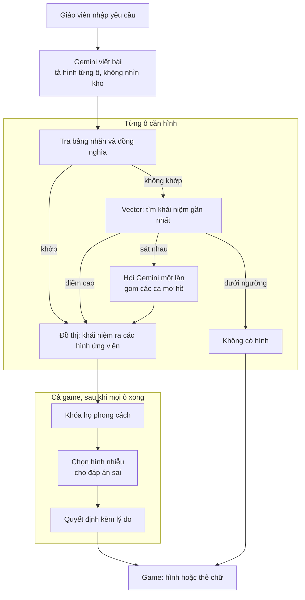
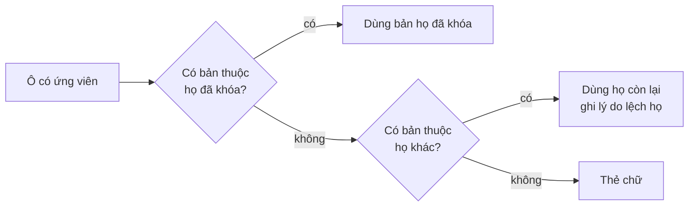

# Pipeline chọn hình bằng đồ thị khái niệm và vector

> **Nguồn**: thảo luận giữa người dùng và phiên chính ngày 2026-11-13; hiện trạng đối chiếu từ code (`backend/src/main/java/com/aigameplatform/backend/service/generation/GeminiGameContentGenerator.java`, `backend/src/main/java/com/aigameplatform/backend/service/factory/AbstractGameDslFactory.java`, `backend/src/main/java/com/aigameplatform/backend/service/curriculum/CurriculumRagConfiguration.java`). Đây là **thiết kế đề xuất, chưa cài đặt, chưa đo**.
> **Cập nhật**: 2026-11-13
> **Liên kết liên quan**: [[Tìm và chọn assets phù hợp cho game]], [[Khảo sát kho asset và độ phủ]], [[Tiêu chuẩn Đồ họa và Asset Pipeline]], [[Chương trình GDPT 2018 và Curriculum RAG]], [[Game JSON DSL]], [[Kết quả đo sinh game]]

Trang này chốt hướng thay cách chọn hình hiện tại (AI chọn id trong danh mục cố định đưa cả vào prompt) bằng một bộ chọn **tường minh**: mỗi quyết định chọn hình đều có đường đi, điểm số và lý do. Nó kết hợp ba phương án trong [[Tìm và chọn assets phù hợp cho game]]: tầng khái niệm (phương án 2), gán hình sau theo từng ô (phương án 3), chọn theo vai trò trong game (phương án 4), thêm vector ngữ nghĩa ở bước tìm khái niệm.

## 1. Vì sao đổi

| Cách hiện tại | Hệ quả |
|---|---|
| AI vừa viết bài vừa chọn id trong danh mục đưa cả vào prompt | Không biết vì sao AI chọn hình đó; kho lớn thì prompt không chứa nổi |
| Khớp từ khóa tiếng Việt ở hai nơi (frontend và backend) | Từ lạ, từ đồng nghĩa chưa liệt kê thì không nhận ra; từ trùng âm khi bỏ dấu khớp nhầm |
| Không có khái niệm "loại" | Câu hỏi theo loại ("đâu là con vật?"), hình nhiễu cùng nhóm không làm được bằng từ khóa |
| Kho đã tải không nối vào pipeline | Pipeline chỉ biết 158 hình trong danh mục |

Nhận định của người viết: khớp từ khóa kèm đồng nghĩa (hướng đề xuất đầu tiên) vẫn có lỗ hổng "hình có trong kho mà không nhận ra". Vector bù chỗ đó; đồ thị bù chỗ vector mơ hồ ("gần giống" thay vì "đúng") và làm được các câu hỏi theo loại.

## 2. Pipeline

Đọc sơ đồ:

- **Gemini không nhìn kho.** Nó chỉ viết nội dung và mô tả hình bằng chữ (`visualPrompt` đã có trong prompt hiện tại). Việc gán hình là bước riêng.
- **Tra bảng nhãn là đường tắt**, không tốn lời gọi embedding. Từ khớp thẳng nhãn hoặc đồng nghĩa của một khái niệm thì bỏ qua vector.
- **Vector chỉ đổi chữ thành khái niệm, không tìm hình.** Nhãn khái niệm được nhúng sẵn; chữ Gemini tả được nhúng lúc chạy rồi so với nhãn. Vector không tính cho ảnh.
- **Đồ thị luôn chạy.** Nó trả các hình gắn với khái niệm, và cho biết quan hệ để chọn hình nhiễu.
- **Khung "Từng ô" chạy lặp theo từng ô; khung "Cả game" chạy một lần** vì khóa họ phong cách và chọn hình nhiễu cần biết kết quả của mọi ô.
- Ô "Không có hình" đi thẳng vào game, hiện thẻ chữ.

## 3. Đồ thị khái niệm

Mỗi hình gắn với một khái niệm; khái niệm có quan hệ:

| Quan hệ | Dùng để |
|---|---|
| thuộc nhóm cha (voi thuộc thú rừng, thú rừng thuộc con vật) | Câu hỏi theo loại; chọn hình cùng nhóm hoặc khác nhóm |
| cùng nhóm | Hình nhiễu cùng loại nhưng khác nghĩa |
| dễ nhầm với (mèo và hổ) | Tránh chọn hai hình quá giống làm đáp án |
| nhiều hình, nhiều họ phong cách cho một khái niệm | Chọn hình theo họ đã khóa |

Chủ đề của khái niệm lấy từ thư mục chủ đề của kho đồ họa thử nghiệm (ngoài repo, đã chia theo chủ đề). Đồ thị dựng bằng cách để AI sinh bản nháp theo lô rồi người duyệt, chỉ dựng cho phần kho dùng được, không dựng cho cả 27.667 file đã tải.

## 4. Khóa họ phong cách và quy tắc lùi

Sau khi mọi ô có ứng viên, đếm họ nào xuất hiện nhiều nhất và khóa họ đó cho cả game. Khi một ô không có bản thuộc họ đã khóa:

## 5. Quyết định của người dùng (2026-11-13)

- Cố gắng **bổ sung tài nguyên đồ họa đầy đủ nhất có thể** để quy tắc lùi ít phải dùng.
- Ô không có bản thuộc họ đã khóa thì **lấy họ còn lại mà ô đó đang có**; không có họ nào thì **hiện thẻ chữ**. Ưu tiên đủ hình hơn đồng nhất tuyệt đối.
- Hướng chọn hình dùng đồ thị khái niệm kết hợp vector, thay cho khớp từ khóa thuần.

## 6. Ví dụ minh họa

Các điểm số và ngưỡng dưới đây là **giả định để minh họa**, chưa đo trên hệ thống. Yêu cầu: "Trắc nghiệm nhận biết con vật, lớp 1".

| Ô | Gemini tả | Cách tìm | Khái niệm, điểm | Kết quả |
|---|---|---|---|---|
| 1 | con mèo | Tra nhãn khớp, bỏ qua vector | mèo, 1,00 | Hình mèo |
| 2 | thú có vòi | Vector (không khớp nhãn) | voi, 0,82 | Hình voi |
| 3 | kỳ lân biển | Vector | cá heo, 0,51, dưới ngưỡng 0,60 | Thẻ chữ, không gán nhầm cá heo |
| 4 | con chó | Tra nhãn khớp | chó, 1,00 | Hình chó |

Bước "Cả game": ba ô có hình, ứng viên Kenney có ở cả ba, Fluent có ở hai; khóa họ Kenney. Câu 1 có đáp án đúng là mèo, cần hai hình nhiễu: đồ thị lấy chó (cùng nhóm thú nuôi, khác nghĩa) và voi (khác nhóm), cùng họ Kenney, không trùng hình đã dùng. Bản quyết định ghi từng ô: hình nào, tìm bằng đường nào, điểm bao nhiêu, vì sao loại ứng viên khác.

## 7. So với pipeline hiện tại

| Giữ nguyên | Đổi |
|---|---|
| Gemini viết nội dung và `visualPrompt` | Prompt không còn danh sách hình |
| Chuỗi kiểm duyệt Layer 1, 2, 3 | Thêm bộ chọn hình đứng giữa Gemini và factory (chỗ đổi id thành `imageUrl` trong factory) |
| Hạ tầng LangChain4j | Vector dùng lại hạ tầng embedding của Curriculum RAG nếu kiểm tra thấy dùng được |
| Trường `imageUrl` của DSL | Ban đầu không đổi contract; bỏ trường `asset` khỏi đầu ra AI là bước sau, cần sửa đồng bộ schema và record |

Hạ tầng vector đã có trong code: Curriculum RAG dùng mô hình embedding của Google qua LangChain4j và kho vector pgvector. **Chưa kiểm** có dùng lại được ngay không, và cần bảng mới cho hình (phải qua migration, không sửa migration cũ).

## 8. Lộ trình đề xuất

1. Dựng chỉ mục khái niệm và nhãn từ kho đồ họa, đo bằng bộ đo offline có sẵn (xem mục 12 và 13 của [[Khảo sát kho asset và độ phủ]]); chưa đụng pipeline.
2. Thêm bộ chọn sau một cờ cấu hình; Gemini vẫn điền `asset` như cũ, bộ chọn chỉ gán hình cho ô Gemini bỏ trống. So với mốc các lần thử nghiệm 5 và 6.
3. Nếu đo tốt: bỏ danh mục khỏi prompt, bỏ trường `asset` khỏi đầu ra AI (đụng contract phía AI).
4. Thêm khóa họ, chọn hình nhiễu, bản quyết định có lý do.

Phải chạy `ai-prompt-evaluator` và `contract-guardian` theo bảng định tuyến khi tới bước 2 và 3.

## 9. Điều chưa biết và rủi ro

- **Ngưỡng điểm vector** chưa có số thật. Thấp quá thì gán nhầm hình gần nghĩa; cao quá thì coi hình có trong kho là không có. Phải đo trên bộ đo thật.
- **Embedding tiếng Việt cho từ rất ngắn** (một hai chữ) chưa kiểm; có thể phải ghép nhãn thành cụm ngắn trước khi nhúng.
- **Đồ thị là phần tốn công nhất**: dựng bản nháp bằng AI rồi duyệt tay.
- **Kho ngoài repo** nên chỉ chạy trên máy người dùng khi thử nghiệm; đường dẫn đọc từ biến môi trường, không hardcode.
- **Họ còn lại khi có nhiều họ**: đề xuất lấy họ có nhiều ô nhất trong game; chưa chốt. Hòa nhau khi khóa họ cũng chưa chốt.
- **Gemini tả hình bằng câu tự do** nên bước khớp nhãn có thể khớp nhầm ("khó khăn" ra cái khăn); bước hỏi Gemini cho ca mơ hồ giảm lỗi này nhưng chưa đo.
