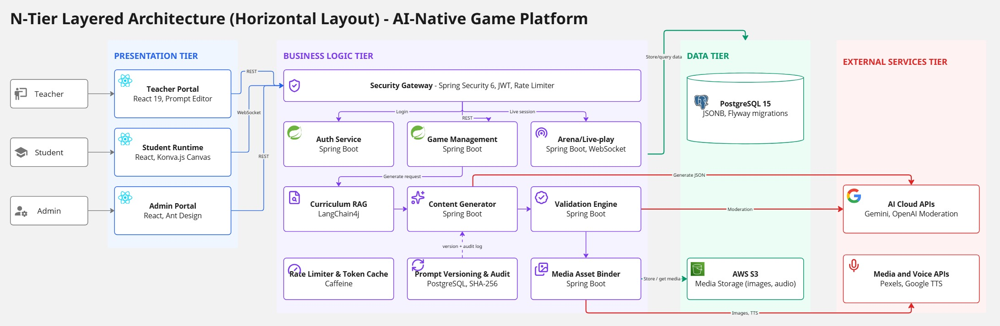

# Sơ đồ hệ thống

Nguồn: `docs/diagrams/`, nhóm cung cấp ngày 2026-11-02.
Cập nhật: 2026-11-02

Sơ đồ giúp hiểu luồng và cấu trúc. **Khi viết code, field, endpoint hay mã lỗi, tin contract và code, không tin tên trong sơ đồ.** Tên trang, service, repository trong sơ đồ tuần tự là tên thiết kế, có thể khác code (ví dụ `GameCreationPage`, `UserRepository`).

## Kiến trúc tổng thể



Bốn tầng: Presentation (Teacher Portal, Student Runtime, Admin Portal), Business Logic (Security Gateway, Auth, Game Management, Arena, Curriculum RAG, Content Generator, Validation Engine, Rate Limiter, Prompt Versioning, Media Asset Binder), Data (PostgreSQL, AWS S3), External (Gemini, OpenAI Moderation, Pexels, Google TTS).

## Cách agent đọc file draw.io

File `.drawio` là XML, đọc nguyên file tốn nhiều token. Chỉ lấy nhãn bằng lệnh sau, nhãn hiện ra theo thứ tự trong file, không hẳn theo thứ tự luồng:

```bash
grep -oE 'value="[^"]+"' docs/diagrams/sequence/UC-07_SaveAndPublishGame_SequenceDiagram.drawio
```

Obsidian không tự vẽ `.drawio`. Người xem mở bằng app.diagrams.net hoặc plugin Diagrams.

## Sơ đồ tổng quát

| Sơ đồ | File | Ghi chú |
|---|---|---|
| Activity toàn luồng | `docs/diagrams/activity-tong-quan.drawio` | Giáo viên, Backend, học sinh, CSDL: tạo, kiểm tra 3 lớp, xuất bản, chơi, kết quả |
| Use case | `docs/diagrams/use-case.drawio` | Trang `Main` là bản hiện hành, các trang `Bản cũ` chỉ để tham khảo |
| Class | `docs/diagrams/class-diagram.drawio` | Mô hình miền, Strategy, kế thừa `QuestionGame`, `GameSession`, `PlayInteractionDetail` |

## Sơ đồ tuần tự

Đọc cùng ca sử dụng tương ứng trong `docs/srs/`. Không có sơ đồ cho UC-10.

| Ca sử dụng | File |
|---|---|
| UC-01 Đăng ký | `docs/diagrams/sequence/UC-01_Register_SequenceDiagram.drawio` |
| UC-02 Gửi mô tả trò chơi | `docs/diagrams/sequence/UC-02_Submit_Game_Description_SequenceDiagram.drawio` |
| UC-03 Chơi thử | `docs/diagrams/sequence/UC-03_TrialPlay_SequenceDiagram.drawio` |
| UC-04 Chỉnh sửa trò chơi | `docs/diagrams/sequence/UC-04_Edit_Game_WorkspaceEditor_SequenceDiagram.drawio` |
| UC-05 Chỉnh sửa thủ công | `docs/diagrams/sequence/UC-05_Manual_Edit_SequenceDiagram.drawio` |
| UC-06 AI làm lại | `docs/diagrams/sequence/UC-06_AI_Regenerate_SequenceDiagram.drawio` |
| UC-07 Lưu và xuất bản | `docs/diagrams/sequence/UC-07_SaveAndPublishGame_SequenceDiagram.drawio` |
| UC-08 Tự luyện | `docs/diagrams/sequence/UC-08_SelfPractice_SequenceDiagram.drawio` |
| UC-09 Tham gia phòng | `docs/diagrams/sequence/UC-09_JoinGame_SequenceDiagram.drawio` |
| UC-11 Giọng đọc | `docs/diagrams/sequence/UC-11_NarrationAudio_SequenceDiagram.drawio` |
| UC-12 Theo dõi chi phí | `docs/diagrams/sequence/UC-12_CostMonitoring_SequenceDiagram.drawio` |
| UC-13 Quản lý giáo viên | `docs/diagrams/sequence/UC-13_TeacherManagement_SequenceDiagram.drawio` |
| UC-14 Cài đặt AI | `docs/diagrams/sequence/UC-14_AIBrainConfig_SequenceDiagram.drawio` |
| UC-15 Đăng nhập | `docs/diagrams/sequence/UC-15_Login_SequenceDiagram.drawio` |

## Điểm lệch cần nhóm chốt

Phát hiện khi nạp sơ đồ, chưa đối chiếu hết từng sơ đồ với code:

- **TTS:** sơ đồ activity và use case ghi Edge TTS; sơ đồ kiến trúc và `CLAUDE.md` ghi Google TTS.
- **UC-09, trạng thái phòng:** sơ đồ dùng `WAITING`, `IN_PROGRESS`, `ENDED`; `RoomClient` dùng `WAITING`, `ACTIVE`, `PAUSED`, `CLOSED`.
- **UC-09, vào khi đang chơi:** sơ đồ cho vào phòng đang chạy; `RoomClient` trả `SESSION_ALREADY_STARTED`.
- **UC-09, phòng đã kết thúc:** sơ đồ trả 410; `docs/ui/API-CONTRACT.md` đề xuất mã lỗi riêng trên 409.
- **UC-09, phản hồi:** sơ đồ trả phản hồi ngay sau mỗi câu; `docs/decisions.md` chốt phòng chỉ báo đúng sai khi câu kết thúc.

Xem thêm: [[Kiến trúc và công nghệ]], [[Ca sử dụng]], [[Điểm lệch và việc cần chốt]]
