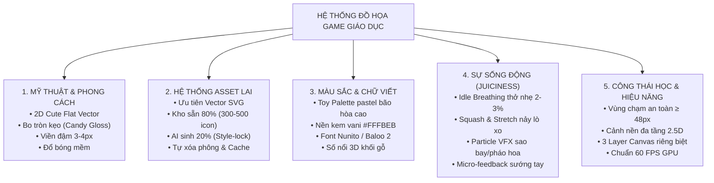

# Tiêu chuẩn Đồ họa, Trải nghiệm Thị giác & Asset Pipeline (K-5)

> **Nguồn tài liệu gốc**: [[Đồ họa game|Báo cáo Nghiên cứu Đồ họa gốc]]  
> **Cập nhật**: 2026-11-04  
> **Liên kết liên quan**: [[Game JSON DSL]], [[Mô tả ngoài danh mục game]], [[Kiến trúc và công nghệ]], [[Trải nghiệm cho trẻ]]

---

## 1. Bảng Chốt Hạ: 5 Trụ Cột Đồ Họa Game Giáo Dục

---

## 2. Phong Cách Mỹ Thuật Chủ Đạo (Art Style)

* **Định hình phong cách**: **2D Cute Flat Vector / Chibi Kawaii** (tương đồng với *Duolingo, Toca Boca, Khan Academy Kids*). Tuyệt đối tránh 3D tả thực làm nặng máy và gây rối mắt cho trẻ K-5.
* **Quy chuẩn đường nét**:
  * Mọi góc cạnh đều bo tròn mềm mại (`border-radius` lớn), tạo cảm giác thân thiện và an toàn.
  * Có **đường viền đậm màu tối** (`Stroke 3 - 4px`) bao quanh vật thể để tách bạch rõ rệt khỏi phông nền.
  * Có **vệt sáng cong màu trắng mờ** ở góc trên tạo hiệu ứng nổi khối như viên kẹo ngọt (*Candy Gloss*).

---

## 3. Hệ Thống Tài Nguyên Đồ Họa (Asset Pipeline)

### Định dạng tối thượng: Vector SVG
* Phóng to vô cực không bao giờ bị vỡ hạt trên màn hình iPad Retina hay màn hình tương tác trường học 65 inch.
* Dung lượng siêu nhẹ ($2 - 5\text{KB}$/file), mở game là hiển thị ngay tức thì.
* Đổi màu sắc linh hoạt bằng code CSS/Konva mà không cần vẽ ảnh mới.

### Chiến lược Kho Asset Lai (Hybrid 80/20)
* **80% từ Kho chuẩn bị sẵn (Asset Bank)**: Gom sẵn $300 - 500$ icon/sprite SVG chuẩn (hoa quả, con vật, xe cộ, cung tên, cá...).
* **20% sinh tức thì bằng AI**: Khi gặp yêu cầu lạ, AI sinh ảnh với prompt khóa phong cách (*Style-lock*) $\to$ Tự động cắt phông trong suốt $\to$ Lưu cache dùng lại.

---

## 4. Bảng Đánh Giá 16 Nguồn Tài Nguyên Đồ Họa & Âm Thanh Quốc Tế

| STT | Nguồn (Platform / Source) | Nhóm tài nguyên | Hợp nhất với (K-5) | Định dạng | Bản quyền (License) | Đánh giá & Khuyến nghị thực tế cho Đề tài |
| :---: | :--- | :--- | :--- | :--- | :--- | :--- |
| **1** | **itch.io** *(tag: cute, kids, vector)* | Nhân vật, Cảnh nền, Full Themes | Trọn bộ theme hoạt hình đồng bộ (Nông trại, Biển, Vũ trụ, Rừng) | PNG, SVG, Vector EPS | Tùy gói (Nhiều gói CC0 / Free thương mại) | ⭐⭐⭐⭐⭐ **Khuyên dùng số 1 cho Nhân vật & Theme**: Đẹp nhất, chuẩn kẹo ngọt Duolingo/Toca Boca. |
| **2** | **Kenney.nl** | Nút bấm UI, Hình khối, Âm thanh | Giao diện nút bo tròn, thanh tiến trình, icon cơ bản | SVG, PNG, MP3/OGG | CC0 1.0 (Public Domain 100%) | ⭐⭐⭐⭐⭐ **Khuyên dùng số 1 cho UI & Sound FX**: Siêu sạch, chuẩn vector, không rủi ro bản quyền khi chấm đồ án. |
| **3** | **LottieFiles** | Hiệu ứng động (VFX Celebration) | Pháo hoa giấy (Confetti), 3 sao nảy, Cúp vàng xoay | File JSON vector (Lottie) | Từng file riêng (Rất nhiều file free) | ⭐⭐⭐⭐⭐ **Khuyên dùng số 1 cho Ăn mừng**: File nhẹ ~10KB, chạy cực mượt trên Canvas, tạo độ chuyên nghiệp cao. |
| **4** | **SVG Repo** *(svgrepo.com)* | Icon, Đồ vật học tập rời | Trái cây, con vật, phương tiện giao thông, dụng cụ học tập | 100% Vector SVG | Bộ lọc riêng: CC0, MIT, Apache | ⭐⭐⭐⭐⭐ **Khuyên dùng số 1 cho Học liệu bài học**: Hơn 500.000 icon siêu nhẹ ($2-5\text{KB}$), phóng to vô cực Retina. |
| **5** | **Glitch Public Domain Archive** | Nhân vật, Đồ vật, Môi trường | Cây cối, thức ăn, thú cưng, nhà cửa vẽ tay phong cách sách tranh | PNG trong suốt, SVG | CC0 1.0 (Public Domain giải phóng từ game Glitch) | ⭐⭐⭐⭐⭐ **Kho báu vẽ tay**: Hơn 10.000 hình vẽ tay cực dễ thương từ cựu đội ngũ sáng lập Slack, hoàn toàn miễn phí. |
| **6** | **OpenMoji / Twemoji** | Biểu tượng, Động vật, Đồ vật | Con vật quen thuộc, hoa quả, nốt nhạc, hình học toán học | 100% Vector SVG | CC-BY 4.0 / MIT | ⭐⭐⭐⭐ **Bí kíp của Duolingo**: Hệ thống icon chuẩn quốc tế, nét vẽ tối giản, mắt trẻ em nhận diện siêu nhanh. |
| **7** | **CraftPix.net** *(Mục Freebies)* | 2D Sprites, Background phân tầng | Game đi cảnh, kéo thả, thú cưng hoạt hình cắt sẵn sprite | PNG trong suốt, PSD, Vector | Miễn phí có điều kiện (Dùng tốt cho đồ án) | ⭐⭐⭐⭐ **Rất tốt**: Chuyên sâu cho game casual, có sẵn cảnh nền đa tầng 2.5D Parallax rất đẹp. |
| **8** | **Openclipart.org** | Học liệu trường học, Tranh vẽ nét | Bảng đen, thước kẻ, compa, quả địa cầu, sách vở | 100% Vector SVG | CC0 1.0 (Public Domain) | ⭐⭐⭐⭐ **Tốt cho môn Toán/Tiếng Việt**: Đầy đủ mọi đồ vật đời thực nhưng phong cách vẽ hơi cổ điển một chút. |
| **9** | **ZapSplat.com** | Âm thanh hiệu ứng (SFX) | Tiếng Cartoon Boing, tiếng Pop, chuông leng keng, nảy lò xo | MP3, WAV chất lượng cao | Miễn phí (Ghi nguồn hoặc tài khoản free) | ⭐⭐⭐⭐ **Rất tốt cho âm thanh hoạt hình**: Hơn 100.000 âm thanh chuyên nghiệp, tiếng rất nảy và vui tai cho trẻ nhỏ. |
| **10** | **OpenGameArt.org** | Đồ họa, Âm thanh tổng hợp | Cây cối, đá, mây, nhạc nền chiptune | PNG, OGG, WAV | Hỗn hợp (CC0, CC-BY, GPL...) | ⭐⭐⭐ **Dùng bổ sung**: Rất nhiều tài nguyên nhưng giao diện cũ, cần để ý tránh các file dính giấy phép GPL. |
| **11** | **GameArt2D.com** *(Mục Free)* | Nhân vật hoạt hình 2D | Nhân vật trẻ em, quái vật dễ thương, bối cảnh rừng xanh | PNG, Vector EPS | Miễn phí cho cá nhân và thương mại | ⭐⭐⭐ **Dự phòng tốt**: Đồ họa chất lượng cao nhưng số lượng gói miễn phí còn ít. |
| **12** | **Freepik / Flaticon / Storyset** | Minh họa câu hỏi, Icon phẳng | Tranh minh họa tình huống bài học (Gia đình, lớp học, bác sĩ) | SVG, PNG | Yêu cầu ghi nguồn (Attribution) | ⭐⭐⭐ **Chỉ nên dùng cho Ảnh bài học**: Không nên dùng làm sprite chuyển động vì phong cách các tác giả bị lệch nhau. |
| **13** | **Leonardo.ai / Scenario.com** | Tạo ảnh bằng AI (Generative) | Sinh các con vật/vật phẩm độc lạ khi kho có sẵn không tìm thấy | PNG (sau đó dùng xóa phông) | Bản quyền theo tài khoản người dùng | ⭐⭐⭐ **Dùng cho 20% ngoại lệ**: Khóa phong cách (Style-lock) để sinh ảnh mới khi giáo viên yêu cầu đề tài lạ. |
| **14** | **Vectorizer.ai / PixelVibe** | Công cụ chuyển đổi kỹ thuật | Biến ảnh PNG/JPG từ AI thành vector SVG chuẩn | Xuất ra SVG | Dùng thử / Tool web | ⭐⭐⭐⭐ **Cầu nối AI sang Vector**: Giúp ảnh AI vẽ không bao giờ bị mờ khi đưa vào Canvas. |
| **15** | **Rive Marketplace** | Nhân vật có máy trạng thái | Nhân vật tương tác động cao cấp | Rive Runtime format | Tùy tác giả | ⭐⭐ **Không khuyến khích**: Quá phức tạp để nhúng vào React-Konva Canvas, dễ xung đột Render Loop. |
| **16** | **Pixabay / Pexels** | Ảnh chụp stock, Nhạc nền | Nhạc nền nhẹ nhàng không lời (BGM) | JPG, MP3 | Miễn phí theo giấy phép nền tảng | ⭐ **Chỉ dùng lấy nhạc nền**: Tuyệt đối không dùng ảnh chụp vì làm nát phong cách hoạt hình của trẻ em. |

---

## 5. Bảng Màu & Chữ Viết Dành Cho Trẻ Em (Color & Typography)

### Bảng màu đồ chơi (Toy Palette)
* **Quy tắc cấm kỵ**: Tuyệt đối cấm dùng các màu chói gắt nguyên bản (`#FF0000`, `#00FF00`) gây mỏi mắt trẻ.
* **Bảng màu kẹo ngọt bão hòa cao**:
  * Vàng mật ong (`#FBBF24`)
  * Xanh bạc hà (`#34D399`)
  * Hồng san hô (`#F87171`)
  * Xanh biển mây (`#60A5FA`)
  * Nền kem vani ấm áp (`#FFFBEB`) — bảo vệ mắt trẻ khi chơi lâu.

### Font chữ bo tròn thân thiện
* Sử dụng các font chuẩn giáo dục bo tròn: **Nunito**, **Quicksand**, hoặc **Baloo 2**.
* Chữ số và phép tính có **viền trắng dày** và **bóng đổ nổi khối 3D** trông như các khối gỗ xếp hình Montessori.

---

## 6. Sự Sống Động của Chuyển Động ("Juiciness" & Micro-Feedback)

1. **Thế giới chuyển động (Idle Breathing)**: Nhân vật, tấm bia, cây cung luôn nhấp nhô nhẹ $2 - 3\%$ theo nhịp thở sinh học, không bao giờ đứng im đơ như bức tranh chết.
2. **Nảy lò xo khi bấm (Squash & Stretch)**: Chạm vào vật thể thì nó hơi co lại rồi bật nảy to ra $\to$ Tạo cảm giác bấm chạm xúc giác cực kỳ "sướng tay".
3. **Bắn hạt ăn mừng (Particle VFX)**: Trả lời đúng lập tức có mưa sao vàng lấp lánh hoặc pháo hoa giấy ngũ sắc bung tỏa, kích thích cảm xúc chiến thắng.

---

## 7. Công Thái Học & Tối Ưu Phần Cứng (Ergonomics & Performance)

### Vùng chạm an toàn (Hitbox)
* Kích thước vùng bấm ngón tay tối thiểu $\ge 48\text{px} \times 48\text{px}$ (khuyến nghị $56\text{px}$) để trẻ mầm non không bị bấm trượt.

### Kiến trúc 3 Tầng Canvas Riêng biệt (Multi-Layer Rendering)
Thay vì vẽ dồn toàn bộ trò chơi lên một thẻ `<canvas>` duy nhất:
- **Layer 1 (Nền tĩnh)**: Vẽ cảnh nền bãi cỏ, vũ trụ đúng 1 lần duy nhất khi mở game; tắt bắt cảm ứng (`listening: false`) $\to$ **Tiêu tốn 0% CPU**.
- **Layer 2 (Gameplay Layer)**: Nơi chứa cung tên, bia ngắm, cá bơi chuyển động $\to$ Chỉ vẽ lại khu vực có chuyển động bằng kỹ thuật `batchDraw()`.
- **Layer 3 (UI & FX Layer)**: Bảng điểm sao, đồng hồ đếm ngược, pháo hoa nổ Canvas WebGL nằm trên cùng.

### Thích ứng Màn hình Thông minh (Viewport Scaler)
* Virtual Stage chuẩn cố định $1920 \times 1080$ (tỷ lệ 16:9).
* Công thức co giãn Letterbox tự động trên iPad ($4:3$) hoặc điện thoại ($19.5:9$):
  $$\text{Scale} = \min\left(\frac{\text{Chiều rộng thực tế}}{1920}, \frac{\text{Chiều cao thực tế}}{1080}\right)$$
* Đảm bảo không bao giờ méo hình, không mất góc và không tràn viền nút bấm.

### Tối ưu GPU & Tiết kiệm Pin
* **GPU Texture Caching (`node.cache()`)**: Biến vector SVG thành ảnh bitmap nằm sẵn trên GPU; khi xoay hay phóng to chỉ xoay texture chứ không tính toán lại nét vẽ.
* **Tween Pooling**: Tái sử dụng đối tượng tween để tránh kích hoạt trình gom rác (Garbage Collector) của JavaScript gây sụt khung hình.
* **Web Audio Bus**: Phát nhạc nền êm dịu và âm thanh tiếng vút/pháo hoa đè lên nhau đa kênh; tự kích hoạt âm thanh ngay cú chạm đầu tiên để vượt rào cản Autoplay trên trình duyệt Safari/iOS.

---

## 5. Tài liệu Nghiên cứu Gốc & Thực nghiệm
- [[Đồ họa game|Toàn văn nghiên cứu Đồ họa game giáo dục]]
- [[experiments/results/t10-bee-garden/README|Thực nghiệm Đồ họa Vườn hoa của ong (T10)]]
