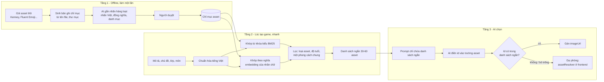

# Tìm và chọn assets phù hợp cho game

> **Nguồn**: thảo luận giữa người dùng và phiên chính ngày 2026-11-11; cơ chế hiện tại đối chiếu từ code (`GameAssetCatalog`, `CpfAssetCatalog`, `assetResolver.ts`). Phần phương án là **đề xuất, chưa cài đặt, chưa đo**.
> **Cập nhật**: 2026-11-13 (thêm liên kết tới thiết kế đã chọn hướng)
> **Liên kết liên quan**: [[Pipeline chọn hình bằng đồ thị khái niệm và vector]] (hướng đã chọn từ các phương án 2, 3, 4 và vector), [[Tiêu chuẩn Đồ họa và Asset Pipeline]], [[Mô tả ngoài danh mục game]], [[Game JSON DSL]], [[Kiến trúc và công nghệ]], [[Trải nghiệm cho trẻ]]

Trang này lưu các phương án cho một bài toán: kho asset ngày càng lớn (đã có thêm nhiều gói Kenney và các gói khác), làm sao để hệ thống **tìm và chọn đúng asset nhanh nhất, hiệu quả nhất** cho mô tả game của giáo viên. Mỗi phương án là một mục riêng; phương án nào được chốt thì ghi vào [[Các quyết định đã chốt]].

| # | Phương án | Trạng thái |
|---|---|---|
| 1 | Ba tầng: chỉ mục offline, truy xuất danh sách ngắn, AI chọn trong danh sách ngắn | Đề xuất, chờ nhóm duyệt (làm nền cho các phương án sau) |
| 2 | Tầng khái niệm (ontology) trước, asset sau | Đề xuất, bổ sung cho 1 |
| 3 | Sinh nội dung trước, gán hình sau theo từng ô (late binding) | Đề xuất, bổ sung cho 1 |
| 4 | Chọn theo vai trò trong luật từng loại game | Đề xuất, bổ sung cho 1 |
| 5 | Gắn nhãn chỉ mục bằng mô hình nhìn được hình, kiểm tra sau khi chọn | Đề xuất, là một bước của 1 |
| 6 | Học từ lựa chọn của giáo viên | Đề xuất, làm sau khi có người dùng thật |

Phương án 2 đến 6 đều **dùng lại chỉ mục của phương án 1**, nên không loại trừ nhau; xem so sánh và thứ tự gợi ý ở mục 7.

---

## 0. Hiện trạng (để so sánh)

Hệ thống hiện chọn hình theo hai đường, đều dựa trên **danh mục cố định, đưa toàn bộ vào prompt**:

- **Game DSL:** `backend/src/main/resources/assets/game-asset-catalog.json` (96 hình, mỗi hình có `id`, `label` tiếng Việt, `url`). `GeminiGameContentGenerator` nối cả danh mục vào system prompt; AI điền `asset` bằng id ở mỗi chỗ có `visualPrompt`; factory đổi id thành `imageUrl`. Id lạ hoặc thiếu thì không gán hình.
- **CPF:** `backend/src/main/resources/cpf/asset-catalog.json` (55 assetId). Lớp 2 của chuỗi kiểm duyệt kiểm id có trong danh mục; id bịa bị bắt và sinh lại.
- **Dự phòng ở frontend:** `frontend/src/utils/assetResolver.ts` đoán hình từ chữ và chủ đề khi game không có `imageUrl`.

Danh mục cố định chạy tốt với vài chục đến vài trăm hình. Khi kho lên hàng nghìn, cách này không còn khả thi (xem mục 1.1).

---

## 1. Phương án 1: Ba tầng (chỉ mục, danh sách ngắn, AI chọn)

### 1.1 Vấn đề cần giải

| Vấn đề | Hệ quả nếu giữ cách cũ |
|---|---|
| Prompt không chứa nổi hàng nghìn dòng | Tốn token, chậm, AI chọn kém đi khi danh sách quá dài |
| Tên file asset là tiếng Anh (kiểu `tree_pineTall.png`), mô tả giáo viên là tiếng Việt | Không tìm được "con voi", "chữ A" nếu chỉ dựa vào tên file |
| Nhiều hình không hợp trẻ mầm non và tiểu học (vũ khí, tile platformer, skybox...) | AI có thể chọn nhầm hình không phù hợp lứa tuổi |
| Hình của nhiều gói có phong cách khác nhau | Một game lẫn pixel và vector trông thiếu nhất quán, trái tiêu chuẩn ở [[Tiêu chuẩn Đồ họa và Asset Pipeline]] |

Ý tưởng chung: **đừng bắt AI đọc cả kho**. Lọc trước ra một danh sách ngắn bằng thuật toán rẻ và nhanh, rồi để AI (giỏi hiểu ngữ cảnh) chọn trong danh sách đó.

### 1.2 Tổng quan

### 1.3 Tầng 1: Lập chỉ mục (offline, chạy một lần mỗi khi thêm gói)

Mục tiêu: biến mỗi file asset thành một bản ghi có đủ thông tin để tìm kiếm, không phụ thuộc vào tên file tiếng Anh.

**Bản ghi chỉ mục (các trường gợi ý):**

| Trường | Ý nghĩa | Nguồn điền |
|---|---|---|
| `id` | Mã duy nhất, ổn định (ví dụ `kenney-animal-elephant`) | Sinh từ gói và tên file |
| `pack` | Gói gốc (Kenney Animal Pack, Fluent Emoji...) | Tên thư mục |
| `type` | Hình vật thể, nền, ký tự, âm thanh, nhạc | Thư mục, đuôi file |
| `style` | Vector phẳng, pixel, 3D render, emoji... | Theo gói |
| `labelVi` | Tên tiếng Việt chuẩn ("con voi") | AI gắn nhãn, người duyệt |
| `synonymsVi` | Từ đồng nghĩa, cách gọi khác ("voi", "thú có vòi") | AI gắn nhãn, người duyệt |
| `tagsEn` | Từ khóa tiếng Anh (lấy từ tên file, thư mục) | Sinh tự động |
| `category` | Nhóm nghĩa: động vật, đồ ăn, phương tiện, số, chữ cái... | AI gắn nhãn |
| `ageSuitable` | Cờ hợp lứa tuổi mầm non, tiểu học | AI đề xuất, người duyệt |
| `license` | Giấy phép (CC0, MIT...) và nguồn | Theo gói |
| `url` | Đường dẫn file trong `frontend/public` | Sinh tự động |

**Các bước:**

1. Quét thư mục gói, sinh bản ghi thô (`id`, `pack`, `type`, `style`, `tagsEn`, `url`) từ tên file và thư mục. Bước này tự động hoàn toàn.
2. Đưa lô bản ghi thô cho AI để điền `labelVi`, `synonymsVi`, `category`, `ageSuitable`. Chạy theo lô, một lần mỗi gói.
3. Người duyệt: ưu tiên duyệt các bản ghi AI đánh dấu không chắc chắn, cùng một mẫu ngẫu nhiên để ước lượng chất lượng nhãn.
4. Bản ghi `ageSuitable=false` bị loại khỏi truy xuất nhưng vẫn giữ trong chỉ mục (để biết lý do loại).
5. Lưu chỉ mục thành file trong repo (cùng chỗ với danh mục hiện tại) để diff được trong git.

**Ghi chú:**
- Chất lượng toàn hệ thống phụ thuộc phần lớn vào **chất lượng `labelVi` và `synonymsVi`**. Đây là bước đáng đầu tư nhất.
- Chỉ mục không nằm trong contract đã freeze (DSL, REST). Trường `asset` và `imageUrl` ở DSL giữ nguyên, nên không phải đổi contract.

### 1.4 Tầng 2: Truy xuất danh sách ngắn (lúc tạo game)

Đầu vào: mô tả của giáo viên, chủ đề, môn, lớp, loại game. Đầu ra: khoảng **30 đến 60 asset ứng viên**.

**Bước 2a: Chuẩn hóa tiếng Việt.** Hạ chữ thường, bỏ dấu để so khớp, tách từ, mở rộng đồng nghĩa. Dùng cùng một hàm chuẩn hóa cho cả lúc lập chỉ mục và lúc truy vấn để hai phía khớp nhau. Frontend đã có `normalizeKeyword` ở `assetResolver.ts`; nên xem có tái dùng được ý tưởng không.

**Bước 2b: Hai cách chấm điểm, gộp kết quả.**

| Cách | Cơ chế | Mạnh | Yếu |
|---|---|---|---|
| Khớp từ khóa (kiểu BM25) | Chấm điểm theo độ trùng từ giữa truy vấn và `labelVi`, `synonymsVi`, `tagsEn`, `category` | Nhanh, rẻ, dễ giải thích vì sao ra kết quả, khớp chính xác từ hiếm | Kém ở từ đồng nghĩa chưa có trong danh sách |
| Khớp theo nghĩa (embedding) | So vector của truy vấn với vector của **nhãn chữ** từng asset | Bắt được từ gần nghĩa, không cần đồng nghĩa liệt kê sẵn | Hay trả về "gần giống" thay vì "đúng"; cần mô hình embedding |

Embedding chỉ áp dụng cho **chữ** (nhãn), không phải cho ảnh, nên **không cần mô hình hiểu hình ảnh**. Gộp hai danh sách bằng cách xếp hạng chung (ví dụ cộng điểm xếp hạng), vì hai thang điểm khác nhau.

**Bước 2c: Lọc cứng trước khi cắt danh sách.**

- `ageSuitable = true`.
- Đúng `type` cần (hình cho thẻ, nền cho cảnh, âm thanh cho phản hồi...).
- **Một phong cách chung cho cả game.** Chọn phong cách (hoặc gói) có nhiều ứng viên khớp nhất, rồi chỉ lấy ứng viên cùng phong cách. Đảm bảo game nhất quán thị giác.
- Đảm bảo **đa dạng**: không để một gói chiếm hết danh sách ngắn nếu có hình đúng nghĩa ở gói khác cùng phong cách.

**Bước 2d: Cắt về 30 đến 60 ứng viên.** Con số này là điểm khởi đầu, cần đo lại (xem mục 1.8).

### 1.5 Tầng 3: AI chọn trong danh sách ngắn

Giữ nguyên cơ chế hiện tại, chỉ đổi nguồn danh sách:

- Prompt chứa **danh sách ngắn** (`id: nhãn`) thay cho toàn bộ danh mục.
- Luật cho AI không đổi: chỉ dùng id có trong danh sách, chọn theo **đúng nghĩa trong ngữ cảnh** (ví dụ "bóng bay" khác "quả bóng đá"), không có hình đúng nghĩa thì **bỏ hẳn trường `asset`**, không chọn hình gần giống.
- Backend kiểm id có nằm trong danh sách ngắn của lần gọi đó không. Id ngoài danh sách bị coi là không hợp lệ (giống cách Lớp 2 của CPF bắt id bịa), có thể cho sinh lại hoặc bỏ hình.
- Khi asset bị bỏ trống, `assetResolver.ts` ở frontend vẫn là phương án dự phòng như hiện nay.

Lý do để AI chọn ở bước cuối thay vì lấy hạng nhất của thuật toán: chỉ AI thấy toàn bộ ngữ cảnh câu hỏi (ví dụ cùng chữ "cá" nhưng một câu về món ăn, một câu về con vật).

### 1.6 So sánh với các hướng khác

| Cách | Ưu | Nhược |
|---|---|---|
| Đưa hết danh mục vào prompt (hiện tại) | Đơn giản | Hỏng khi quá vài trăm hình |
| Chỉ khớp từ khóa | Nhanh, rẻ, dễ kiểm | Kém ở đồng nghĩa và ngữ cảnh |
| Chỉ embedding | Hiểu nghĩa | Hay chọn "gần giống", sai nghĩa; khó giải thích |
| **Ba tầng (phương án này)** | Chính xác, rẻ lúc chạy, giữ nguyên kiểm duyệt id | Cần làm chỉ mục một lần và duyệt nhãn |

### 1.7 Ràng buộc và lưu ý

- **Không tự thêm thư viện.** Phần embedding có thể tái dùng hạ tầng của pipeline RAG chương trình học (xem [[Chương trình GDPT 2018 và Curriculum RAG]]), nhưng **chưa kiểm tra** có dùng lại được không. Nếu không, bản đầu chỉ cần khớp từ khóa kèm đồng nghĩa, chưa cần embedding.
- **Đúng kiến trúc đã chốt.** Nên có một interface truy xuất asset riêng (ví dụ `AssetRetriever`) để đổi thuật toán không phải sửa chỗ khác; implementation đăng ký qua Spring DI, đúng nguyên tắc Open/Closed và Dependency Inversion trong `CLAUDE.md`. Không rẽ nhánh theo `gameType` bằng `if/switch`.
- **Gọi AI ngoài phải mock trong test.** Bước gắn nhãn (Tầng 1) và embedding (Tầng 2) đều không được gọi API thật trong test.
- **Giấy phép.** Nhiều gói Kenney là CC0 nhưng phải kiểm từng gói trước khi đưa vào chỉ mục; xem bảng nguồn ở [[Tiêu chuẩn Đồ họa và Asset Pipeline]].
- **Kích thước.** Chỉ mục chứa hàng nghìn bản ghi; cần tải một lần lúc khởi động và giữ trong bộ nhớ, không đọc file mỗi lần tạo game.
- **Tính ổn định của id.** Đã có game lưu `asset` theo id. Đổi tên hoặc xóa id trong chỉ mục sau này sẽ làm game cũ mất hình; nên chỉ thêm id mới, hoặc có bảng ánh xạ id cũ sang id mới.

### 1.8 Cách đo xem phương án có tốt không

Làm trước khi viết code thật, trên một mẫu nhỏ:

1. Chọn khoảng **200 asset** từ vài gói, gắn nhãn thủ công hoặc nhờ AI rồi duyệt.
2. Soạn khoảng **50 câu mô tả** thực tế (chủ đề, từ vựng) kèm hình đúng mong đợi.
3. Đo **Recall@K**: tỉ lệ hình đúng nằm trong danh sách ngắn K phần tử (xác định K đủ nhỏ để prompt gọn mà vẫn bao được hình đúng).
4. Đo **độ chính xác cuối**: tỉ lệ AI chọn đúng hình, và tỉ lệ AI bỏ trống đúng lúc khi không có hình hợp.
5. Đo **độ trễ** của Tầng 2 (mục tiêu: không đáng kể so với thời gian gọi AI).
6. So sánh với hiện tại (toàn danh mục 96 hình) để biết phương án mới có thực sự tốt hơn không.

Ghi số đo vào trang riêng theo mẫu [[Kết quả đo sinh game]] khi có.

### 1.9 Câu hỏi còn mở

1. Tổng quy mô asset: vài trăm, vài nghìn hay hàng chục nghìn? (quyết định có cần embedding hay chỉ cần khớp từ khóa.)
2. Có chọn tự động cả **âm thanh, nền, nhạc** không, hay chỉ hình vật thể?
3. Gắn nhãn: dùng AI gắn hàng loạt một lần rồi người duyệt, hay đặt nhãn thủ công?
4. Mỗi game có **khóa một phong cách** không, và lấy theo gói hay theo tiêu chí khác?
5. Hình của giáo viên tự tải lên (nếu có) có đi vào cùng chỉ mục không?

---

## 2. Phương án 2: Tầng khái niệm (ontology) trước, asset sau

**Ý tưởng.** Thêm một tầng ở giữa: **từ khóa → khái niệm → danh sách asset của khái niệm đó**. Ví dụ "voi", "elephant", "thú có vòi" cùng trỏ về khái niệm `animal.elephant`; khái niệm này gắn với nhiều asset thuộc nhiều phong cách.

**Cách làm.**
- Mỗi khái niệm có mã, tên Việt, từ đồng nghĩa, nhóm cha (ví dụ `animal` → `animal.farm` → `animal.farm.cow`) và danh sách asset.
- Có thể tự sinh khái niệm từ trường `category` của chỉ mục (phương án 1) rồi người duyệt.
- Truy vấn: chuẩn hóa chữ, tra bảng từ khóa sang khái niệm, lấy asset của khái niệm, lọc theo phong cách và độ tuổi như phương án 1.
- Gắn khái niệm với chương trình học: pipeline RAG đã tách được chủ đề và chuẩn kiến thức (xem [[Chương trình GDPT 2018 và Curriculum RAG]]), nên "tập đếm 1 đến 10, lớp 1" có thể ra thẳng nhóm `numbers`, `counting-objects`.

| Tiêu chí | Nhận định |
|---|---|
| Tốc độ | Nhanh nhất, chỉ tra bảng, gần như không có độ trễ |
| Ngữ cảnh | Phân biệt nghĩa bằng khái niệm: "cá" món ăn khác "cá" con vật |
| Ổn định | Cao, cùng đầu vào cho cùng kết quả, dễ kiểm bằng test |
| Nhược điểm | Tốn công dựng cây khái niệm; khái niệm thiếu thì không chọn được hình |

## 3. Phương án 3: Sinh nội dung trước, gán hình sau theo từng ô (late binding)

**Ý tưởng.** Đảo thứ tự hiện tại. AI **không nhận danh mục**, chỉ viết nội dung và mô tả hình bằng chữ tự do (`visualPrompt` đã có sẵn trong DSL). Sau đó backend gán hình cho **từng ô** (đáp án, hình nhiễu, thẻ...).

**Cách làm.**
1. AI sinh nội dung kèm mô tả hình bằng chữ, prompt không chứa danh mục.
2. Với mỗi ô, truy vấn gồm: mô tả hình, câu hỏi, đáp án đúng, môn, lớp. Dùng truy xuất của phương án 1 hoặc 2.
3. Ô có một ứng viên vượt trội thì gán thẳng.
4. Ô mơ hồ (nhiều ứng viên điểm sát nhau) thì **gom tất cả ô mơ hồ của cả game vào một lần gọi AI** để chọn, không gọi riêng lẻ.
5. Ô không có ứng viên đủ tốt thì để trống, frontend hiện thẻ chữ hoặc dự phòng như hiện nay.

| Tiêu chí | Nhận định |
|---|---|
| Tốc độ | Prompt sinh game ngắn hơn nhiều; thêm tối đa một lần gọi AI nhỏ, chỉ khi có ô mơ hồ |
| Ngữ cảnh | **Tốt nhất**, vì lúc gán hình đã biết đầy đủ câu hỏi và đáp án |
| Nhược điểm | AI không thấy "kho có gì" nên có thể mô tả hình mà kho không có |
| Cách giảm nhược điểm | Nhắc AI ưu tiên vật quen thuộc, dễ vẽ; chấp nhận thẻ chữ khi thiếu hình |

Lưu ý ràng buộc: thay đổi này đụng luồng sinh game (`GameGenerationService`, prompt, đầu ra AI), nên phải qua `ai-prompt-evaluator` và không được làm lệch contract đã freeze (xem [[Game JSON DSL]]).

## 4. Phương án 4: Chọn theo vai trò trong luật game, không chỉ theo từ khóa

**Ý tưởng.** Mỗi loại game có ràng buộc riêng về hình, ngoài việc "hình đúng nghĩa". Những ràng buộc này nên do code kiểm, không để AI tự lo.

| Game | Ràng buộc nên được code bảo đảm |
|---|---|
| Odd One Out | 3 hình cùng `category`, 1 hình khác `category` |
| Memory Card, Matching | Các cặp cùng phong cách, không trùng hình giữa các cặp |
| Quiz hình, Audio-Visual Match | Hình nhiễu khác nghĩa hẳn hình đúng, không là từ đồng nghĩa |
| Ordering | Hình trong một chuỗi cùng phong cách và cùng cỡ |

**Cách làm.** Dùng `category` và `style` của chỉ mục (phương án 1) để **tự chọn hoặc kiểm hình nhiễu**: cùng loại với đáp án đúng nhưng khác nghĩa, hoặc khác loại hẳn khi game đòi "khác biệt". Đây là chỗ AI hay sai và khó kiểm, trong khi dữ liệu chỉ mục làm được gần như chắc chắn.

**Ràng buộc kiến trúc.** Logic này đặt trong class riêng của từng loại game (đa hình, qua Strategy hoặc Factory đã chốt), không dùng chuỗi `if/switch` theo `gameType`. Thêm loại game mới là thêm class mới. Logic nghiệp vụ kiểm hợp lệ vẫn thuộc `GameValidationService`, không đặt trong `GameContentStrategy`.

| Tiêu chí | Nhận định |
|---|---|
| Tốc độ | Nhanh, chỉ tính trên dữ liệu có sẵn |
| Ngữ cảnh | Chặn lỗi đặc thù từng game (hình nhiễu sai nghĩa, hình lẫn phong cách) |
| Công làm | Trung bình; ít tốn công nhất mà đúng ngay |

## 5. Phương án 5: Gắn nhãn chỉ mục bằng mô hình nhìn được hình, kiểm tra sau khi chọn

**Ý tưởng.** Khi lập chỉ mục (Tầng 1 của phương án 1), cho **mô hình đa phương thức** (nhìn được ảnh) mô tả từng hình: tả hình, đoán nghĩa, chấm độ phù hợp trẻ em. Thay vì chỉ dựa vào tên file.

- Nâng chất lượng `labelVi` và `ageSuitable`, đặc biệt với tên file vô nghĩa như `tile_0123.png`.
- Có thể thêm bước kiểm sau chọn: hỏi lại mô hình xem hình có khớp với từ không. Bước này tốn chi phí nên **chỉ chạy offline trên mẫu để đo chất lượng**, không chạy mỗi lần tạo game.
- Người vẫn duyệt mẫu để ước lượng chất lượng nhãn.

| Tiêu chí | Nhận định |
|---|---|
| Tốc độ lúc chạy | Không ảnh hưởng, vì làm offline |
| Chất lượng | Nâng nhãn của chỉ mục, nền tảng cho mọi phương án khác |
| Nhược điểm | Tốn quota ở bước lập chỉ mục; kết quả vẫn cần người duyệt |
| Ràng buộc | Gọi mô hình ngoài phải mock trong test; không đẩy ảnh có dữ liệu nhạy cảm ra ngoài |

## 6. Phương án 6: Học từ lựa chọn của giáo viên

**Ý tưởng.** Lưu các lần **giáo viên đổi hình** trong trình soạn (AI chọn hình A, giáo viên thay bằng hình B) làm tín hiệu:

- Tăng điểm cho cặp (từ, hình) hay được giữ lại, giảm điểm cho cặp hay bị thay.
- Lưu bộ nhớ đệm: cùng một từ trong cùng ngữ cảnh lần sau không phải truy xuất lại.

| Tiêu chí | Nhận định |
|---|---|
| Tốc độ | Cải thiện dần theo thời gian |
| Ngữ cảnh | Học theo cách dùng thực tế của giáo viên |
| Nhược điểm | Cần dữ liệu thật mới học được, không dùng được ngay |
| Ràng buộc | Chỉ lưu lựa chọn của giáo viên, **không lưu dữ liệu học sinh** (xem quy tắc ở [[wiki/README|quy tắc wiki]] và [[Quy tắc nghiệp vụ]]) |

## 7. So sánh và thứ tự gợi ý

| Phương án | Tốc độ lúc chạy | Đúng nghĩa theo ngữ cảnh | Công làm | Cần phương án 1? |
|---|---|---|---|---|
| 1. Ba tầng | Nhanh | Tốt | Trung bình | Nền |
| 2. Tầng khái niệm | Nhanh nhất | Tốt, ổn định | Cao (dựng cây khái niệm) | Có |
| 3. Gán hình sau | Nhanh (prompt ngắn) | **Tốt nhất** | Trung bình | Có |
| 4. Theo vai trò trong game | Nhanh | Chặn lỗi đặc thù từng game | Trung bình | Có |
| 5. Nhãn bằng mô hình nhìn hình | Không ảnh hưởng | Nâng chất lượng chỉ mục | Thấp đến trung bình | Là một bước của 1 |
| 6. Học từ giáo viên | Cải thiện dần | Cải thiện dần | Thấp, cần dữ liệu | Có |

**Thứ tự gợi ý** (nhận định của người viết, chưa đo):

1. Phương án 1 làm nền, dùng phương án 5 để nâng chất lượng nhãn.
2. Phương án 4 trước tiên trong các phương án bổ sung, vì chặn trực tiếp lỗi hình nhiễu sai nghĩa, ít tốn công mà đúng ngay.
3. Phương án 3 nếu đo thấy prompt quá nặng hoặc AI chọn sai vì thiếu ngữ cảnh.
4. Phương án 2 khi số asset đã lớn và cần chọn ổn định theo chương trình học.
5. Phương án 6 sau khi có người dùng thật.

## 8. Hướng đã cân nhắc nhưng chưa khuyên làm

| Hướng | Lý do chưa chọn |
|---|---|
| Embedding trực tiếp trên ảnh | Thường cần thêm thư viện hoặc dịch vụ mới (phải hỏi trước khi thêm); yếu với tiếng Việt nên không hơn embedding trên nhãn chữ |
| AI sinh hình mới khi kho thiếu | Chậm, tốn tiền, khó kiểm duyệt an toàn cho trẻ; chỉ nên cân nhắc về sau như đường lùi cuối cùng |

## 9. Việc cần chốt để thu hẹp lựa chọn

1. Lỗi gặp nhiều nhất hiện nay là **chọn sai nghĩa**, **hình nhiễu không hợp lý**, hay **thiếu hình** cho chủ đề? (quyết định phương án bổ sung nào làm trước.)
2. Các câu hỏi còn mở ở mục 1.9 (quy mô, loại asset, cách gắn nhãn, khóa phong cách, hình giáo viên tải lên).

Thêm phương án mới ở dưới theo cùng khung: vấn đề cần giải, cách làm, so sánh, ràng buộc, cách đo, câu hỏi mở.
